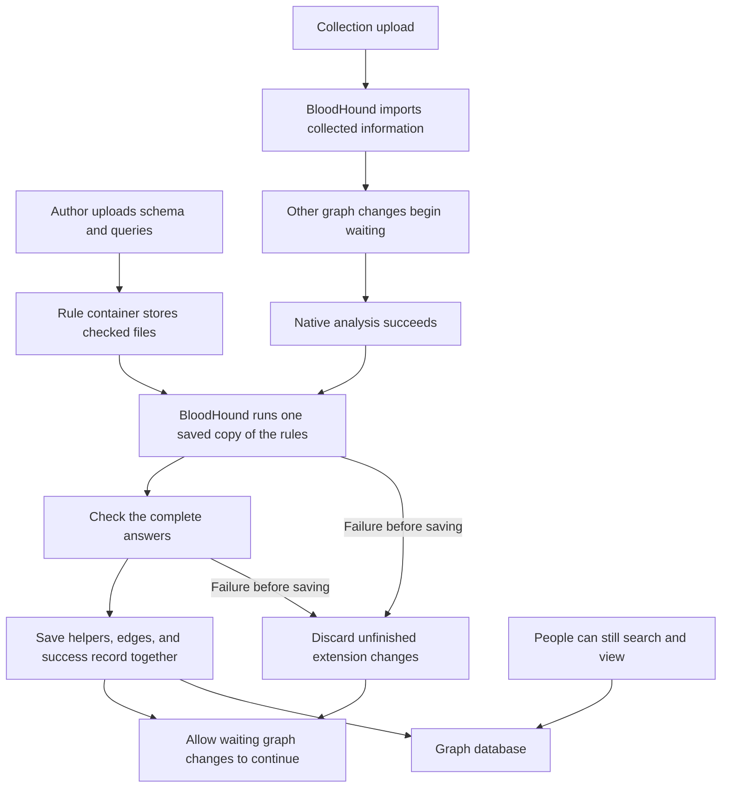

# How the extension processing works

BloodHound imports collected information and finishes its own analysis. This modified application then runs extra rules supplied as text files. The rules describe which additional connections should exist; shared code checks their answers and saves the complete update. The rule container stores files and reports. The calculations and graph changes run inside BloodHound.

This guide explains the current design and its limits. Extension authors should start with [DEVELOPERS.md](DEVELOPERS.md) for a working example and the authoring rules. [USAGE.md](USAGE.md) contains operating instructions, [REVIEW.md](REVIEW.md) contains the source inventory and evidence, and [HANDOFF.md](HANDOFF.md) preserves the earlier demonstrations that stopped the application while a separate command ran.

## Find a topic

- [Important design decisions](#important-design-decisions)
- [What changed in BloodHound](#what-changed-in-bloodhound)
- [A native BloodHound page](#a-native-bloodhound-page)
- [Schema and exact endpoint pairs](#schemas-describe-types-cypher-declares-calculations)
- [Writing query files](#authoring-query-files)
- [Existing-edge policies](#what-happens-to-an-existing-edge)
- [Saving results, helpers, and recovery](#saving-results-and-recovering-from-failure)
- [Resource controls and temporary files](#resource-controls-and-temporary-files)
- [Both databases and DAWGS changes](#both-databases-and-focused-dawgs-changes)
- [Selecting affected extension queries](#selecting-affected-extension-queries)
- [Remaining limits](#what-remains-unproven)

## Terms used here

| Term | Meaning |
| --- | --- |
| Graph | BloodHound's stored objects and the connections between them. |
| Node and relationship | An object and a directed connection. This guide also calls a relationship an edge. |
| Kind | An object's or connection's type, such as `User`, `Domain`, or `PoC_ADCSESC1`. |
| Cypher | The text language used to ask questions about the graph. |
| Schema | A description of kinds, their presentation, and which connections the extension permits. |
| Prerequisite | An earlier query whose answers another query needs. |
| Helper | A separate object created to support a calculation. It does not replace a collected object. |
| Transaction | A group of database changes saved together, or discarded together if work fails before saving. Saving is called committing; discarding is called rollback. |
| Revision and fingerprint | Identifiers calculated from the saved rule files and the instructions loaded for a run. They help recognize when instructions have changed. |
| Runner | The shared Go code that runs the rules, checks their answers, and saves results. |
| Bundle | All extensions’ schema and query files saved together as one complete set. |
| Writer and gate | A writer is work that changes graph data. The gate is the code that decides when that work may begin. |
| DAWGS | BloodHound's Go library for working with its graph database. |

## Important design decisions

| Problem | Decision | Why | How it works |
| --- | --- | --- | --- |
| Writing new Go code for every extension would make extensions harder to build. | Keep rules in ordinary `.cypher` text files. | Authors can use the language BloodHound already uses to ask questions about its data. | Shared Go code runs the questions, checks their answers, and saves the results. |
| Separate model descriptions and pictures could disagree. | Use one authoritative schema per extension and generate its model picture. | The description and picture stay consistent. | Each file lists its extension’s object types, allowed connections, and calculation instructions. The extra settings are proposed additions to OpenGraph. |
| Manually inserted objects would not show whether rules work with collected data. | Test real uploads through BloodHound. | Custom collected objects must be able to connect to existing directory users. | The examples use ordinary BloodHound and OpenGraph collections, including JSON and ZIP files. |
| Testing updated rules should not require another collection upload. | Add Run Analysis to the rule page. | Reuse BloodHound's normal scheduling and protections. | A server-held API key requests native analysis; the existing extension step follows it. No further BloodHound code changes are needed. |
| The information could change halfway through a calculation. | Make other graph changes wait during BloodHound's analysis and the rules that follow it. | The rules need consistent information to produce a trustworthy answer. | This BloodHound application controls when graph changes can begin. Searches remain available. |
| Unrelated changes could repeat every extension calculation. | Select queries using the changed object and connection types. | Avoid unrelated work while keeping each selected answer complete. | Run affected queries, their consumers, and needed prerequisites once; leave skipped outputs alone. Unknown coverage or changed rules requires a full run of enabled rules. |
| Uploading changed rules could mix old and new instructions. | Keep the same copy throughout a calculation and its retries. | Every attempt needs a consistent set of instructions. | Uploads are checked and stored for later calculations. They do not change work that has already fetched its files. |
| Several rules can produce the same connection. | Combine their complete answers before updating the graph. | Refresh every producer of the selected relationship type together. | One edge represents the source, target, and type. Remove it only when no producer still returns it. Existing edges within the declared endpoint scope participate regardless of who created them. |
| Losing one reason for a connection could remove it even when another reason remains. | Finish the complete calculation before removing old answers. | A half-finished answer must not replace the last good one. | Check every supporting reason, then save the helper objects, connections, and success record together. |
| Old and new results may give a connection different details. | Let the author choose through a query's `// existing-edge-policy:` comment. | Authors do not need a separate list of details they are allowed to change. | Replace the connection, update only supplied details, or keep it unchanged. Replacement is the default. All choices remove connections no longer justified by the combined answer. |
| Following every route could take too long or use too much memory. | Reuse shared answers, keep large lists in temporary files, and work in smaller pieces. | Avoid repeated work and stop excessive calculations while preserving earlier results. | Limit time, memory estimates, disk use, and the number of questions running together. Remove temporary answers when no longer needed. Large-graph testing is still required. |
| Rules should work with Neo4j and PostgreSQL. | Keep both choices and share the calculation code. | The same rules should produce the same answers on both. | Focused changes to DAWGS provide the database support; shared Go code performs the more involved calculations. |
| Equal counts could hide connections between the wrong objects. | Check exactly which objects are connected. | A matching number alone does not prove correctness. | Compare ESC1 with BloodHound's own answers and written expectations. Keep failures in the evidence alongside passing checks. |

## What changed in BloodHound

The persistent mode needs a modified BloodHound application. Installing it and enabling the settings requires an application restart. Later rule uploads require neither a rebuild nor a restart. The separate container has no graph credentials and no Docker socket; it cannot run calculations by itself.

The optional settings are `bhe_post_processing_url` and `bhe_post_processing_token`. An empty URL disables the service, its writer waiting rule, and its maintenance restriction. DAWGS corrections remain part of this build even when processing is disabled. The service address must be HTTP or HTTPS with a host and no credentials, query, fragment, or non-root path; the native setting requires a token of at least 32 bytes after surrounding whitespace is trimmed.

**Run Analysis uses BloodHound's existing request button behavior.** The page asks the rule server to send `PUT /api/v2/analysis`. BloodHound schedules its normal full analysis; the existing extension step follows successful completion. This adds no further changes to BloodHound itself. It preserves affected-rule selection and all existing rules for saving or preserving results.

The rule server holds a separately configured BloodHound API token and signs the request; the browser never gets that key. It reads `/api/v2/analysis/status` for queued requests and `/api/v2/datapipe/status` for running work. These are distinct from the extension's completion report. Only those three fixed operations are available through this connection. Requests have time and response-size limits, never follow redirects, and retain normal BloodHound permission checks. Local browser requests retain the existing address and same-page checks. Production needs the authenticated page integration described below; local mode is not a user permission system.

Repeated clicks are refused while a request is being sent or native analysis is queued/running. BloodHound remains responsible for combining requests from other callers. A lost response leaves the outcome uncertain, so the page checks status before allowing another click. There is no second calculation scheduler or new saved request queue. An absent connection disables only the manual button, not rule uploads or automatic execution. Setup is in [USAGE.md](USAGE.md#run-analysis-without-another-collection-upload).



### Which operations wait

Before analysis, the application waits up to 30 seconds for an opportunity to work without other graph changes. **Other graph changes can still begin while it waits.** Some existing operations need to start another update to finish their work. Blocking that update too early could leave both operations waiting forever. A continuously busy graph can therefore postpone analysis. The 30 seconds limits the wait to begin; calculations can take longer.

Once analysis begins, other graph changes wait until both BloodHound's own checks and the extension finish. They cannot slip in between the two steps. This includes database updates through DAWGS `DatabaseSwitch`, graph deletion (including PostgreSQL's faster deletion methods), and tag updates that can rename graph kinds. Asking a calculation to stop does not mean it has already stopped. Waiting changes are released only after the work has actually finished.

Searches do not have to wait for permission from this gate. People can still search and view the graph during analysis and calculation. The database may still delay them while busy or while it protects data involved in an update.

Only this one Community Edition application process participates. A second BloodHound server, a direct database writer, or new code that writes through a read callback or an unguarded connection can bypass the gate. PostgreSQL read transactions are not globally forced into SQL read-only mode. Future write call sites need review for participation.

Database-switching and graph-migration tools use separate connections that cannot follow this gate. While the URL is enabled, the tool API rejects `PUT` requests under `/graph-db/switch/` and `/pg-migration/` with HTTP 409. These operations require disabling processing and restarting first. Status checks and unrelated tools remain available; this is a limited maintenance restriction.

### Scheduling and failure reports

After BloodHound successfully finishes its own analysis, it can run the extension. That analysis may cover several uploads. Uploading rules alone never starts a calculation. A newer successful analysis replaces any older pending attempt because it provides newer information. Pending attempts are kept in memory; after a restart, BloodHound's startup analysis provides another chance to run the rules.

After a failure, BloodHound can retry when its background processing is idle, no sooner than one minute later. The retry uses the same saved rules. If downloading the rules failed, the next eligible attempt can download them. A retry is allowed only if no other graph update has started since the successful analysis. An update that later fails still prevents a retry, as does a failed new analysis. In those cases, the extension waits for another successful analysis. It checks this condition again after obtaining permission to run.

BloodHound can report a successful import and native analysis even if an extension fails. The extension report separately records calculation and saving, each query's name/stage/state/reason, complete answer count, read duration, proposed output count, and confirmed saved output count. Stages describe dependency order. Durations measure producing an answer, including any existing reachability/group-overlap transformation; they do not imply simultaneous execution. Waiting queries become skipped when a run stops, and started peers are canceled after a failure. Calculation can succeed while saving fails. Neo4j reports a save only after BloodHound's outer database operation confirms it.

Only counts, rule names, and fixed error explanations are sent to the rule service. Graph answer rows and raw errors remain out of this report. The original error still reaches private application logging. Known errors get specific explanations; unknown errors point to those logs. Connection failures during commit retain an explicit uncertain state and the existing write gate remains blocked.

The rule service saves the latest report, up to 20 recent attempts, and the last confirmed saved revision together in private `status.json`. One received report is limited to 64 KiB; the stored file is bounded by 21 times that size. Updates to a running attempt replace its history entry; retries have separate attempt IDs. Saved revision survives history trimming and later failures. A newly active revision can differ from the one whose results are saved. A missing completion after the two-hour run limit plus one minute is displayed as unavailable, not as proof of rollback.

The worker keeps a bounded queue of 20 undelivered status updates and retries delivery on idle ticks, including after a successful graph save. Reporting failure does not repeat a successful calculation. The queue is in memory: restart or a long outage can lose reports, so a displayed report is not a live health check. The browser labels a failed status request as unavailable. Intermediate answer inspection remains part of TODO #3 rather than ordinary report access.

BloodHound retains its normal step for clearing cached query answers after analysis. A successful retry also clears those cached answers.

### Where the application changes live

These links explain the integration; [REVIEW.md](REVIEW.md) holds the complete inventory and checks.

| Source | Purpose |
| --- | --- |
| [config.go](../../cmd/api/src/config/config.go) | Defines the optional URL and token. |
| [entrypoint.go](../../cmd/api/src/services/entrypoint.go) | Connects the rule service to BloodHound's database and schema registration at startup. |
| [pipeline.go](../../cmd/api/src/daemons/datapipe/pipeline.go), [extensions.go](../../cmd/api/src/daemons/datapipe/extensions.go) | Hold the native/extension writer turn, schedule processing after success, and retry during idle ticks. |
| [delete.go](../../cmd/api/src/daemons/datapipe/delete.go), [assetgrouptags.go](../../cmd/api/src/api/v2/assetgrouptags.go) | Make deletion and tag changes follow the same waiting rule. |
| [tool API](../../cmd/api/src/daemons/api/toolapi/api.go) | Blocks the limited switching/migration operations when enabled. |
| [service.go](postprocessing/service.go), [gate.go](postprocessing/gate.go), [observe.go](postprocessing/observe.go), [observe_query.go](postprocessing/observe_query.go) | Retain rules and tracked changes, make other changes wait, select affected queries, and report outcomes. |
| [native.go](internal/graphdb/native.go) | Runs the shared calculation code through BloodHound's existing graph connection. |
| [root go.mod](../../go.mod), [DAWGS switch.go](../DAWGS/graph/switch.go) | Include this project and its DAWGS changes, and make graph updates follow the waiting rule when enabled. |

Existing collection parsing and native attack calculations retain their rules. The integration controls when graph changes may begin and observes which types they could change. It adds no native migration or generated mock change.

The reusable work is under [internal/extension](internal/extension), which loads and checks instructions; [internal/runner](internal/runner), which orders queries, computes shared answers, manages temporary files, and prepares publication; [internal/graphdb](internal/graphdb), which reads/writes either database; and [internal/ruleservice](internal/ruleservice), which stores uploads and reports. These folders separate responsibilities without requiring extension authors to write Go.

## A native BloodHound page

This is the smallest proposed integration; it is not implemented by the standalone page. Add one item to BloodHound's left navigation, one route, and a React view containing the rule plan and change-review controls. Use the existing `apiClient` and session, so signed-in users need no additional login or pasted rule-service token.

Add authenticated server routes for `GET plan`, `GET rules`, `GET status`, `POST preview`, and `PUT rules`. Each route proxies only its fixed corresponding `/v1/` path; it must not accept arbitrary upstream URLs or paths. The server attaches the rule-service bearer secret and keeps it out of browser responses. Reuse `OpenGraphRead` for plan, rules, and status reads, and `OpenGraphWrite` for preview and activation. The server forwards the base and confirmation revisions so the same stale-tab and review checks apply.

The existing post-processing URL and token configuration already provides the upstream address and server-held secret. No new configuration fields, database tables, or migrations are needed. Add the route contracts to the API documentation and focused tests for session/permission enforcement, fixed upstream paths, secret handling, and preview/activation errors. The existing worker and stored bundle format can remain the calculation and storage path.

## Schemas describe types; Cypher declares calculations

Each extension has an authoritative schema beside its query files. `schema.json` remains supported, and named files such as `active_directory.schema.json` allow several schemas in one directory and saved bundle. The examples are [ESC1](extension/schema.json), [vault](examples/vault/extension/schema.json), and [the separate Active Directory and CyberArk schemas](examples/cross-platform/README.md). Choose unique filenames across the entire bundle, including the query files. Query names and their parameter names are global.

The loader validates each definition, combines its declarations with the others, and orders all queries together. Schema names, namespaces, declared kinds, managed helper prefixes, and query output bindings must remain unambiguous across extensions. Shared graph references can point to kinds declared by any loaded schema; native kinds come from BloodHound’s graph definitions. Each kind has one schema declaration. Several relationship queries may return that kind; the combined plan retains every producing query. Helpers still have one producing query per kind.

BloodHound registers each definition under its own schema name before any rule executes. The service caches the complete list only after every registration succeeds. A failure partway through prevents calculation and leaves the list uncached, so an eligible retry registers all definitions again.

| Definition field | What it describes |
| --- | --- |
| Standard `schema` | Name, display name, version, and namespace. |
| Standard `node_kinds` | Object kinds and their presentation. |
| Standard `relationship_kinds` | Connection kinds, presentation, and whether pathfinding can follow them. |
| Proposed relationship `compatible_kinds` | Exact allowed source-kind/target-kind pairs. |
| Query `RETURN ... AS kind` | Literal relationship kind produced by this file. |
| Query `RETURN ... AS kinds` | A literal one-element helper-kind list; its ID prefix is the kind followed by `_`. |
| Optional query `// existing-edge-policy:` | How to update an existing matching calculated edge; all producers of that kind must agree. |

The custom schema fields and query conventions are proposals implemented by this experiment, **not accepted official OpenGraph processing features**. Before registration through BloodHound's existing extension service, the code strips them in memory. Each extension uses the same authoritative definition for calculation and presentation. Registration provides names and presentation; it does not install these files as saved queries or calculate their answers.

The definition reader/export preserves standard `environments`, `relationship_findings`, `queries`, and `pz_rules`, but the standalone `schema` command's upload helper rejects those top-level sections rather than silently dropping them. That helper supports the standard sections used by these examples, not every valid OpenGraph definition. Persistent native registration uses a different path through BloodHound's existing service.

The platform supplies the reference build. The experiment retains its native-agreement gate for `PoC_ADCSESC1`; other output kinds do not require a native equivalent. There are no owner settings or ownership checks for relationships, helpers, or the success record. See [the developer guide](DEVELOPERS.md#updating-older-bundles) for updating older files.

The final Cypher projection declares its output with a literal edge name as `kind`, or a literal helper `kinds` list. The loader first checks the complete query using the same read-only language checks as execution. The final output is then read using the Cypher return-projection parser, excluding comments, strings, and nested returns. Named graph kinds and prerequisite parameters found in the query must be declared. Unnamed kinds and dynamic kind inspection cause conservative recalculation instead of unsafe skipping; the author still declares inputs that determine ordering. Dynamic output names are rejected. Several relationship producers are allowed when their update policies agree; helper kinds retain one producer. Output is therefore known even for zero rows, so empty-answer cleanup needs no duplicated schema binding. Rows are checked against the declared name before publication. The optional update policy belongs to the query. Display-only schemas do not acquire managed output merely by declaring a kind.

Managed kinds and helper prefixes start with `PoC_`. Query filenames use `snake_case.cypher`. Loading rejects missing producers, multiple bindings to a query, duplicate kinds, malformed/unknown declarations, undeclared endpoint kinds, unused queries, missing prerequisites, undeclared parameters, and circular prerequisite dependencies.

### Compatible kinds are exact directed pairs

An endpoint is one end of a connection. Each `compatible_kinds` entry permits one source-kind/target-kind pair, preserving its direction. Native node kinds come from BloodHound's graph definitions; custom node kinds come from the schemas loaded together. No separate external-kind list is needed. References are checked only after the whole schema set is read, so two schemas can name each other's types without choosing an upload order. This does not allow a circular dependency between calculations.

| Example relationship | Permitted source | Permitted target |
| --- | --- | --- |
| `PoC_ADCSESC1` | `User` | `Domain` |
| `PoC_ADCSESC1` | `Group` | `Domain` |
| `PoC_ADCSESC1` | `Computer` | `Domain` |
| `PoC_ADCSESC1` | `ADLocalGroup` | `Domain` |
| `PoC_Vault_ContainsAccount` (collected evidence) | `PoC_Vault_Container` | `PoC_Vault_Account` |
| `PoC_Vault_HasAccountFor` (calculated output) | `PoC_Vault_Container` | `User` |

For another definition, permitting `User → Domain` and `Group → Computer` would not permit `User → Computer`. The runner checks the combined pair for each calculated edge. Today's native collection upload does not enforce these proposed endpoint declarations on collected data. The vault containment kind has no producer and remains collected evidence. The calculated vault association matches a collected account’s `user_sid` to a native `User.objectid`. It does not filter on account exposure or the user’s enabled state. Containing an account for a user alone does not establish an attack path, so `PoC_Vault_HasAccountFor` is not traversable.

Each source and target object ID must resolve to exactly one node. The graph identity check exempts only an isolated node labeled exactly `MigrationData`, which native startup can create without an object ID; connected or differently labeled metadata is rejected.

### Persistent upload rules

The registry stores several schemas and their calculated outputs in one active bundle. A change can replace files, add extensions and producers, remove rules, or move an output to another query. Existing schema names and filenames remain stable. The complete updated bundle must satisfy dependency, output, policy-agreement, and helper-prefix validation.

The page presents one table, sorted initially by calculation order. Users can sort by name, stage, date added, or extension, filter by extension, select visible rows, and expand each rule for its full query and declared inputs, outputs, prerequisites, and dependents. Stage 1 has no earlier query to wait for. Later stages follow the deepest chain of query prerequisites and declared calculated graph inputs: a rule needing a stage 2 answer is in stage 3. Stages describe ordering, not a promise of simultaneous execution. Display sorting and filtering do not affect the runner’s order.

**Up to five ready queries can run together.** Each query starts after its own required earlier queries have succeeded. When its answers are checked, another ready query can use the free place immediately; an unrelated slow query does not hold up the whole group. Shared earlier calculations run once, and their answer files stay available until every reader finishes. The report lists queries in the order their answers were accepted, which can differ between runs.

Before creating supporting graph objects, the runner finishes the independent reads that can already proceed. From that point onward, queries run one at a time in the same database operation so they can see the new objects before saving. All final results still save together. If any query fails, the runner stops the other queries and waits for them to close before discarding unfinished work.

For every changed existing file, the author explicitly chooses whether to overwrite its complete contents, including dependency declarations. `POST /v1/preview` validates a proposed change using its `base_revision` and returns the full proposed plan and revision. `PUT /v1/rules` checks that the active base still matches and requires that exact preview revision as `confirm_revision`. An older browser tab therefore cannot replace newer work or activate a different change. Preview saves nothing.

Activation records the date added for new query files. This date survives overwrites, disabling, enabling, and restarts. Earlier saved files without a date stay unknown; the page displays **Not recorded**. A new file in a preview displays **On activation**. Dates are excluded from the revision calculation so recording the actual activation time does not change the reviewed candidate’s revision. Dates must refer to existing query files. Deleting a query removes its date; adding it again records a new activation.

Deleting a query also deletes rules that explicitly require its returned rows, continuing through their query dependents across schemas. Unused supporting queries are pruned. Graph readers and other producers of the same type remain. The preview distinguishes deleted files from outputs to refresh. At the next successful run, the remaining producers rebuild their combined answer, then graph readers use those refreshed edges. Deleting the last producer records the relationship type and endpoint scope for cleanup; a reader can validly see an empty result. Schema kind names and presentation remain. Retirement history survives later edits and restarts. Cleanup, new results, and the success record save together. Activation makes no graph changes, and failure preserves the previous committed graph answer. Helpers are never automatically deleted, including when their producer is removed.

Disabling is saved separately from deletion. It keeps query files, calculation bindings, activation dates, and existing graph objects. The plan marks the explicitly disabled query, pauses every producer sharing its relationship output, and pauses consumers that need those query rows, calculated graph kinds, or helper endpoint kinds. This propagation continues across schemas and through further consumers. Refreshing only the other producers could otherwise remove the disabled rule’s previous connections. The runner excludes paused queries and their outputs from calculation and cleanup, so other enabled rules can run without removing the disabled rules’ previous connections. Enabling removes an explicit disabled setting; consumers become eligible when no remaining dependency or explicit setting pauses them. Existing results may become stale while disabled.

Accepted files, dates, disabled settings, and retirement scopes atomically replace `active.json`. Files, disabled settings, and retirement metadata determine the bundle revision. Limits are 32 files, 1 MiB per file, and 4 MiB per bundle. Duplicate JSON keys and unknown request fields are rejected. Filenames, schema shape, dependencies, and forbidden writes are checked before activation; database-specific syntax and returned row shapes are checked during execution. An accepted change can consequently fail when run without replacing the last good graph results. The worker validates the complete downloaded bundle, including its revision and saved metadata, before using it.

Storage uses private directories (`0700`) and files (`0600`). The new file is synced before rename; this is not a promise that the newest rename survives sudden power loss. Saved rules, the latest report, recent report history, and the last confirmed saved revision survive a registry restart. HTTP clients disable environment proxies and do not follow redirects carrying the bearer token.

The supplied Compose service publishes `127.0.0.1:18081` and explicitly enables `-local-ui-origin http://127.0.0.1:18081`. Allowed browser requests use `/ui/plan`, `/ui/rules`, `/ui/preview`, `/ui/draft`, `/ui/analysis`, and read-only `/ui/status`; the service supplies the secret internally. It checks the exact Host and any present Origin, rejects browser cross-site requests, and requires the exact Origin and JSON for writes. `/v1/browser-mode` tells the page whether local editing is enabled. Machine endpoints retain bearer authentication. With no configured local origin, the page uses manual bearer entry without saving the token.

This convenience trusts the loopback host-port boundary. The container listens on its network interface, so exact Host and Origin cannot authenticate arbitrary clients on that network. Remote production access should use BloodHound login and an authenticated server proxy.

### The offline model viewer

[model.html](model.html) and [the vault model](examples/vault/model.html) are generated from the definitions. They open directly in a browser without credentials or a server and include their starting schema. The viewer can also show a definition without calculation instructions.

It includes all declared kinds, isolated custom kinds, referenced native kinds, directed connections, and a table of exact compatible pairs. Traversable connections are green; non-traversable connections are red. The viewer displays the selected/default edge policy and supports parallel connections and connections back to the same kind. Missing endpoint declarations fail rather than being guessed. Readers can drag objects, pan/zoom, search/filter, select details, and download SVG. Choosing a local definition keeps that file in the browser. Regenerate saved pages after changing the authoritative schema. The picture describes the declared model, not current objects, attack paths, or all of BloodHound's native model; browser checks in BloodHound remain necessary to verify actual published display behavior.

## Authoring query files

Queries execute through either supported database adapter, not only Neo4j. Authors should use the supported shared Cypher forms demonstrated in the examples. They return plain values, not database node, relationship, or path objects.

Each query declares the kinds it reads and the earlier files it needs:

```cypher
// depends-on: node:Base, relationship:Enroll,
// query:membership.cypher
```

Declare every object and connection kind the query reads, including those used only in property filters, and every earlier query it needs. Selection trusts these declarations; missing dependencies can leave results stale. A query with no dependencies declares `// depends-on: none`. A filename stem becomes its parameter name: `membership.cypher` provides `$membership`, a list of row maps. Only declared prerequisite parameters are supplied. The loader builds an ordered plan; each prerequisite runs once for its consumers. A circular file dependency is an error, separate from a cycle in graph membership.

Prerequisites can cross schema boundaries. In the synthetic example, `cyberark_links.cypher` declares `query:ad_users.cypher` and reads `$ad_users`, including each helper row’s `properties.user_sid`. This receives the current run’s complete answer, rather than requiring the helper to replace a collected object. The dependency is the filename, not a schema name.

Declaring a calculated relationship kind as a graph input makes the query wait for every producer of that type. The runner combines and stages their complete result inside the final transaction before the reader runs. Declared helper graph inputs likewise wait for their producer. Reads after staging run in that same transaction; other users see the changes only after the complete run commits. Explicit query prerequisites still pass returned rows as parameters. A rule reading its own output type reads the previous graph state and does not wait for peer producers of that type; its answer is itself needed to finish their combined new result. Other dependencies that form a cycle between different producers are rejected.

| Query role | Required answer |
| --- | --- |
| Ordinary prerequisite | Rows made of plain strings, numbers, booleans, lists, and maps. Use an object's `objectid` instead of returning the database object. |
| Relationship producer | Nonempty string `source` and `target` object IDs, literal `kind`, and optional `properties` map. |
| Helper producer | Exactly `id`, `kinds`, and `properties`; `kinds` contains only the declared helper kind. |
| Reachability seed query | Node metadata `id`, `graph_id`, and `kinds`, as shown in the reach examples. |
| Group-overlap seed query | Separate `left` and `right` direct-principal lists, a `target`, and literal `kind`, as in [esc1.cypher](extension/esc1.cypher). The shared step emits source/target pairs and preserves `kind`. |

Within one query, repeated relationship pairs must have identical property maps; conflicting rows fail. Across queries producing the same type, the runner combines pairs and merges supplied properties in alphabetical filename order. Later filenames win overlapping keys, including explicit null removals. Query completion timing never chooses the result. All producers must choose the same existing-edge policy; omission means `replace-existing`.

All authored queries are read-only. The loader checks forbidden writes, and the adapters check query form before execution. The persistent native adapters parse each read query and reject writes on either backend. The standalone Neo4j adapter instead inspects the planned statement type in a separate read session: running `EXPLAIN` inside a Neo4j 4.4 publication transaction can prevent later writes. PostgreSQL also translates its supported query forms. Comments and filenames alone cannot establish read-only behavior. Only the runner's publication code writes results.

### Stored property values

Relationship `properties` may be omitted, meaning an empty map, but the column itself cannot be `null`. Values can be strings, booleans, signed 64-bit whole numbers, finite fractional numbers, or lists of one simple type. Lists cannot contain nulls, nested lists, or maps. Empty property names and nested property maps are rejected. Whole-valued decimals such as `2.0` become integers; out-of-range whole numbers fail. Exact large integers are not converted to floating point. Numeric lists must be all whole or all fractional values.

For relationships, a property value of `null` removes that key when merging and leaves it absent when creating or replacing. Helper properties do not accept `null`; they must be simple values or lists of one simple type, without nested maps/lists. Authors cannot overwrite the helper’s `objectid` field. A property named `poc_owner` has no special meaning. Even `keep-existing` validates requested properties before any cleanup is allowed.

### What happens to an existing edge

A match has the same relationship type, source object ID, and target object ID. The runner refreshes that type within the schema’s allowed source/target kind pairs. Existing edges within this scope participate regardless of their origin or properties, including manually inserted edges. No contribution or owner list is stored on the edge.

| Query `existing-edge-policy` | Matching edge | New desired edge |
| --- | --- | --- |
| `replace-existing` (default) | Delete and recreate with the requested properties. Discard old ordinary properties even if the new map is empty. The database edge ID changes. | Create with requested non-null properties. |
| `merge-properties` | Keep its ID; update supplied keys, delete keys supplied as `null`, and preserve unmentioned properties. Skip unchanged writes. | Create with requested non-null properties. |
| `keep-existing` | Keep its ID and every existing property. | Create with requested non-null properties. |

**Every policy removes in-scope edges absent from the complete combined answer for a selected output type.** Skipped output types are not refreshed or removed. An empty answer from one producer does not remove an edge another producer still returns. If all producers return no edges, the runner clears the type’s declared endpoint scope. An invalid answer, failed query, or interrupted result stream cannot authorize cleanup. The runner cannot tell whether the author used a debugging `LIMIT` or omitted valid objects from an otherwise successful query; authors must return the complete answer they intend to publish.

Duplicate existing source/type/target pairs within the managed scope fail publication. Other relationship types and edges outside the declared endpoint pairs remain outside this cleanup.

The [complete properties example](DEVELOPERS.md#calculated-relationships) shows how to add evidence to existing relationships using `merge-properties`. A returned map such as `{confidence: 0.9, old_note: null}` would update confidence and remove `old_note` under that policy. The property map belongs in the producing query; it needs no duplicate schema declaration.

Replacement counts as a removal and addition; a changed merge counts once under `relationships_updated`; no-op merges and kept edges count under `relationships_unchanged`. Replacements are deleted before creation because PostgreSQL permits only one edge of that kind between those endpoints. Every batch remains part of the final transaction, so failure before commit restores original IDs and properties.

ESC1 uses replacement. The vault example uses `keep-existing` to demonstrate stable IDs and preservation of manually added properties. Replacement writes more even when a pair remains justified; its cost counts toward the change allowance.

Native BloodHound does not have one universal calculated-edge policy. Its AD cleanup explicitly includes native `ADCSESC1` with native endpoint restrictions. Other calculations use tracked relationship sinks. Adding a custom property to a native edge does not protect it from native replacement or cleanup. The experiment therefore publishes separate `PoC_` kinds, which are absent from the native cleanup lists, and compares ESC1 answers with native output.

## Shared calculations and ESC1 behavior

The current ESC1 example puts part of the calculation in Go, so editing its Cypher alone cannot change all of its behavior. This choice reuses compact membership/trust calculations and worked around missing DAWGS expressions. Its performance advantage over an equivalent optimized Cypher implementation has not been measured.

The preferred authoring model is ordinary Cypher returning final relationships. Additional DAWGS language support is an acceptable way to simplify extension development when correctness and measured performance support the change; minimizing DAWGS changes is not a requirement that overrides author usability. The Go-assisted ESC1 operations below remain implemented today. [The developer guide](DEVELOPERS.md#cypher-support-and-dawgs) separates current support from that design direction.

The Cypher files select eligible templates, usable certificate authorities, direct enrollment permissions, and special-group meaning. Shared Go code computes reachability and ordered permission overlap. Reachability means finding objects connected through the relevant membership or trust relationships without enumerating every route to them.

The `// reachability:` JSON instruction specifies incoming/outgoing direction, relationship kinds, whether to include the starting node, whether to expand returned results, optional node-kind restrictions, and whether cycles are rejected. Those kinds must also appear in dependency declarations. The operation uses known graph IDs for batched single-hop reads, visits relevant nodes, and shares compact reachable sets between ancestors.

The `// group-overlap: {"memberships":"membership.cypher"}` instruction uses a declared membership prerequisite to compare permission sides. It is only for relationship producers and cannot be combined with reachability in one query.

The `// batch-on: trusted_cas.cypher` instruction names one declared prerequisite that can be divided into chunks. It is only for relationship producers and cannot batch reachability seed queries. The author promises that combining all chunk results gives exactly the same complete relationship set as the undivided input. Chunking is unsafe for queries whose answer depends on seeing the complete input at once.

ESC1 keeps each template/CA permission pair separate; combining unrelated permission lists could invent a shortcut. Native behavior first preserves matching direct template principals, then considers nested groups from smaller membership reach to larger. Selecting a group removes its members from further consideration while retaining earlier results. Removal must not toggle a shared member back into the result when groups overlap.

Everyone and Authenticated Users have special rules: appearing directly in a permission set, or under one of its direct Group/ADLocalGroup principals, skips that set as a requirement. If both sides are skipped, the result is the union of their original direct sets; if one side is skipped, it is the other's original direct set. [QUERY_NOTES.md](extension/QUERY_NOTES.md) gives the exact SID suffixes, trust direction, terminal-auth-edge rules, and coverage limits.

Relevant membership and certificate/auth cycles fail the ESC1 calculation. Disconnected membership cycles do not block unrelated work. Reciprocal Domain forest trust is permitted. The rules require complete native certificate/trust evidence; they do not repair incomplete ingestion.

## Saving results and recovering from failure

Schema registration, Neo4j index preparation, and PostgreSQL kind-catalog preparation are separate metadata operations. They can remain after a calculation fails. Upload ingestion and native analysis have also already happened; extension rollback does not undo them.

The final transaction groups **all helper changes, all calculated relationship changes, and the successful-run record**. Independent ready reads may run on separate connections while participating graph writers are excluded. Helper writes are delayed while ordinary reads can progress. After helper or relationship changes are staged, subsequent reads run serially inside the final transaction so they can see those changes. Uncommitted helper changes are not externally published; only one coordinator writes.

Before staging a relationship type, the runner finishes every producer’s complete result reads, endpoint checks, property checks, existing-edge checks, and any requested exact native ESC1 comparison. It sorts desired and existing sets and applies changes in batches inside the same transaction. Graph consumers can then use that staged result. Nothing commits until all selected queries succeed. A timeout, invalid row, incomplete file/read, exhausted allowance, or native mismatch fails the calculation. None permits deletion based on a partial answer.

The `PoC_Run` node stores the successful batch ID, plan fingerprint, reference commit, and completion time in the same database transaction. Its identity uses the plan’s schema name. A later process can inspect committed state; it does not reuse unfinished in-memory answers.

### Helpers stay separate

The domain example uses `PoC_DomainHelper_` plus the real Domain object ID. Its node has only `PoC_DomainHelper`, so it cannot masquerade as a native Domain. An existing object with that ID must have exactly the expected helper kind. Changed properties replace the helper's approved map plus the object ID; identical properties cause no write.

Helper publication scans each declared ID prefix once, includes other kinds to detect collisions with other node kinds, then compares sorted answers. It does not repeat an unrestricted graph lookup for every helper. Helper output kinds receive Neo4j object-ID indexes.

Helpers omitted from a later answer are retained. There is no automatic helper deletion because other data may refer to them. Removing a calculation declaration also retains its old helpers. Any cleanup needs a separate explicit policy. Every returned helper ID must include a nonempty suffix after its declared prefix.

### A lost commit reply is different from rollback

If the database saves changes but its acknowledgement is lost, the actual outcome is uncertain. Provisional counts do not prove rollback or success. Inspect the saved batch ID and saved graph state before retrying. A known failed PostgreSQL commit can roll back normally.

For an uncertain native run, this application blocks further graph changes before releasing its exclusive turn. Reads remain admitted. Recovery requires inspecting the saved result and restarting the application. The registry's report alone cannot settle the database's committed state.

## Resource controls and temporary files

These controls stop excessive work without treating an incomplete result as complete. They do not establish a hard process-memory ceiling or large-graph capacity.

| Information | Location and lifetime |
| --- | --- |
| Ordinary prerequisite answers | Private binary files in a per-run temporary directory; released after the last consumer, with remaining files removed when the run finishes. No cross-run answer cache. |
| Prerequisite query parameters | Bounded encoded values loaded for consumers; the combined input must fit the parameter allowance. |
| Relevant graph/reachable sets | Runner memory, with a conservative cache estimate. Dense sets can still exhaust the allowance. |
| Complete desired/existing edge sets | Sorted private files, compared in batches. Each in-memory sort part has an allowance. |
| Database work and unfinished writes | The database; its memory is additional to runner limits. |
| Committed helpers, edges, and success record | Persist in the graph. Later complete runs remove obsolete in-scope edges, but not omitted helpers. |
| Standalone reports | Exact counts plus bounded examples; standard output and `work/runs.jsonl`. Logs rotate near 8 MiB, retaining four older files and the current file. |
| Persistent registry status | The latest bounded report, rather than a full query-answer log or heartbeat. |

Temporary files carry row counts, framing, and in-memory SHA-256 fingerprints checked while reading to the end. Damaged or incomplete data fails the run. Sorting incrementally merges groups of sixteen files; each level retains at most fifteen pending files. This avoids retaining a filename for every original sort chunk. A plain-value size check rejects oversized rows before binary encoding makes another copy, although the database driver has already allocated the original row.

Parameter accounting includes helper properties, names, and list brackets. Reach and overlap loops check cancellation. Normal completion/error cleanup removes temporary files; this is not a promise that a killed process or machine failure runs cleanup.

### Current defaults

The persistent service calls `DefaultLimits()` with the values below. The flags shown are **standalone command flags**, not persistent-service configuration options.

| Standalone flag | Default | Meaning |
| --- | ---: | --- |
| `--workers` | 5 | Ready queries at once; permitted range 1–5. A free place can be reused without waiting for unrelated queries. After supporting graph objects are created, remaining queries run one at a time. |
| `--batch-rows` | 500 | Rows in a write batch or explicitly declared input chunk. |
| `--row-bytes` | 1 MiB | One encoded complete answer row. |
| `--parameter-bytes` | 32 MiB | Combined prerequisite parameters and reach-cache estimate. |
| `--sort-bytes` | 8 MiB | One in-memory sorting part. |
| `--temporary-bytes` | 8 GiB | Live temporary answer files for the whole run. |
| `--answer-rows` | 100,000,000 | Rows in one answer; a safety limit, not demonstrated capacity. |
| `--changed-objects` | 10,000,000 | Helper, relationship, and success-record changes in the final transaction. Replacement costs both deletion and creation. |
| `--query-timeout` | 15 minutes | One complete query, including all its declared input chunks. |
| `--timeout` | 2 hours | Complete operation. |
| `--report-pairs` | 100 | Example pairs per relationship kind or comparison side; exact counts remain available. |

Desired report examples together have a 1 MiB encoded allowance; missing/extra comparison examples share a separate 1 MiB allowance. The standalone `compare` command streams complete calculated/native sets through bounded files and uses query and run deadlines too; it does not retain every pair in memory.

Byte allowances measure encoded data or conservative estimates. Go object overhead, temporary copies, garbage collection, database-driver buffers, and multiple workers add memory. Database memory is separate. Batching limits each operation, but all writes still form one potentially expensive final transaction. Dense reach, large answers, disk capacity, prefix scans, and database sorting need measurement on representative graphs.

Native Neo4j's existing driver cannot interrupt every network call immediately using a query context. The transaction callback enforces the run deadline, independent read callbacks have query deadlines, and processing does not leave abandoned reader goroutines. A deadline is not proof that the underlying call has already ended; writer release still waits for completion.

## Both databases and focused DAWGS changes

Neo4j and PostgreSQL run the same query plan and shared reach/overlap code, with database-specific reading and publication. Neo4j prepares object-ID indexes for declared input, endpoint, and helper kinds. PostgreSQL prepares catalog entries even for declared kinds with no current objects, so absent prerequisites return empty answers. These preparations do not create calculated graph objects.

The PostgreSQL adapter requires exactly one graph named `default`, actual `public` graph/node/edge/kind tables, and validated non-null graph-ID foreign keys to the graph table. Standalone deployment checks require the application's PostgreSQL role. These restrictions prevent reading across graphs or accidentally using different tables or permissions. Persistent mode borrows BloodHound's existing connection.

The local DAWGS work adds map/row-map values, guarded `toFloat`, minimal `trim`/`properties`, and corrections to JSON types, collected maps, empty parameters, grouping, aliases, optional joins, leading UNWIND/WITH frames, and bound traversal roots. Subquery aliases retain their own scope; null and Boolean checks retain their meaning. Unsupported comprehensions and indexing are rejected instead of silently receiving another interpretation. This does not add general `CASE`, `reduce`, list comprehensions/indexing, or `CALL` support. The examples deliberately use supported simpler forms.

Additive transaction/batch methods support per-edge properties. Native PostgreSQL reads extension result numbers precisely through per-result JSON decoding without changing other native queries' number handling. The kind lookup maps share locking and return copies to protect concurrent reads and refreshes. Optional `DatabaseSwitch` observer hooks decorate transaction and batch writes on either backend and flag operations they cannot describe. With no observer, existing behavior is unchanged. These hooks add no Cypher syntax. Native Neo4j borrows its callback transaction and uses parameterized writes; the callback's actual commit determines publication success.

The persistent root module selects the local POC and DAWGS replacements. The historical standalone control/reference build used the original native source and original DAWGS dependency; it is a separate comparison, not the modified persistent application. DAWGS is a separate Git checkout, so a commit in BloodHound alone does not capture its edits. [REVIEW.md](REVIEW.md) identifies the exact DAWGS source and evidence to review.

## Selecting affected extension queries

The automatic service records changed node and relationship kinds during native graph writes, including property updates and removals. A change to a kind selects queries that declare it, every producer sharing their relationship outputs, their later consumers, and the prerequisites needed to calculate their answers. Selection repeats until adding a producer, prerequisite, or consumer adds no more work. Shared prerequisites execute once in that run. Each selected query runs against the whole graph; this is not selection of individual changed nodes or properties. BloodHound's built-in analysis still runs normally.

Disabled rules and their paused consumers are excluded first; their declared output contracts remain in the complete plan. Only selected enabled output kinds are published. Their complete new answers are compared with their previous in-scope results, including removing obsolete connections. Skipped helper and connection kinds are left alone. No prerequisite answers are cached between runs.

The success record stores the fingerprint of the entire rule plan, even after a selective run. First runs and new or edited plans require all enabled queries. The service starts with unknown coverage after a process restart, so its next run is also complete. A run with no affected queries skips successfully only when this same plan has already succeeded.

Tracked changes survive failed native analysis, failed extension calculations, and later uploads. They are cleared only after confirmed extension publication or a successful skip, while other graph writers still wait. The extension's own output writes do not become input changes for the next run.

Tracking has bounded allowances for metadata lookups, returned rows, and distinct kinds. A failed lookup, exhausted allowance, or unsupported write marks coverage unknown and falls back to all enabled queries; it does not block the native write. Raw database operations and node deletion can require this fallback. Large collections can exceed the tracking allowance, so this does not promise selective processing for every upload into a 100-million-edge graph. Direct external writers remain outside the application's tracking and coordination.

The standalone runner uses the same query selection when supplied a confirmed change file with `run -job-id ...` after controlled graph changes are checked. Include removals as well as additions:

```json
{"coverage_known": true, "nodes": [], "relationships": ["Enroll"]}
```

Do not call coverage known merely because the uploaded file types are known: native analysis may change additional facts. Unknown coverage runs the complete enabled plan.

The standalone lab also requires complete upload history: any failed, partial, canceled, or unfinished job blocks publication. An old successful job cannot hide newer failed evidence. Its readiness checks and stop/restart maintenance procedure belong in [HANDOFF.md](HANDOFF.md), not the persistent gate. Neither mode repairs partially imported evidence.

## What remains unproven

This is a single-server Community Edition experiment. It has not established Enterprise integration, production availability, or performance with 100 million objects or edges. A 100-million-row limit is a brake, not proof of capacity. Small laboratory browser requests demonstrate read availability within their scope, not a load-test guarantee.

Failure preserves the previous committed extension answer when rollback is known, but that answer may be stale. Metadata preparation remains outside rollback. Helpers have no automatic deletion. Rule removal refreshes shared outputs or retires their last producer’s relationship scope only on a later successful run; uploading alone does not run rules or delete graph data. A continuously busy graph can delay admission, database locks/load can delay reads, and direct external writers can invalidate the coordination assumption.

Large deployments still need exact native agreement, total runtime, runner/database memory, temporary-disk measurements, query work, transaction duration, rollback behavior, and lost-connection recovery measured together. [REVIEW.md](REVIEW.md) separates current evidence from historical measurements and preserves failed checks. Those records are the basis for assessing this experiment; they do not replace production qualification.

### Inactive uploads

The rule service stores one draft separately in `draft.json`. It contains uploaded file changes and the active revision against which overwrite choices were made. Draft saving checks filenames, text sizes, and JSON structure; missing definitions and other rule-validation failures are reported without losing the upload. The draft API uses `GET`, `PUT`, and `DELETE` on `/v1/draft` (or `/ui/draft` for the local page). Preview and activation use the existing endpoints with a `draft_revision` identifying the saved proposal. The worker only reads `active.json`, so drafts never calculate or publish results.

Review combines the draft with the unchanged active files and uses the same complete-plan validation as activation. Activation repeats those checks and verifies both the active revision and draft revision, plus confirmation of the reviewed result. Changed active rules require downloading and resubmitting the draft for fresh overwrite choices. Changed draft files invalidate an earlier review. The browser discards an applied draft only after activation succeeds; if that cleanup fails, it reports successful activation and leaves the draft available. Draft save or discard failures do not change active rules.
