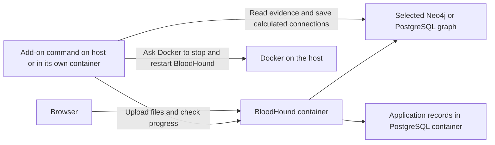
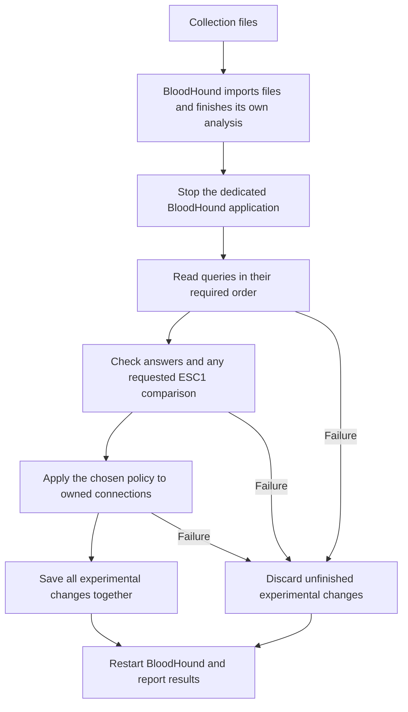

## TODOs 11 and 12 — 13 October 2026

The user explicitly requested execution of both TODOs. Follow `tools/esc1-poc/AGENTS.md`: plain English, preserve author requirements, work within postprocessing/local endpoints, and do not stage or commit.

#11 adds preparation-step timings in `internal/runner/runner.go` and `internal/graphdb/native.go`, including setup outside the runner and rejected file validation. The identity check now checks the migration kind before asking for all its type names, and counts required-match rows. It retains the complete graph scope, exact isolated-migration exception and all-or-nothing saving. The 100,000-object comparison found PostgreSQL preparation medians 1.912 → 1.446 seconds (24.4%); complete-run medians were 9.423 → 8.332 seconds with other phase variation. Neo4j ranges overlap. Do not attribute the whole complete-run difference to this change or extrapolate it to the old million-object results.

#12 reached its expressly permitted investigation/deferral outcome. The simple distinct-member query already used indexes well. The full membership plan multiplied 267 expanded rows by 101 input rows before DISTINCT. A separate two-input query proves wrong starting-object/result pairings on PostgreSQL; Neo4j gives the expected pairs. New TODO #13 records the required input-association correction. This follow-up did not modify the pre-existing dirty DAWGS checkout. No automatic replacement, new author format or depth-limit change was made.

While work continued, the user asked for plain-English reachability explanations and whether modern Neo4j `ANY` could replace the custom instruction. The answer is yes for the central traversal, with surrounding Cypher for output shaping, expanded starting sets and explicit cycle rejection. Full parity includes paths, bounds, filters and input rows, and needs a newer Neo4j reference backend than the present 4.4.42 or a verified compatibility translation. This was discussion, not authorization to add the new syntax or change author requirements. The option is recorded in `PREPARATION_AND_REACHABILITY.md`.

The focused report and public evidence are in `PREPARATION_AND_REACHABILITY.md` and `evidence/preparation-followup/`. Private binaries, initial diagnostics, full logs and new database storage are under ignored `work/preparation-followup/`. Original `esc1-poc-test-*` database directories and stopped states were never touched. New measurement containers use project `esc1-followup`; separate empty correctness fixtures use `esc1-followup-check`. Both projects must be stopped at handoff. `validation.json` records final checks/state.

Unit checks use race detection. Targeted integration checks cover native identity rejection and exact migration exceptions on both databases, complete graph preservation, late save failure, and existing ordinary/advanced written-answer cases. The broad DAWGS suites and 852-observation matrix were not repeated because DAWGS was unchanged. Before any future commit, the required repository command still applies.

After reviewing the report, this is a suitable manual checkpoint for the preparation change and documented investigation. No stage or commit was performed. Replace the Jira placeholder with the appropriate tag:

```sh
just prepare-for-codereview
# Review the resulting changes before staging.
git add tools/esc1-poc
git commit -m "perf: Reduce extension identity-check preparation <JIRA-TAG>"
```

DAWGS is a separate repository with pre-existing uncommitted work; these commands do not commit it. Resolve #13 and the existing depth-limit review before making broader ordinary-query correctness or automatic-optimization claims.

## Report explanation completed — 13 October 2026

The user asked where the automatic-performance recommendation was specified and then challenged its wording. The report now explains "shared preparation" as the setup/checks before an analysis, distinguishes measured phase time from an unproven cause, and describes how to investigate cheaper checks and narrowly recognized query improvements. New open TODOs #11 and #12 track those investigations with completion criteria and source links. They do not authorize implementation, additional benchmark studies, new author requirements, or bypassing existing checks. No runtime changes were made.

The report now also includes an "Actual Cypher file differences" section, linked from the executive summary and ordinary example guide. It contains all six changed-file comparisons, a separate one-line batching comparison, links to both versions, the seven unchanged files, and the exact mapping to measured variants. The differences were generated directly from the two example directories; update the embedded comparisons if those queries change. This was documentation only, with no query edits or database runs.

The executive summary was subsequently rewritten at the user's request to lead with the extension-authoring problem, explain why each advanced instruction exists, and distinguish feasible automatic optimization from the work needed to recognize safe replacements. It includes concrete examples of why routes, group choices and splitting input can change answers. The user wants this background in plain English rather than a summary dominated by technical results. This revision also changed documentation only.

The user requested an executive summary at the top of CYPHER_COMPARISON.md and a detailed explanation of the BloodHound and DAWGS changes. Both are now in the report. The detailed breakdown links the affected files and explains each problem, implementation choice, reason, checks and remaining limitations. It distinguishes the new ordinary example and measurement tools from shared PostgreSQL changes, and records that omitting `batch-on` already worked in the starting version. The depth-limit removal is explicitly described as an unresolved safety decision with broader effects, requiring maintainer review; the available history does not establish why the original default was chosen. These follow-up requests changed documentation only. No tests or benchmarks were rerun, and no code was staged or committed.

## Final comparison progress — 13 October 2026, 02:31 UTC

## Cypher plan completed — 13 October 2026

This supersedes the progress notes below. Both examples and shared query fixes are finished. Full DAWGS suites passed on both databases; the complete pilot suite passed with race detection (graph package 871.846 seconds after the original ten-minute test allowance was exhausted). Final comparable unit coverage is 61.9273%, versus 61.8852% initially. Static checks and final measurement-command vet passed. No correctness suites were repeated for the later measurement-tool corrections.

All eight final studies completed: 852 timed observations across small, divided-input, 100k search and million-object studies on both databases. Complete saved and intermediate answers match within each backend; stable saved-output comparisons also match across backends. All search/writer probes succeeded. The separate wide-input check completed three matched repetitions per backend: batching succeeded, whole input exceeded the unchanged 32 MiB parameter limit, and every rejection preserved 1,000 prior outputs and their successful-run record. Public evidence and conclusions are in CYPHER_COMPARISON.md and evidence/cypher-comparison/. The user explicitly capped this work at one million objects. Do not start further studies.

Million-object full-run medians, seconds: PostgreSQL starting 42.419, advanced 5.157, ordinary-all 11.722; Neo4j starting 3.071, advanced 2.518, ordinary-all 3.895. Optional reachability helped PostgreSQL; optional group selection helped both. Batching's small timing differences are inconclusive, but the separate wide-input test demonstrates its input-limit benefit. Native ESC1 calculation remains substantially faster than the extension calculations; native saving was excluded. The generated graph has 1,003,106 relationships and only 0.1032% relevant input share. No larger or production capacity claim. The report retains failed proposed targets and does not treat them as accepted tradeoffs.

Measurement interruptions remain documented. Wide-input setup initially selected about 500k users before returning/limiting large text rows, causing memory pressure. It now selects exactly the intended 1,000 identifiers first. The host monitor initially counted recovery reads from swap as renewed pressure; it now counts continuing writes to swap while retaining the same memory reserve and other limits. Completed observations were retained; PG resumed only unfinished cases. Neo4j has no Docker health check, so readiness was confirmed with RETURN 1. The inactive backend was stopped during this separate capacity study. Private resume scripts and public continuation/setup records preserve all distinctions. Sessions 94052, 60513 and subsequent capacity continuations have ended; no test or benchmark remains running.

Restoration is complete: private restoration.json records successful archive comparison of both installed original database directories and both original stopped states. The first restore helper assumed Neo4j logs were archived, but the archive contains data only; complete-restoration.py finished the inspected partial move and verified both databases. Existing Neo4j logs, including experiment logs, were retained. Original archives and generated databases remain private. No application or rule-service deployment, staging or commit was performed.

TODO #7 is complete. TODO #10 is a separate discovered PostgreSQL issue: WITH/LIMIT before DELETE can lose its limit. Measurement cleanup works around it by reading bounded IDs then deleting only those IDs; the general query-language correction is not implemented here. Future efficiency controls are recommendations only. User will review and commit; run the required just prepare-for-codereview before that commit, and remember DAWGS is a separate repository. The user raised the cost of the broad test matrix; acknowledged that a smaller staged comparison could have established the main differences sooner. Do not restart testing without a new concrete reason.


All six smaller final studies are complete: 630 timed observations, complete saved/intermediate answers matching, no search or waiting-writer errors. Public evidence now includes all six. The report includes final small, divided-input and 100,000-object search tables. The million-object PostgreSQL study is in its second repetition of the committed starting version (latest record 0148), with no errors; session 94052 then runs the million-object Neo4j study. Session 60513 still waits to run the separate batching-limit check and export all eight completed studies. No larger datasets or additional performance studies are authorized.

`work/cypher-comparison/report-final-sections.py` is prepared to generate the million-object, resource and native-reference tables from the final public evidence; run it only after all studies are exported, then inspect and incorporate its Markdown. The report still needs final conclusions, batching-limit results, review-target findings and restoration status. Update README/REVIEW/TODO/plan/example statuses after completion. `restore-original-state.py --execute` remains unrun. Python syntax and both repository whitespace checks pass. No further core code changes or large correctness-suite reruns are needed.

The user asked whether another agent could edit and whether to commit first. Recommended a separate checkout, including DAWGS, and waiting for final report/restoration before the manual checkpoint. `just prepare-for-codereview` remains required before committing and should not overlap measured runs. No commits/staging or deployment were performed.

## Resumed the search study after a sampler error — 13 October 2026

The active final queue is now **session 94052**, private `resume-final-studies.py` / `resume-final-studies.log`. Earlier session 98186 stopped during `final-compact-probes/neo4j` because Python's recursive directory listing raised FileNotFoundError when normal calculation cleanup removed a whole temporary directory. The stopped attempt is `0057-ordinary-groups-3-first`; no completion time or answer is claimed for it. All 34 earlier timed observations are retained. The resource sampler now uses `os.walk` and ignores only normal disappearance, including directories. Checks passed for correct byte totals, a vanished directory, and retaining other read failures. No Go binary, query, or calculation changed.

The continuation validates both unchanged binary hashes, restores generated inputs, resumes the unfinished round-three versions and rounds four/five, then checks all intermediate answers. Its `resume-note.json` and original/resumed orchestration source retain the distinction. The summary exporter includes that note. It then runs only final-million PG and Neo4j under the existing limits. **No larger study is authorized.** Waiting session60513 still runs the separate batching-limit check and publishes all eight studies when their completion files exist.

Two automatic-review attempts timed out during this turn (a read-only database diagnostic and this continuation launch); each succeeded on its permitted retry. No unresolved approval rejection. The original database snapshots remain preserved, and restoration is still required after measurements. Core code has been frozen since the full passing tests; subsequent code changes were measurement-only cleanup and sampling fixes.

## User set the stopping point — 13 October 2026

The user explicitly said: “ok, let's finish up after those tests.” Finish the existing queued comparisons through one million objects and the separate batching-limit check. **Do not start 10M or 100M tests, or add another performance study.** Then finish the report/evidence/status documents and restore original test databases. The scale decision is now the user's chosen scope, not an inferred memory-capacity failure. Report the largest actual completed dataset and avoid claims about larger capacity. Queues remain 98186 (final studies) and 60513 (after-study batching/export).

Both final-small studies completed: 185 timed runs each, with exact final and intermediate matches. Public evidence now contains these 370 corrected-build runs; earlier-build performance tables in the report still need replacement. All later studies are queued. The user is concerned about token/credit use; keep further work and monitoring concise.

## Final studies running; cost-conscious monitoring — 13 October 2026

Final-study queue is session 98186. The separate after-study queue is session 60513. `final-small/pg` completed 185 timed observations plus complete intermediate checks without errors; Neo4j is running. The private final-small PG setup retained physical space after the earlier million-object graph was deleted; use its recorded database allocation and do not describe it as a fresh compact 1,000-object database. Small/full PG median seconds: starting 1.7554, advanced .6921, ordinary-reach 1.8140, no-batch .7124, ordinary-groups .7782, ordinary-all 1.8760. These are corrected final binaries, including the same cleanup-only adjustment on both versions.

The user asked about credits. Explained that extended coding/debugging/checks use model tokens, local benchmark execution does not itself call a model, and actual session credits are not visible. Applied OpenAI Docs and cited https://learn.chatgpt.com/docs/pricing; do not claim an exact cost. Keep further monitoring/output concise without dropping the authorized task. Earlier rough estimate was one to two hours for remaining comparisons, then report/restoration; it is not a deadline promise.

Verified actual server settings in `database-query-settings.json` (safe copy also published). PostgreSQL work_mem is 4 MiB, shared_buffers128MiB; Neo4j page cache512MiB, no explicit transaction-memory cap. The configured DAWGS32MiB value limits certain Go path calculations, not database query memory; corrected report/reproduction wording. Summarizer now treats an absent/empty I/O counter as unmeasured, preserving explicitly reported zeros. Three small arithmetic checks passed. No runtime calculation changes since full correctness tests; last code change was measurement cleanup only.

## Measurement cleanup adjustment — 13 October 2026, 00:27 UTC

The first final study stalled before any timed run: PostgreSQL translated `MATCH (n) WITH n LIMIT 2000 DETACH DELETE n` without the LIMIT and tried to delete the whole million-object graph in one transaction. Its exact observed SQL/plan had no limit. Canceled only that dedicated comparison query; the failed setup is preserved as `final-small-pg-cleanup-cancelled`, with metadata in `cleanup-adjustment.json`. The measurement command now selects at most 2,000 IDs in a separate read and deletes only that list. Applied identically to the starting measurement source. Both measurement binaries are being rebuilt before restarting all final studies; no extension or DAWGS calculation changed. Retain the missing write-limit behavior as a separate DAWGS follow-up.

The final-study queue has been restarted. A second waiting process, session 60513 (`after-final-studies.py`), starts the batching-capacity checks only after all eight final completion files exist, then publishes the matched evidence. It does not decide further scale or restore databases. The original final queue session 82373 ended on the canceled setup; no timing measurements need to be repeated from it.

## Final correctness checks passed — 13 October 2026, 00:13 UTC

Session 18663 completed successfully. The complete graph package passed in 871.846 seconds; the other pilot packages passed in `endpoint-fix-pilot-full.log`. Both complete DAWGS suites and static checks passed after the final endpoint correction. The waiting queue (session 82373) has built both measurement binaries and started `final-small/pg`. `corrected-build.json` records their hashes. Do not change runtime source or binaries during these studies. The remaining sequence, separate batching check, scale decision, final report and restoration are described immediately below.

## Current continuation — 13 October 2026, 00:12 UTC

The ordinary example and query fixes are implemented. The complete final graph package is still running with race detection and a 30-minute allowance (session 18663, private `endpoint-fix-pilot-graphdb.log`); all 408 timed variant comparisons passed, and existing native/lifecycle tests are now running without failures. The other pilot packages passed in the earlier full invocation. Both full DAWGS database suites and static checks passed. The earlier graph invocation reached Go's default 10-minute test timer; it did not report a wrong answer. Its inspected leftover test objects were removed, with the ownership check retained in `timed-out-fixture-cleanup.json`.

The waiting final measurement queue is session 82373, private `final-studies.py`. It starts only after `endpoint-fix-checks-passed`, builds both fixed measurement binaries, and runs `final-small`, `final-divided`, `final-compact-probes`, then `final-million`, one database at a time. Earlier measurements describe the code before the selected-endpoint correction and are not the final performance result. Leave runtime source and binaries unchanged once final measurements start. The user was told that the hidden ordinary-path cutoff belonged to DAWGS's PostgreSQL query translation, not our ESC1 rules.

After both final-million studies finish, run `scripts/comparison/batch_capacity.py` before changing their generated graphs. It checks a separate 1,000-row input with 64 KiB per row against the unchanged 32 MiB input limit, three alternating repeats on each database; this is not an ESC1 capacity claim. Then assess 10M/toward100M using actual final resources and the experiment deadline, 13 October 15:17 UTC. Final report/evidence, status documents and database restoration remain. `restore-original-state.py --execute` is prepared but not run; inspect its result and retain generated databases. No application, rule service, staging, commit or deployment was changed.

## Test timer update — 12 October 2026, 23:53 UTC

All pilot packages except `internal/graphdb` passed the final full invocation. That package hit Go's default ten-minute test timer during `TestCypherAlternatives` with no preceding assertion failure. It is rerunning in session 3753 via `finish-endpoint-checks.py`, now with `-timeout 30m`; log `endpoint-fix-pilot-graphdb.log`. This is only a test-suite allowance, not a benchmark or analysis limit change. It writes the checks-passed marker on success; the waiting final-study queue (session 82373) then starts automatically. The canonical REVIEW test command now includes this allowance.

Captured corrected read-only PostgreSQL EXPLAIN into `trust-complete-after.sql` / `trust-estimated-plan-after.json`. Public `evidence/cypher-comparison/query-plans` retains both plans/statements and explains that their row counts are estimates. The unrelated `n0_1` scan (estimated 999,991 rows) is absent after the correction. No EXPLAIN ANALYZE was run.

`restore-original-state.py` is prepared in private work but NOT RUN. It validates archives and original container images/stopped states, stops only the two test containers, extracts and compares original data, moves generated databases aside, installs originals with their original ownership, verifies them again, and records `restoration.json`. Run only after every database measurement/check is finished. The rule service/application are untouched. Inspect errors rather than blindly retrying a partial restoration.

## Cypher verification update — 12 October 2026, 23:42 UTC

The endpoint correction passed full DAWGS checks on PostgreSQL and Neo4j. Neo4j initially exposed an unrelated test assumption in `cmd/retriever/retriever_integration_test.go`: it compared ID-sorted query output with creation-order IDs, which can differ when deleted IDs are reused. The expectation now sorts copied IDs; full Neo4j and targeted PostgreSQL retriever checks pass. Full pilot race/integration checks are running in exec session 42980 (`resume-endpoint-checks.py`); the marker still gates measurements. Preserve the failed log as evidence of the test correction.

The fresh measurement queue is already waiting in exec session 82373, `work/cypher-comparison/final-studies.py`, log `final-studies.log`. It builds BOTH measurement binaries with identical final measurement-tool source once tests pass, retaining committed DAWGS in the reference. It checks Neo4j is empty before removing only test-created nonunique `poc_endpoint_*` indexes. It then runs both backends for `final-small` (five/all workloads), `final-divided` (51 authorities/batch50/five), `final-compact-probes` (100k/groups/probes/five), and `final-million` (three/all workloads). Do not change runtime source/binaries during studies. Stop file `stop-final-studies` prevents the next study. Old `stop-queue` applies only to the ended earlier queue.

New `scripts/comparison/batch_capacity.py` is prepared but NOT RUN. Run it after both final-million studies complete, before altering those graphs for a larger study. It uses an intentionally wide separate rule (1,000 rows, 64 KiB evidence each) on the million-object graph, under the unchanged 32 MiB parameter allowance and batch500. Three alternating repeats should show batching completes while whole input rejects the input and preserves the previous 1,000 outputs. This is a controlled input-limit demonstration, not an ESC1 scale claim. It publishes a separate batch-capacity JSON/CSV and never invents a failed speed ratio. Inspect any unexpected result; do not silently accept it.

The summarizer now exports actual limits, PostgreSQL temporary writes/files, and proposed review-target checks for every complete-style/workload pair (including peak measurements and adequate probe counts). It was exercised on completed old studies into private `summary-check`; regenerate the public files using fresh completed paths. Final current unit coverage: 21,168/34,182 = 61.9273%, above starting 21,140/34,160 = 61.8852%. Copy retained as `corrected-unit-coverage.out`. Earlier 63.01% figure is not the latest profile. SQL generator scratch files moved into private `endpoint-fix-updated-sql-cases`, leaving only intended fixtures in DAWGS.

## Cypher continuation — 12 October 2026, 23:33 UTC

This supersedes earlier active-queue notes. The old measurement queue has stopped. `million-users/pg` was deliberately stopped after a read-only query plan exposed a PostgreSQL bug: reusing an already selected end object in a later two-edge path joined an unrelated copy of the whole node table. A five-object test counted one path five times. The earlier timings remain diagnostic evidence, not the final comparison.

Fixed `tools/DAWGS/cypher/models/pgsql/translate/traversal.go`; shared required/optional/count/property/mutation/reverse/undirected/self-loop cases pass on both databases, and SQL examples/unit tests pass. Full verification script `work/cypher-comparison/verify-endpoint-fix.py` is active in exec session 94001: full PostgreSQL DAWGS passed; full Neo4j DAWGS is running, then full pilot race/integration checks on both databases. Marker `endpoint-fix-checks-passed` is written only on complete success. Logs have the `endpoint-fix-` prefix. Do not run benchmarks alongside these tests.

Rebuild only the updated `measure` binary after checks pass. `measure-reference` must retain the committed DAWGS behavior. Old updated binary is preserved as `measure-before-bound-endpoint-fix`. Restart fresh final studies on both databases: small/all workloads/five repeats; actual divided input (51 authorities, batch 50)/five repeats; prepared 100k group/probe/five repeats; million-object/all workloads/three repeats with recorded projections. Then assess ten million and larger against measured resources and the unchanged total deadline, 13 October 15:17 UTC. Recompute coverage, regenerate public evidence/report, update documentation, and restore original saved databases and stopped container states. No staging/commits/deployment.

The report's old trust-cost justification for a new key-lookup instruction must be revised: the demonstrated cause was an automatic translation bug, now fixed without an author instruction. Current published tables still reflect the earlier build and must be replaced or explicitly separated.

## Cypher measurement continuation — 12 October 2026, 23:08 UTC

This entry supersedes earlier unfinished-state notes. The active task is still to execute the entire plan. Tests/code and multiple studies are done; scale decisions, final reporting and database restoration are still required. No staging, commits or deployment.

Private active queue: `work/cypher-comparison/continue-studies.py`, exec session 66017, log `continue-studies.log`. Both `compact-steady-probes` studies completed (100k objects, 300 relevant users, 21 group outputs, 5 repeats, probes, explicit PostgreSQL ANALYZE). It is now running `million-users` on PostgreSQL, followed automatically by Neo4j: 1M objects, 1,000 relevant users, 2 authorities, all six workloads, 3 repeats, no probes. Large preflight projections are written in the queue and checked by run.py: PG 12 GB memory/12 GB storage/4h, Neo4j 13 GB memory/20 GB storage/3h, including inactive DB allowance. Total budget still ends 13 October 15:17 UTC. A file `work/cypher-comparison/stop-queue` prevents starting the next study; it does not cancel an active one. Do not start another heavy test/measurement while this queue is active.

Completed studies (all exact saved/intermediate answers matched):
- `small-users-final/pg` and `/neo4j`: five repeats, 1k objects, all workloads, no probes.
- `compact-probes/pg` and `/neo4j`: three repeats, 100k objects / 100,338 edges / 960 membership pairs / 21 group outputs, first/full only, with probes. PG first-repeat times varied widely as a fresh large graph settled; the active five-repeat follow-up explicitly prepares statistics. Keep studies separate. Neo4j medians full: advanced .763s, ordinary-all 1.572s.
- `divided-input/pg` and `/neo4j`: three repeats, 2k objects, 20 relevant users, 51 authorities; batch size 50 equally for all versions so advanced really splits the input. Complete row checks passed. PG timing ranges are wide (advanced 7.887–12.366s, no-batch 7.940–10.733s); add a five-repeat `divided-steady` follow-up with `--prepare-statistics` after the active queue, before making a strong batching conclusion. Neo4j advanced median .895s versus no-batch .806s; ordinary-all 2.244s.

Stopped study `many-authorities/pg`: default batch500 with 501 authorities. First starting run completed exactly 20 outputs in 695.815s, of which trusted_cas took 662.626s and esc1 12.154s. Projected complete matrix >8h. Cancelled next trusted_cas query through pg_cancel_backend (only isolated cypher_comparison database); failure retained the previous identity-sensitive output/run-record hash (`previous_saved_state_preserved:true`). `stopping-decision.json` records deliberate budget cancellation, NOT a 15-minute timeout or batching-capacity failure. Do not invent comparative ratios from this one run. Neo4j 501-authority study was not started.

Both binaries were rebuilt together after tightening native evidence-file caps and cleanup; only the native checker changed, not extension calculations or native ESC1. New source snapshot/note in `measurement-revisions/native-check-bounds/`. The current binaries are frozen during studies. run.py now handles Python3.10, records source/binary hashes, captures its own source per study, safely samples disappearing temp files, requires large-load projections, records stop reasons/resources on sampling-limit failures, detects continuing swap activity, optionally ANALYZEs PG before comparisons, and records post-load disk size. Current Go build succeeded. Native runs in the completed 100k/51-authority studies passed after this checker change.

Public `evidence/cypher-comparison/` currently exports eight completed studies, 656 measured runs, plus the separated stopped study. `scripts/comparison/summarize.py` generates CSV/JSON, exact intermediate fingerprints, direct differences/percentages, phase/resource tables and probe percentiles. Re-run with all desired completed study paths and `--attempts many-authorities/pg` after the active queue. `CYPHER_COMPARISON.md` is a draft containing small primary tables, method, correctness explanations and provisional future-control recommendations. README/review/plan completion status and final scale/tradeoff tables still need finishing.

Resource evidence: 100k PG comparison DB 92,534,463 bytes; whole PG data allocation ~412,348 KiB; Neo4j physical data+logs ~535,500 KiB (retains earlier allocated store space). 100k sampled Neo4j peak ~3.509 GB, PG <1 GB. Neo4j configured page cache512MiB, no explicit heap settings; startup log records actual JVM heuristic maximum8,371,830,784 bytes. The first 1M PG starting runs passed: 98.1s first, 104.3s full, 0.071s unchanged skip; changed eligibility correctly returns zero. The graph has 1,000,000 nodes, 1,003,106 edges, 2,605 membership pairs, 1,000 expected ESC1 pairs and 0.1032% relevant share. PG database after load is 686,864,063 bytes. Full-run preparation took 12.7s; trusted_cas 90.6s. Use the complete 1M results to decide 10M/toward100M. Do not claim capacity from projections. The generated graph has one domain/template and fixed25 groups; vault input is present but only ESC1 is timed.

Original snapshots and stopped-container states still require restoration at the end. Rule service/application remain untouched. Tests already passed as recorded below; no reason to repeat full tests during measurements. Final native measurement-only edits were built and exercised through both DB native comparisons.

## Cypher comparison continuation — 12 October 2026, 20:20 UTC

Execution remains in progress; this entry supersedes the unfinished-state notes below. Both isolated database containers are running. Original stopped data copies and source archives remain untouched; restore both data and stopped states when finished. No commit or deployment.

- Final DAWGS PostgreSQL full suite and Neo4j shared-shape check passed (`dawgs-final-pg.log`, `dawgs-final-shapes-neo4j.log`). Combined unique unit coverage increased from 61.8852% to 63.0127% (`coverage-comparison.json`). Full pilot, ordinary answer/failure, and latest runner/native timing tests passed. The two-authority regression now compares raw supporting-row multiplicity too (`supporting-rows-check.log`).
- Ordinary ESC1 final RETURN no longer uses DISTINCT. Earlier `small-users/pg` measurements are diagnostic only: saved edges matched but intermediate supporting rows differed (200 versus 100). Its query copy was made later and is not an exact record of that older query; do not publish it as a matched source snapshot.
- Completed primary PostgreSQL study: `work/cypher-comparison/small-users-final/pg`, 5 alternating repeats, all six workloads, actual native reference and exact complete intermediate checks. 1,000 nodes / 1,316 edges / 100 relevant users / 2 authorities. Full-run median seconds: starting .3468, advanced .3372, ordinary-reach 1.4430, no-batch .3196, ordinary-groups .3914, ordinary-all 1.5392. These are unprobed measurements.
- Matching Neo4j study is running as `small-final-neo4j.log`; first four repeat results match. It initially found an index/constraint setup conflict left by tests. Verified the database had zero nodes, then removed only the nine `poc_endpoint_*` test indexes so the command could install the normal combined graph schema. Failed setup attempts are preserved in sibling folders. Python 3.10 also required replacing hashlib.file_digest with a streamed SHA-256 helper. Neither issue changed calculation code.
- Both measurement binaries were rebuilt before these primary studies and remain unchanged during them. Native Neo4j timing includes surrounding transaction preparation and commit. Full reference instrumentation is retained in the tracked patch and private copy. Per-study source copies and binary hashes are now recorded; the already-running PostgreSQL study was amended with identical copies/hashes afterward.
- `scripts/comparison/run.py` now requires explicit memory/storage/time projections before >=1M loads, supports separate first/full-only studies, and records saved-state identity preservation after failures. It has not loaded a million objects yet. Total budget ends 13 October 15:17 UTC.
- `scripts/comparison/summarize.py` exports explicitly selected complete synthetic studies to CSV/JSON. Draft `CYPHER_COMPARISON.md` explains method, correctness fixes, limitations and provisional future-control recommendations; performance tables and scale stopping decisions remain to fill. Do not claim the plan complete yet.
- Remaining measurements: completed Neo4j primary; actual multi-piece batching (more than 500 authority inputs); separate search/writer probes and compact group outputs; resource-qualified 1M then 10M/toward100M decisions with relevant-share variation. Finish public evidence/report/docs, appropriate final checks, and original database restoration.

## Cypher comparison continuation — 12 October 2026, 17:45 UTC

The user explicitly requested execution of `CYPHER_IMPLEMENTATION_PLAN.md`. No staging, commit, deployment, or live rule changes are authorized. The original committed sources and stopped test-database data are preserved under private `work/cypher-comparison/`; both dedicated test containers are currently running and must be restored to their original stopped state when finished.

- Full updated pilot tests passed both databases with race detection (`pilot-full-updated.log`, graph tests 717.770 seconds). Full DAWGS PostgreSQL and Neo4j suites passed before the final returned-column sorting correction (`dawgs-all-pg.log`, `dawgs-all-neo4j.log`). Final PostgreSQL suite is running as `dawgs-final-pg.log`; a final focused Neo4j template check remains needed after the pilot releases Neo4j.
- The known `RETURN source.name AS source ORDER BY source` discrepancy is reproduced and corrected. A returned column now takes priority after its earlier object name has been attached to an input table. Shared template tests and a focused unit test cover it. The changed shortest-path golden SQL merely sorts by the equivalent returned column; shortest-path bounds remain unchanged.
- Ordinary membership now checks each principal for a loop before expanding its members, avoiding repeated checks. Both-database answer/failure tests are running as `ordinary-final-checks.log`. Do not run measurements while these or coverage tests are running.
- New measurement command: `cmd/cypher-comparison`. It is restricted to local test ports and PostgreSQL database `cypher_comparison` (created separately from `esc1_poc_test` and `dawgs_cypher_test`). The small generated PostgreSQL graph has 1,000 objects, 1,316 connections, 100 relevant users, 2 authorities. Updated advanced, ordinary and actual built-in native ESC1 return exactly the same 100 pairs; advanced/ordinary complete saved-output hashes also match (`harness-check-*.json`). Those checks are not performance evidence.
- Native measurement now spools proposed jobs to disk and sorts outside its calculation timing, checks cancellation and unresolved IDs, and explicitly does not save native edges. It measures the actual `PostADCSESC1` routine and reports shared ADCS cache preparation separately. This avoids the reviewer's identified unbounded duplicate-job allocation.
- The command hashes all ESC1 connection properties and domain helpers, plus a separate identity-sensitive saved-state hash and run-marker hash. `COMPARISON_ANSWERS` retains rows for exact differences. `COMPARISON_INTERMEDIATE` enables a separate correctness run retaining complete intermediate answers; timed runs leave the new optional `runner.Options.ObserveAnswer` unset. Its unit test verifies complete row observation and rollback on observer error (`observer-tests.log`, passed).
- `scripts/comparison/run.py` builds five variants, runs 3 alternating-order repeats of first/full/unchanged/small-change/one-support/last-support workloads, includes the starting binary and native reference, samples Docker resources, measures application RSS/CPU, optionally probes database searches and the real write gate, retains JSON/CSV, checks exact results and then intermediate answers. It is not yet fully exercised. It resets only verified generated input. A reset uses delete/create for PublishedTo because PostgreSQL does not support Cypher MERGE here. The experiment budget is read from the saved manifest (24 hours from 15:17 UTC).
- Starting measurement source has only the command/dependency additions and measurement-only runner instrumentation applied; `reference-instrumentation.patch` records the latter. `measure-reference` needs rebuilding after final command edits. Original source archives and original binary remain unchanged.
- Baseline DAWGS unit coverage is running in the saved source (`dawgs-starting-unit.log`) for comparison with current `.coverage/unit.out`. No performance matrix or million-object load has started yet. Resource projection checks before advancing beyond small data still need to be added to orchestration.
- `ADVANCED_CONTROLS.md`, ordinary example README and DAWGS README describe optional controls and remaining language limits. Final `CYPHER_COMPARISON.md`, public evidence, final documentation/status updates and cleanup remain unfinished.

# Notes for the next person or agent

## Cypher implementation underway — 12 October 2026

The user authorized execution of `CYPHER_IMPLEMENTATION_PLAN.md`. Do not stop at this progress note: comparisons, measurements, final recommendations, and documentation remain unfinished. No staging or commits.

Private evidence is in `work/cypher-comparison/` (0700). Source archives preserve BloodHound `7d57d4d11f34038991c491983a9490a20cb7ac58` and DAWGS `5f16c574e48045472d15a447c2fa9707d394a4bd`; `starting-source/` is the separately built committed tree. `starting-tests.log` passed the full pilot race/integration suite on both databases. Stopped database data and rule files were archived in `saved-state/`; image IDs/settings and a 24-hour experiment budget are in the manifests. No large data loaded yet.

Dedicated test containers were originally stopped and are currently running: `esc1-poc-test-graph-1` (Neo4j 4.4, Bolt 27687) and `esc1-poc-test-pg-graph-1` (PG18, 25432). Return them to stopped when finished. Pilot PG database is `esc1_poc_test`. DAWGS tests now use separate database `dawgs_cypher_test`: they create a graph called `integration_test`, which the pilot correctly rejects. After verifying zero nodes/edges, the empty `integration_test` graph entry was removed from the pilot DB. Never run both test families against the same PG database. The future measurement command only allows `cypher_comparison` on this port; that database has not yet been created. No application deployment was performed.

New ordinary example: `examples/esc1-cypher/`. It keeps the original enrollment/certificate queries but replaces the four reach calculations with paths, and expresses group selection as four commented steps in one query. Keeping group selection in one file preserves the original trusted-CA batching boundary. Relevant membership/certificate loops explicitly cause division by zero; forest loops remain allowed. The README explains this awkward current limitation. A reviewer confirmed the complete-DAG group reasoning, and an exploratory 20,000-DAG check matched the ordered algorithm (`group-formula-check.json`). This is not a proof for arbitrary user-supplied membership tables.

`cypher_comparison_integration_test.go` compares all five required variants on both databases, including the existing hand-written cases, additional deep/overlap/forest cases and failure preservation. `cypher_answers_integration_test.go` records complete reach/membership inputs only during correctness tests; it preserves the database's publishing, streaming and concurrency interfaces. The initial existing-case suite passed all five variants on both databases (`all-variants-first.log`). The expanded suite is still being checked; see `all-answers-and-failures.log`. Relevant failure cases preserve connection IDs/properties, helpers and successful-run record. Multi-authority cases exercise batch sizes 1, 2 and 500. Lists used as sets are sorted only in the test recorder.

Uncommitted DAWGS changes fix paths beginning after WITH, boolean map fields, SET values referencing an unfinished update, and parameter/column name collisions. Ordinary paths no longer silently stop at 15 links; the bounded aggregate-count shortcut now requires an explicit upper bound. Shortest-path behavior remains unchanged. Shared template and mutation cases are in `integration/testdata/templates/ordinary_cypher_shapes.json`. Generated SQL fixtures were updated by `CYSQL_UPDATE_CASES=true`. Full DAWGS validation, both backends, still remains. The reviewer caught reuse of a parameter after a same-named column: named parameters now have a separate binding map, with new decisive test cases; this latest fix still needs validation.

The runner report now separately measures preparation, calculation, and final saving time. Calculation includes helpers/early writes needed by later queries; failed phases retain elapsed time. New command `cmd/cypher-comparison` is still under construction: it can initialize a dedicated graph, execute an extension through the native adapter, hash full saved ESC1 pairs, and measure the actual built-in ESC1 calculation and its preparation separately. Native cache preparation also prepares other ADCS information, so do not call its entire time ESC1-only. Adding the actual native reference introduced indirect dependencies in this pilot's go.mod/go.sum. The deterministic large-data loader, orchestration/metrics, snapshot resets, resource gates, workload changes, exact output checks, and final report are not done yet. Build logs are private.


Use [DEVELOPERS.md](DEVELOPERS.md) for current authoring instructions and [USAGE.md](USAGE.md) for the persistent lab. Entries below record earlier implementations and deployments; old schema processing blocks, ownership settings, commands, and performance limits are not a second current authoring format.

## Large-upload change-tracking TODO — 12 October 2026

Added TODO #9 at the user's request. It proposes reporting affected types while saving graph changes and checking existing data in groups, with coverage for imports, native analysis, property/type changes, and deletion of attached connections. It retains the full-run fallback for incomplete tracking, preserves pending changes across failures, and requires comparison with full-run results on both databases plus measurements of total cost. This is backlog documentation only; no implementation, application tests, staging, or commits were performed. Existing documentation edits were preserved.

## Filename TODO and large-upload explanation — 12 October 2026

The user requested a TODO to remove the requirement for unique filenames across extensions. Expanded existing TODO #6 to cover schemas as well as rules, extension-specific file handling throughout upload and management, explicit references between extensions, and checks with three independently installed extensions using matching filenames. The author-facing format still needs agreement before implementation; this request authorized documenting the work, not implementing it.

Clarified END_USERS.md: large uploads can exhaust the limited work spent tracking changed types, so the engine runs all enabled rules when it cannot safely choose which to skip. Verified this against `postprocessing/observe.go` and the runner: tracking allows 256 extra lookups, 4,096 returned records, and fewer than 4,096 distinct types; each lookup has a 100 ms timeout. These allowances cover accumulated changes until a confirmed save or successful skip resets tracking, not a fixed upload file size. Existing budget tests show imports continue when tracking becomes incomplete. Documentation only; no application tests, staging, or commits. Preserve the existing unrelated plan and TODO edits.

## Plain-English plan rewrite and independent review — 12 October 2026

The user asked to start the Cypher plan over for a less technical audience and explicitly requested a subagent review against this conversation and their intent. Rewrote [CYPHER_IMPLEMENTATION_PLAN.md](CYPHER_IMPLEMENTATION_PLAN.md) from scratch. It now explains the two authoring choices, the meaning of each instruction, preparation and correctness checks, direct comparisons, larger tests, future controls, and final deliverables in plain language. It retains the agreed scope and saved commits, while removing detailed implementation prescriptions and the old assignment of work to named models. TODO #7 remains consistent.

The independent reviewer found the rewrite substantially easier to follow and identified no missing core requirement. Applied its suggested corrections: explain what the engine is, put correctness and failed-calculation tests before large comparisons, describe the future simultaneous-work control as running fewer other queries alongside an expensive query, and distinguish an accepted performance cost from unfinished work. The numerical experiment limits and performance targets remain proposals for review, not measured guarantees.

Checked local links, section numbering, and whitespace. No implementation, tests of the application, benchmarks, database changes, deployment, staging, or commits were performed. Earlier uncommitted documentation work was preserved except for the requested replacement of the plan itself.

## Optional advanced instructions and direct comparisons — 12 October 2026

The user agreed to make `reachability`, `batch-on`, and `group-overlap` unnecessary for ordinary authors while retaining them as supported advanced options. They requested plan changes, separate performance comparisons of each instruction with its Cypher counterpart, and identification of possible future efficiency instructions in the final deliverable. This supersedes the earlier goal of removing all three instructions. No implementation was requested in this turn.

Updated [CYPHER_IMPLEMENTATION_PLAN.md](CYPHER_IMPLEMENTATION_PLAN.md) and TODO #7 accordingly. The plan requires a complete ordinary ESC1 example and an advanced example, both with the same expected connections and properties. Direct comparisons use the same revised engine: all three instructions, each instruction replaced separately, and all three ordinary alternatives. The comparison with the committed starting version remains separate. `batch-on` is compared with the same complete query without that instruction; reachability and group selection need full replacement calculations, not deleted comments. Record automatic engine choices and all input preparation and answer-conversion costs. Do not add individual timing differences to predict the combined result.

The required final `CYPHER_COMPARISON.md` must contain three feature comparisons on both databases, complete-run results, runnable examples, retained measurements, limits, and author guidance. It must also rank future instruction candidates using measured needs or explicitly stated evidence gaps. Candidate areas include retaining shared answers, splitting by a key, choosing which input to look up first, memory versus temporary storage, and limiting simultaneous work. These remain design proposals and do not authorize adding syntax or changing author requirements. Retain the advanced instruction implementations and tests; remove only redundant or unused code.

This turn changed only the plan, TODO, and handoff, preserving the preceding uncommitted documentation update and both recorded starting commits. Checked local links, headings, consistency, and whitespace. No application tests or performance measurements were run; no code, databases, running services, staging, or commits were changed.

## Cypher plan updated after commits — 12 October 2026

The user committed and pushed the previous work and requested an update to [CYPHER_IMPLEMENTATION_PLAN.md](CYPHER_IMPLEMENTATION_PLAN.md). BloodHound is at `7d57d4d11f34038991c491983a9490a20cb7ac58`; the separate DAWGS checkout is at `5f16c574e48045472d15a447c2fa9707d394a4bd`. Both working directories were clean before this documentation update, and each commit matched its locally recorded upstream branch. Preserve those exact IDs for the comparison. BloodHound ignores `tools/DAWGS`; its commit does not contain the separate repository.

The plan now treats source preservation, shared outputs, schemas/drafts, query checks, execution reports, and existing tutorial/example tests as completed starting work. It still requires restorable database copies, actual settings and build versions, saved rule revisions, retained private evidence, and a repeatable small comparison before changing calculations. Git does not capture ignored `work/` evidence or the running application. TODO #7 now separates the completed source snapshot from the remaining test preparation.

New language features must pass the same query checks before activation and at execution. Reuse reports without treating query read times as separate calculation/save timings or adding overlapping query counts as unique connections. The plan also records conservative recalculation after graph changes and the observed PostgreSQL/Neo4j sorting difference as comparison concerns. The interactive execution graph remains separate TODO #3 work and is not required to start the comparison.

Only the plan, TODO, and this handoff were changed. Local document links, commit references, and whitespace were checked; application tests were not rerun for these documentation edits. No rewrite, database copy, large-data load, deployment, staging, or commit was performed.

## Validation and execution reports — 12 October 2026

The user explicitly requested “Execute #2 and #4” and reminded us to use plain English. Both are implemented; see [the review entry](REVIEW.md#earlier-validation-and-execution-reports--12-october-2026) for file responsibilities and test evidence. Keep their unrelated `.gitignore`, `END_USERS.md`, README link, and FAQ handoff edits. No files were staged or committed, and no live service was deployed.

`internal/querycheck.Check` first verifies the complete grammar, then walks that same tree with DAWGS’s normal query reader and read-only filters. It finds named inputs from syntax, not text matching. Missing declarations include locations and corrections. The loader, saved-draft review, activation, and native adapters use these checks. `Query.BroadRead` prevents unsafe skipping for unnamed or dynamic graph reads when changes occurred; known empty changes still skip. Keep explicit dependencies for ordering and special instructions. The ESC1 `trusted_cas.cypher` now declares its direct `EnterpriseCA` read. `plan` JSON changed from an array to `{validation, queries}`. The guide’s six hidden `tested-example` markers identify the complete files used by permanent tests for its four stages. The old upload-validation paragraph in USAGE.md noted by the FAQ work below has also been corrected.

The runner’s `Execution` contains public-safe names/counts/timings/explanations only. Query workers return timing and failure information to the coordinator, which updates the report after readers finish; shared report state is never written by workers. `ConfirmNativeSave` waits for the surrounding Neo4j operation’s actual confirmation. Only confirmed saves populate saved counts. The existing full runner report still has local inspection samples; those are not sent to the rule service.

Status storage keeps the latest report, 20 recent attempts, and last confirmed saved revision in one private file, with all of them replaced together. One received report is bounded to 64 KiB; stored history to 21 times that. Stale/unavailable/uncertain are distinct from success. A missing completion expires after the two-hour run budget plus one minute. The worker keeps 20 unsent status updates and retries delivery on idle ticks without recalculating successful work; that delivery queue is in memory. No intermediate answers or raw database errors are stored in status. Generic errors still require private application logs.

Final checks passed: full pilot race tests; full isolated graph race tests on both databases (132.510 seconds); affected root packages; Go static checks; report browser and existing rule-table browser checks. See `work/validation-reports-final-unit.log`, `work/validation-reports-final-databases.log`, `work/validation-reports-root.log`, `work/validation-reports-vet.log`, and `work/execution-report-browser/checks.json`. Later focused checks verify empty-plan wording, query-error locations, draft activation refusal, save-confirmation phase, and unavailable-report freshness. The local CLI was rebuilt. The existing `esc1-poc-test-graph-1` and `esc1-poc-test-pg-graph-1` containers were stopped when tests began; they were started for these checks and stopped again afterward. No application containers or graphs were changed.

A separate observed follow-up is PostgreSQL ordering when a returned alias shadows a node variable (`RETURN source.objectid AS source ... ORDER BY source`). Compare with Neo4j and determine expected behavior before relying on this with `LIMIT`. It did not change the tested connection sets; the test now compares sets. No DAWGS edit belongs to this task.

After reviewing all changes, a manual commit is appropriate. From the repository root:

```sh
just prepare-for-codereview
# Review generated files and the separate FAQ edits before choosing what to stage.
git add -p tools/esc1-poc
# Add the new validation/report/test files explicitly after reviewing them.
git commit -m "feat: Validate extension queries and report execution results <Jira tag>"
```

Replace the Jira placeholder. `just prepare-for-codereview` was not run during this task. Live rules containing newly detected missing declarations must be corrected before starting the new service; old schema-format conversion from #8 remains a separate deployment concern.

## End-user FAQ — 12 October 2026

Added [END_USERS.md](END_USERS.md) for people using supplied schemas and rules rather than writing them, and linked it from README.md. Its 21 questions cover separate file/data uploads, three sources arriving at different times, drafts, updates, deletion versus disabling, shared connections, old evidence, reports, failures, and pathfinding. Behavior was checked against the current rule page, saved-draft and rule-change code, analysis runner, and existing tests. Local links, question headings, and whitespace were checked; application tests and `just prepare-for-codereview` were not run for this documentation-only change. Nothing was staged or committed. Existing edits were preserved.

Follow-up: the upload-validation paragraph in USAGE.md still says the full application query check happens later. Current code and the earlier paragraph in that guide check complete query syntax during review; actual database execution still happens later. END_USERS.md follows the current behavior. That older wording was left unchanged in this task.


## Schema kinds and inactive drafts — 11 October 2026

The user requested TODO #8, then explicitly chose: “Save incomplete uploads as inactive drafts, and prevent activation until the required schemas are present.” This authorizes the draft storage and upload-page work alongside the schema simplification. Keep the user's separate `.gitignore`, `AGENTS.md`, and existing documentation edits; nothing was staged or committed.

`external_node_kinds` is removed. `RelationshipKind.CompatibleKinds` reads `compatible_kinds`; it still supplies exact directed endpoint pairs to the existing runner. Internal execution bindings and saved retirement scopes retain their endpoint representation. The complete schema set is checked before kind references are resolved. Native kinds come from this checkout's `graphschema.CombinedGraphSchema`, using a local root-module dependency in the pilot's `go.mod`; Go aligned a few transitive versions with the root module. No BloodHound or DAWGS source edits were needed. Validation also checks explicitly declared `depends-on` graph inputs against native and uploaded kinds, including relationship kinds whose endpoints are all native. It does not infer missing dependencies or validate the complete Cypher language; that remains TODO #2.

The new native check exposed the old ESC1 `LocalGroup` label. The schema, membership query, corresponding fixture, and current notes now use BloodHound's actual `ADLocalGroup`. Both graph backends are included in the integration checks.

`internal/ruleservice/draft.go` stores one bounded, private `draft.json` separately from active rules. Upload saves may report missing schemas/queries or other plan errors without losing the files. The worker still receives only the active bundle. Review and activation accept a `draft_revision`, recheck the active revision, and run complete plan validation. Mutual schema references and reads of each other's collected edge types work; circular dependencies on new calculations do not. Drafts persist across restart. A newer draft invalidates an old preview; changed active rules require downloading, discarding, and resubmitting the old draft for fresh overwrite choices. The browser clears an applied draft separately after successful activation and distinguishes cleanup failure from activation failure.

The offline model command loads all schemas in a directory, without queries or a database. The page accepts multiple local schema files and derives native references from its embedded BloodHound kind list. Both HTML examples were regenerated. Shared Go validation replaces the viewer's separate Go validator; browser checks cover the same directed pairs and mutual references in either file order.

Verification and logs are recorded in the new REVIEW.md section. Browser draft checks start disposable loopback services with no application/graph connection and preserve their state/screenshots under `work/`. Test networking required sandbox escalation; no deployed application was restarted, no live rules were activated, and no large dataset was loaded. A new local CLI was built for checks.

**Before a later deployment:** existing saved schema files still using `endpoints` or `external_node_kinds` need conversion before the new service can reopen them. Preserve rule history and recompute the bundle revision as part of that conversion; do not restart the live registry against unchanged old-format state. This task intentionally did not migrate live state. There is no compatibility reader for the removed fields.

After reviewing this change and the existing user edits, a manual commit is appropriate. From the repository root, run:

```sh
just prepare-for-codereview
# Review any generated changes and all existing edits before staging.
git add tools/esc1-poc
git commit -m "feat: Simplify schema kind declarations <Jira tag>"
```

Replace the Jira placeholder. `just prepare-for-codereview` has not been run during this task. The user's separate `AGENTS.md` edit has trailing whitespace; it was preserved, and the changed-file whitespace check excludes that file.

## Ownership removed and shared relationship producers — 11 October 2026

The user approved implementation after discussing Disable/Delete. This supersedes the earlier documentation-only restriction for this change. Preserve their separate documentation and `AGENTS.md` edits. Do not stage or commit.

Current contract: relationship identity is source object ID, type, and target object ID. Several query files may produce one canonically declared type; all agree on existing-edge policy. The runner combines pairs and merges properties in alphabetical filename order, with later filenames winning overlapping keys. Existing edges in the declared endpoint pairs participate regardless of origin. Helpers use object ID plus exact kind. There is no owner field in extension schemas, bindings, registry metadata, or graph access checks. Old `poc_owner` properties have no special meaning.

`internal/extension` keeps one `Schema.Relationships` binding per producer. The definition’s existing `PostProcessing.Query` field remains the first or explicitly named producer for older format support; all producers must be read from `Plan.Schema.Relationships`. Additional inferred producers are kept internally. `Plan.Prerequisites(query)` adds every producer of declared calculated graph inputs, and `Plan.ExpandSelection(names)` repeatedly adds shared producers, prerequisites, and consumers. A relationship self-read excludes the rule and every peer producing that same type, because the rule reads its previous graph state; waiting for the peers’ staged result would deadlock. Other cycles between distinct producers fail with their filenames. Declared graph kinds with no current producers remain valid inputs.

Disable preserves existing results, so it pauses other producers of the same type and downstream query/graph consumers. Enable removes only the selected explicit disabled setting. Delete removes explicit query dependents and unused supporting queries; graph readers and other producers remain. A later successful run refreshes remaining producers, then their graph readers. The last producer’s removal records the endpoint scope for clearing. Failures preserve the previous committed graph results. Helpers remain after omission or deletion.

Final validation passed: the complete extension suite with `go test -race ./...`; the complete real Neo4j/PostgreSQL graph suite with `go test -race -tags integration -count=1 ./internal/graphdb` (103.668 seconds); and root packages `./cmd/api/src/daemons/datapipe`, `./cmd/api/src/daemons/api/toolapi`, and `./cmd/api/src/services`. Final database log: `work/ownership-graphdb-live-race-final.log`. Earlier `ownership-graphdb-live-race.log` includes the repeated-retirement failure fixed before the final run. The regression now skips already-completed cleanup for unchanged or unrelated input, repeats cleanup for relevant changes, and refreshes graph consumers after endpoint-driven cleanup.

Use `/snap/go/current/bin/go` with `GOCACHE=/tmp/bh-ownership-go-cache`, the existing `GOMODCACHE=/home/cthompson/go/pkg/mod`, `GOPROXY=off`, `GOTOOLCHAIN=local`, and `GOTELEMETRY=off`. The Snap launcher cannot run in the restricted shell. The experiment-local `work/modules` cache lacks required dependencies; no dependency download was used. Loopback HTTP/database tests required sandbox escalation, which was approved. The isolated database addresses were `NEO4J_TEST_URI=bolt://127.0.0.1:27687` and `ESC1_POC_POSTGRES_TEST_URI=postgresql://127.0.0.1:25432/esc1_poc_test`; tests use their existing credentials. No application graph was changed or container reloaded. No DAWGS edits were needed.

`prepareDatabase` registers saved retired endpoint kinds even after their declarations are gone, which PostgreSQL needs before running cleanup. `retiredBinding` prefers saved endpoint scopes. Shared-output self-reads use the previous graph, while ordinary graph consumers wait for the combined answer. Both behaviors have regression tests. A single producer reuses its already checked answer file; only shared producers need the extra combination pass.

Nothing was staged or committed. After reviewing this change and the pre-existing documentation edits together, a manual review commit is appropriate. From the repository root, run `just prepare-for-codereview`, inspect any generated changes, then use `git add tools/esc1-poc` and `git commit -m "feat: Remove extension graph ownership <Jira tag>"`, replacing the placeholder with the applicable Jira tag. The required preparation command has not been run during this task.

Current guides and example descriptions now explain this contract. `scripts/check-opengraph-demo.py` snapshots output kinds and named success records, without `poc_owner` filters or assertions. Its intentional runtime-failure query retains its literal output kind so loading does not reject it before the rollback exercise. Historical evidence and earlier handoff entries below retain their original scope; ownership-related claims there describe removed behavior, not current requirements.

## Authoring documentation aligned; automated tests awaiting approval — 11 October 2026

The user requested TODO item 1 with **documentation changes only**, and requires approval before code changes. No application, test, script, schema, or `.cypher` source was changed for this request. Nothing was staged or committed; there was no build, deployment, rule activation, or database execution. Preserve the user's separate edit to `AGENTS.md`.

`DEVELOPERS.md` now extends one starter schema through four steps: direct membership, a shared enabled-user answer, separate helper notes, and relationship properties. Each step names its file and says whether to add or replace it. The properties step uses `merge-properties` so existing edges receive the new evidence. Helpers reuse the starter's already declared `PoC_Start_Note`. A responsibility table explains what authors choose and what the platform handles.

Corrected the cross-platform guide's obsolete reference-commit claim and the review inventory's old CyberArk owner. Aligned the example guides, current-page description in the proposal, and usage/design explanations with the source. `plan` and upload review do not validate all query syntax, infer all graph dependencies, or execute a preview. The runner rejects detected failures but cannot recognize an author's successful yet intentionally partial query. Historical reports were preserved rather than relabeled as new evidence.

One-time checks extracted all four tutorial stages into a temporary directory under `work/` and ran `work/extensions-build/registry/esc1-poc plan`. All stages passed, along with the shipped ESC1, vault, and cross-platform plans. The initial checking script expected the shared query's role to be named `prerequisite`; the CLI names it `intermediate`. The check and guide were corrected to match that existing name. Temporary files were removed. No new testing script was saved, and this check does not prove database execution or validate a fresh source build.

See [REVIEW.md](REVIEW.md#authoring-documentation-check) for scope and results. Three documentation tasks in TODO item 1 are checked off; permanent automated tutorial tests remain unchecked and require approval for code changes. The requested Ghidra/IDA-style execution graph remains future work under TODO item 3. The existing Cypher implementation plan and deferred scale-testing decision are unchanged.

## Five ready queries, reload complete, scale testing deferred — 11 October 2026

This entry supersedes the deployment hold below. The user confirmed “Explain
ESC1 Cypher Directives” has finished and requested a reload. Read the local
`AGENTS.md`; preserve plain-English explanations, readable code, and no staging
or commits. Nothing was staged or committed.

`internal/runner/calculate.go` now starts another ready query after an answer is
accepted, without waiting for a whole group. `limits.go` defaults to five and
rejects more than five; `main.go` documents the one-to-five setting. Each reader
gets its own prerequisite map. The coordinator alone changes progress, checks
answers, stages helpers, and releases files. Consumer counts decrease only
when that consumer finishes, protecting shared files. Ordinary ready reads are
preferred before helper producers; helpers start after other readers close.
After helper creation, all later queries remain sequential in the publication
transaction to see uncommitted helpers. No chain commits separately.

A first failure cancels peers before closing its own reader; closure can take
time. The original failure explanation is retained. The coordinator waits for
all readers to close before rollback or temporary-directory cleanup. Sol 6.1
Medium owned focused tests in `parallel_test.go`; root owned production changes
and review. Nine focused tests passed ten repetitions under race detection,
including a regression for cancellation being delayed by connection closing.

Verification: `work/parallel-current-tests.log` (full pilot race suite),
`work/parallel-final-core-tests.log` (runner and automatic service after the
cancellation fix), `work/parallel-vet.log`, and
`work/parallel-database-tests-final.log` (complete graphdb integration suite,
both dedicated databases, race enabled, 224.628 seconds). First attempts with
restricted loopback access and an incorrectly formatted PG test URI failed;
those are retained as `parallel-baseline-tests.log` and
`parallel-database-tests.log`. The successful database URI is exactly
`postgresql://127.0.0.1:25432/esc1_poc_test`; test helpers supply credentials.
Neo4j uses `bolt://127.0.0.1:27687`. Neither database test touches the app graphs.

Built and reloaded both local containers with existing private `rules.env`:

- Rules page: `http://127.0.0.1:18081`, image
  `0b20cd18a07f641757b95876a8ad6dcdc76849f667f26ac13852fe0948f0024b`.
- Modified BloodHound: `http://127.0.0.1:28080`, image
  `3fa524d373483060c45454e1051ef5c9028220315fe8b52fa16bcdc1924877f0`.

The original control application on 18080 and the stopped PG comparison stack
were preserved. Saved rule files and revision were unchanged across reload:
`cb4e179eb528d4a7d3adc8f2e7a7797733207c8329b102f8f9d531048bccd916`.
The private before-copy is `work/parallel-before-rules.json`. The page retains
three schemas and 16 query files. No existing credential was recreated or
printed. Browser checks confirmed deployed row alignment at 1440px and 600px,
all eight columns within 2px (`work/parallel-deployed-page/`).

One live browser analysis request succeeded at event
`2026-10-12T02:17:53.558907563Z`; extension completion was
`2026-10-12T02:17:54.824939173Z`. All 16 queries succeeded, with 11 connections
added, 11 removed, and zero updated (existing replacement policy). Native
processing returned to idle and the button re-enabled. Saved files stayed
identical; no browser errors. Evidence: `work/parallel-manual-analysis/`.

The user explicitly chose **wait for the Cypher rewrite comparison** before
starting a one-million-object test. No large data was loaded. Updated
`CYPHER_IMPLEMENTATION_PLAN.md` to count actual objects/nodes separately from
relationships: 1 million, then 10 million, toward 100 million only if hardware
and the remaining comparison question justify it. Hardware/resource, failure,
and obvious-answer stop gates are recorded. Main old/new Cypher measurements
must use identical scheduling; scheduler speed gains are a separate experiment.
A pre-change executable and the old scheduler/limits were saved privately under
`work/parallel-baseline/`; this is not a full reproducible frozen source copy.
Create that full comparison snapshot when the future rewrite starts.

The user also asked how independent streams are visually distinguished. The
current single table has no chain column or distinct chain colors. Explained
this and recommended numbered colored Chain labels plus row stripes, retained
through sorting/filtering. No new visual grouping was implemented. If requested,
base chains on actual query prerequisites: existing `PlanView.Threads` also
conservatively groups queries reading the same graph kinds, which is broader
than the new scheduler's waiting requirements. Branches within a chain can run
together once their own prerequisites succeed.

## Cypher simplification plan and deployment hold — 11 October 2026

The user identified the other active conversation as “Explain ESC1 Cypher
Directives” and said they will notify us when it finishes. Wait for that update
before rebuilding or deploying the pending row-alignment change. Do not treat
the earlier request to identify the other task as still unanswered.

Created `CYPHER_IMPLEMENTATION_PLAN.md` at the user's request for a detailed
plain-English plan. It describes what belongs in Cypher versus the shared
engine, a frozen baseline after the other task finishes, incremental replacement
of the three directives, safeguards for ordinary query meaning and ownership,
and exact-result/performance comparisons through 100 million input relationships.
The scale gate requires a successful revised run with substantial relevant,
connected work; attempts alone do not establish capacity. Native ordering
ambiguities and failed baseline runs must be reported rather than hidden.
An independent Sol 6.1 Medium read-only review informed the final test plan.

Only documentation was changed for this request. No code implementation,
database loading, benchmark run, build, container change, staging, or commit was
performed. README links the plan and REVIEW includes it in the file inventory.

## Row content alignment and independent-chain explanation — 11 October 2026

The row-alignment edit is complete in `internal/ruleservice/upload.html`: table
cells align in the middle, checkboxes have no inline baseline offset, and rule
name buttons are block elements. Browser checks at 1440px and 600px covered all
eight columns, wrapped text, expanded details, and enabled/disabled controls.
Text/control centers were within 2px of the action-button centers. Evidence is
under `work/row-alignment/`. No actual rule mutations or analysis clicks occurred.

Deployment is not yet complete. `work/row-alignment-build.log` records a build
failure while another task was actively editing `internal/extension/output.go`,
`extension.go`, and `internal/runner/calculate.go`. The first failure referenced
`Query.OutputKind` before the corresponding struct edit arrived. Later reads
showed that the other task was continuing to change how queries declare their
outputs. Do not overwrite those edits or deploy that unfinished work merely to
publish this CSS change. The task is “Explain ESC1 Cypher Directives”; the user
will notify us when it finishes. The currently running image and saved rules
were untouched.

Current parallel behavior was checked in `calculate.go`, `limits.go`, and both
native database adapters. The service uses two ready queries at once, waits for
each selected group to finish, and switches all remaining reads to one at a time
after handling a helper-object producer. Chains can overlap but cannot advance
fully independently. Final saving is still shared. The existing bounded-parallel
read test passed with race detection (`work/row-alignment-parallel-check.log`).
DESIGN and USAGE explain those limits in plain English; no scheduling behavior
was changed. Nothing was staged or committed.

## CyberArk loaded, clearer controls, and manual analysis — 11 October 2026

The actual rules page at `http://127.0.0.1:18081/` now contains the synthetic
Active Directory and CyberArk definitions alongside ESC1: three schemas and
16 queries. Added `active_directory.schema.json`, `ad_users.cypher`,
`cyberark.schema.json`, `cyberark_accounts.cypher`, and `cyberark_links.cypher`
through reviewed activation. Earlier files were preserved exactly; the private
before-snapshot is `work/manual-analysis-before-rules.json`. No sample collection
or private lab ZIP was imported for this UI change. These are demonstration
schemas, not official CyberArk collector definitions.

The disabled/paused confirmation has a readable name-and-reason list. Row actions
have matching heights and alignment. Run Analysis calls the registry's new
`GET/POST /v1/analysis` (local browser `GET/POST /ui/analysis`). The server uses a
separate BloodHound API key to sign only fixed native status calls and
`PUT /api/v2/analysis`. That queues normal full native analysis; the existing
extension step still selects affected enabled rules. No additional native or
DAWGS code was changed. Native readiness and the latest extension report are
shown separately. A lost request response never triggers an automatic resend.
The request path has a single-start guard, time and body limits, and the usual
registry authentication and local browser origin checks.

Configuration: all three `BLOODHOUND_API_URL`, `BLOODHOUND_API_TOKEN_ID`, and
`BLOODHOUND_API_TOKEN_KEY` must be set in private `rules.env`, or all left empty.
Compose passes them only to the registry. The browser never receives the key.
No existing settings were present. Automatic approval review initially required
explicit approval for an admin-owned persistent API token. The user then approved
it. Created the named `OpenGraph rules page analysis` token through the normal
local BloodHound API and saved it only in ignored mode-0600 `rules.env`.
Its internal address is `http://bloodhound:8080`; only rule-service was recreated.
The real signed status calls succeeded and the page enables Run Analysis.
The live one-click check passed: exactly one browser POST returned 202, the button
stayed disabled while queued/running, and native analysis returned to idle after
a new successful extension event for the saved revision. All 16 queries ran;
the report recorded 11 connections added, 11 removed, and 0 updated. Saved rule
files were unchanged. The previous success had an older event and different
revision and was explicitly excluded from the completion check. The button was
enabled again after completion. No browser errors were observed.

Evidence is `work/manual-analysis-enabled-browser/final-evidence.json`,
`final-run.log`, and the before/queued/after screenshots in that directory.
The successful extension event is `2026-10-12T01:37:56.166971278Z`, with completion
at `2026-10-12T01:38:03.621860898Z`. An initial browser-test assertion overlooked
the existing `schema.json` filename when counting schemas; that failure was
preserved and occurred before any click. Correcting only the ignored test script
allowed the real check to proceed. No application code change was needed.
The existing development login is documented in USAGE; do not print any tokens.

Passed: full pilot race tests (`work/manual-analysis-tests.log`), vet including
integration source (`work/manual-analysis-vet.log`), mocked browser actions and
native status/request/error cases (`work/manual-analysis-browser-configured.log`),
and read-only deployed-page checks (`work/manual-analysis-live-browser`).
Desktop and 390x844 browser checks passed; screenshots are
`work/manual-analysis-ui-polish.png` and `work/manual-analysis-ui-polish-mobile.png`.
One browser launch lacked this environment's extra library path; its retained
failure is `work/manual-analysis-browser-tests.log`. Repeating with
`--library-path /home/cthompson/.cache/ms-playwright/firefox-1509/firefox` passed.
The local API report `work/manual-analysis-deployed.json` verifies 16 queries,
all three schemas, earlier file preservation, and the unavailable manual button.
Build log: `work/manual-analysis-build.log`. Only the registry was rebuilt and
recreated; BloodHound stayed running. Final registry image:
`db9cc088b79e9931f47e6a546bf286470f9f9afe0dfa79e0545e1320e56679a4`.
Both health checks returned 200 after deployment. Nothing staged or committed. REVIEW now
lists all 204 maintained files. No new graph-database performance/parity claim.

## Multiple extensions and the rules table — 11 October 2026

The latest page uses one table with Order, Name, Stage, Date added, Extension,
State, and Actions. Order is the default sort; every requested column is sortable.
The extension filter and Select All act on visible rows, and changing the filter
clears selection. Expand a row for inputs, outputs, dependencies, and full query
text. Both manual refresh and automatic status checks show progress. Single and
bulk deletion show the complete affected file list before confirmation. Disable
and Enable are available per rule and for a selection.

`extension.Load` accepts `schema.json` and strict snake_case `*.schema.json`
basenames. Query filenames are unique across all extensions. Every definition is
validated, then their explicit query dependencies form one execution order.
Each output binding retains its original owner; the combined run record uses
`registered_extensions` / `rules-service/v1`. Adding an extension does not relabel
existing helpers or connections. BloodHound registers each schema separately;
registration is remembered only after the entire list succeeds.

Saved bundles now include explicit disabled rules, first-activation dates, and
the original owners of removed connection kinds. The original digest remains
valid for older saved bundles without the new execution settings. Dates are
excluded from execution identity and assigned only when new files are saved.
Older files without dates stay unknown. The client validates the complete bundle,
including its removal history and settings, before returning it to the worker.

Disabling preserves files and bindings in storage. `settings.go` also pauses
rules that depend on disabled queries or their declared outputs. The runner
fingerprints the full plan, then removes paused queries AND their output bindings
from that run. A skipped calculation must never look like an empty answer that
deletes existing results. Enabling recomputes these pauses. Explicit removal
still clears the retired connection kinds during a later successful run, using
their original owners; helpers remain. A failed transaction restores prior data.

The synthetic Active Directory/CyberArk example has two schemas and three rules.
Its cross-platform rule consumes current AD query rows through `$ad_users`.
Calculated relationships are saved after calculation; do not promise that a
graph read will see new relationship outputs earlier in the same run.

Verification: full pilot race tests, vet, focused native coordination
tests, and the new both-database test passed. The new database test covers adding
CyberArk after AD, unchanged AD helper identity, original output ownership,
disabled consumers, independent work, all-disabled runs, re-enabling, and rollback
after both ordinary cleanup and rule deletion. The browser test used the real
isolated service and tested uploads, previews, activation, sorts, filtering,
selection, persistence, overwrites, stale tabs, and deletion. It also checks bearer
fallback. `check-rules-table.py` supplies delayed responses to check both progress
indicators. Logs are `work/multiple-*`; browser evidence is under
`work/multiple-rules-final-browser` and `work/multiple-rules-browser-bearer`.
The final browser run also checks all three bulk-action buttons with two selected
rules. Review caught and fixed row checkboxes not reflecting Select All and a
cancelled preview leaving a new extension in the filter. Extension sorting uses
the displayed name. The final page code is expanded and commented for readability.

The full graph-adapter regression run had one outdated assertion: enrollment
changes were expected to rerun the unrelated domain helper. That test now checks
that the helper is skipped and unchanged, and passed separately. All other cases
in the full run passed. See REVIEW for exact log paths and scope.

The final page is deployed at `http://127.0.0.1:18081/`; its image is
`4508649f1322d00353c7fcc447ff4bcbbdc0ce0f26b459beda5494eae70ff370`.
The matching worker is in the development BloodHound at port 28080, image
`f025d1d996038d20f39f1e766edf55ed038b7a9ee6d12b017ae14ab85764316e`.
Both health checks returned 200; saved rules remained byte-for-byte unchanged.
Only the registry needed another rebuild for the final browser-only fixes.
The original control at 18080 and saved PostgreSQL lab were not recreated.
The isolated browser test server at 18082 has been stopped. Build records are
`work/multiple-rules-build.log` and `work/multiple-rules-registry-final-build.log`;
final container details are in `work/multiple-rules-deployed-health.json`.

The old graph fixtures override the loaded output owners as well as the run
owner so their existing targeted cleanup still works. No DAWGS production code
or native API route was changed for this table update. No private collection was
re-imported and no large-scale performance claim is made. Nothing was staged or
committed. The file inventory in REVIEW lists 199 maintained files.

## Rules-page wording follow-up — 11 October 2026

Replaced the rule-removal explanation with plain English at the user's request.
Rebuilt and recreated only the rule registry; verified the replacement text at
`http://127.0.0.1:18081/`. The registry image is now
`3e3a389c548e6127eaf010b2f72ded6c90e25f7b95f995d97407a96f1492fabc`.
Use `DOCKER_CONFIG="$PWD/work/docker"` for direct Docker builds in this folder;
it supplies the existing BuildKit setup. No behavior changed, and no tests were
added for this wording change. Nothing was staged or committed.

## Rule management page and safe removal — 11 October 2026

This supersedes earlier notes saying saved analysis declarations cannot be removed
or reassigned. The page is now live at `http://127.0.0.1:18081/`. Both local images
were rebuilt and the persistent Neo4j lab application at port 28080 was recreated
with the matching runner. Its health check passed. The registry's active rules
remained byte-for-byte unchanged. The original control application at 18080 and
the saved PostgreSQL lab were not recreated. Nothing was staged or committed.

The page shows the entire active plan, grouping queries by connected prerequisites,
shared graph inputs, declared endpoint kinds, and traversal inputs. It includes
full Cypher, inputs, outputs, prerequisites, query order, and dependency stages.
These groups describe independence, not dedicated running threads. The existing
worker limit and helper publication rules still control actual concurrency.

`internal/ruleservice/changes.go` prepares changes privately. HTTP callers first
POST a `Change` to `/v1/preview`, then PUT it to `/v1/rules` with the returned
`confirm_revision`. `base_revision` must still match the current saved bundle;
changed existing files require explicit names in `overwrite`. Replacing a query
replaces its dependency declarations too. The page offers overwrite, skip, or
cancel for every changed existing file. GET `/v1/plan` describes the current plan.
`Store.Update` remains only for trusted in-process setup and test fixtures; it is
not the HTTP mutation path.

Removing a rule also removes its consumers and unused prerequisite files. It
removes the corresponding calculation declarations while retaining schema display
information. An uploaded schema can remove or reassign declarations directly.
Schema name and owner remain fixed. Saved `retired_relationships` remembers every
removed connection kind across uploads and restarts, including several edits
before an analysis. Its sorted, duplicate-free history is limited to 1,024 kinds
and included in the revision fingerprint. Reintroducing a producer removes its
kind from that list. Remaining rules cannot declare a retired relationship input.

On the next successful analysis, retired kinds receive a complete empty desired
answer through the ordinary bounded comparison, ownership checks, and one final
transaction. Calculation failure, foreign ownership, or a late save failure leaves
previous results intact when rollback is confirmed. Unknown commit outcomes keep
the existing writer block. All rules can be removed; the empty plan still saves
its cleanup. Helper objects are deliberately preserved, including connected
helpers. No automatic helper deletion was introduced.

`-local-ui-origin` enables the standalone browser routes at one exact loopback
origin. Compose uses `http://127.0.0.1:18081`; users no longer paste a token there.
Host/Origin and JSON checks protect browser requests. The worker API still needs
its secret. Arbitrary clients already on the container network are outside this
local convenience's trust boundary. Remote production use should reuse BloodHound
login through the proposed narrow proxy described in DESIGN. No native navigation
item or management API routes were added in this task.

Verification passed: complete pilot race tests (`work/rules-management-unit-final.log`),
vet (`work/rules-management-vet-final.log`), focused native gate/pipeline tests
(`work/rules-management-native.log`), and removal/rollback on both isolated graph
databases (`work/rules-removal-live.log`). The live check covers last-rule removal,
retained helpers, another owner's connection, no graph mutation on upload, changed
rules overriding selective skips, and failure after deletion starts.

Twelve isolated browser checks passed, plus bearer fallback and five checks of
the deployed page that left active rules unchanged. Reports/screenshots are under
`work/rules-management-browser`, `work/rules-management-bearer-browser`, and
`work/rules-management-deployed-browser`. Browser testing found and fixed empty
list handling. Review also fixed reopening saved rules inside the writable rule
directory: the registry image has a read-only root filesystem and no writable
system temporary directory. A regression test covers this. Final build and health
records are `work/rules-management-build-final.log` and
`work/rules-management-deployed-health.json`. The native image is
`12bb355a092e84d8c6498df24880ab185360e6b1b2a35ae5d1b5ac1a3aed9dd4`; the registry
image is `d04de59cf4bd9270aa0a197d516fb8d7a2a52547d43f7fa51f957d7cf4b1a449`.
No fresh collection upload, private ZIP re-import, Enterprise integration, or
100-million-edge benchmark was performed for this change.

## Affected extension analyses now selected — 11 October 2026

The user asked to replace the automatic full-plan behavior with selection of
affected analyses. The persistent service and standalone runner now share that
selection. Native BloodHound analysis remains unchanged. No application container
was rebuilt or restarted for this task; the changed source must be included in
the next application build. Nothing was staged or committed.

`postprocessing/observe.go` and `observe_query.go` record kinds that native writes
could change, including properties, existing co-labels, removed labels, endpoint
upserts, and relationship deletions. Optional DAWGS hooks live in
`graph/switch_observer.go` and `graph/switch.go`. The observer is installed only
with extension processing. Existing disabled behavior and read callbacks are
preserved. No new Cypher features or native analysis algorithm changes were needed.

Metadata reads use an independent connection to avoid poisoning a PostgreSQL
writer after a failed lookup. They use the same driver and graph as the writer.
New and removed kinds are also recorded from write arguments, including work
not yet visible to the independent reader. Each window permits 256 lookups,
4,096 returned objects, and 4,096 distinct kinds. Each lookup has a 100 ms context
and server transaction timeout; legacy Neo4j connection acquisition can still
use its driver timeout. Failure, exhaustion, raw/unsupported writes, and node
deletion make coverage unknown and select all rules. Large uploads may therefore
still run all extension analyses. This is bounded work, not proof of performance
on a 100-million-edge graph. Separate direct writers remain outside protection.

The service accumulates changes until confirmed publication or a successful
skip, resetting them while it still holds the writer gate. Failed rules,
container outages, invalidated retries, and newer analysis jobs never discard
unsettled changes. Extension preparation/publication has its own context marker
so those writes do not become new input changes. Restart begins with unknown
coverage and a full run.

The runner saves the full plan's fingerprint even after a selective run. First
runs and any plan edit run everything. For an unchanged successful plan it keeps
affected queries, downstream consumers, and needed prerequisites, along with
only their output bindings. This last step prevents skipped outputs from being
mistaken for empty answers and deleted. Every selected producer still calculates
its full answer before publication. Native ESC1 changes also select the comparison
query when comparison is enabled. Complete dependency declarations remain the
author's responsibility; selection is by kind, not individual property or object.

Validation: complete POC race tests (`work/affected-analyses-unit-live.log`), vet
(`work/affected-analyses-vet.log`), and focused native hooks
(`work/affected-analyses-native.log`) pass. New real-database tests on both
backends pass in `work/affected-analyses-selection-live-final.log`: automatic
processing goes from five queries to three, detects the changed object's second
kind, and keeps skipped relationship IDs/properties and helpers unchanged.
Selected empty-result cleanup and late publication rollback also pass. These use
the real rule HTTP service and native adapters, not collection uploads.
Existing regression checks pass in `work/affected-analyses-regression-live-final.log`:
26 native ESC1 fixtures per backend, all matching-edge policies on both, and
Neo4j OpenGraph publication and failure preservation.

Full DAWGS `make test` passes with the known isolated PostgreSQL connection:
`work/affected-analyses-dawgs-unit-pg.log` and the fresh profile in
`work/affected-analyses-dawgs-coverage-pg/`. Coverage is 21,578/34,160 statements
(63.16745%, above the previous 62.95135%). The ordinary run without a database
also passed but skips an existing untagged PostgreSQL cleanup test, so its
coverage must not be compared directly with the old database-enabled run.

Preserved failures: restricted tests could not open localhost sockets; approved
local reruns pass. New live fixture code initially used `AsProperties`, which
does not mark a property modified; it now uses `NewProperties().Set(...)`.
Another fixture used the reserved Cypher variable `node`; renamed to `item`.
Neither fix changed the native drivers or relaxed assertions. Earlier logs remain.
The database-enabled DAWGS cleanup test also leaves `wipe_default` and
`wipe_secondary` graph records. That caused the later POC regression run to
correctly reject a multi-graph database. Both node and edge tables were verified
empty; only those two test-created graph records were removed from the isolated
port-25432 database. If repeating both suites, use separate test databases or
perform that checked fixture cleanup between them. Never weaken the POC's
single-graph check to accommodate a test's leftovers.

README, USAGE, DESIGN, PROPOSAL and the DAWGS README describe selection and its
fallbacks. REVIEW inventories all 179 maintained pilot files. The supplied
proposal text before Implementation is unchanged and the proposal has no vault
references. Dated notes below describe older full-plan behavior.

## Invented exposure field removed and proposal simplified — 11 October 2026

The user rejected the invented `exposed` field and asked for the proposal to
explain the solution without the vault example. PROPOSAL now has no vault
references; every problem is addressed directly, with remaining limits stated.
The original text before Implementation is unchanged.

The maintained example now matches collected account identifiers to directory
users. `account_users.cypher` produces `PoC_Vault_HasAccountFor`, which is not
traversable: knowing which user an account belongs to does not establish an attack
path. Neither an exposure flag nor the user's enabled state affects this identity
match. Helpers record `account_count`. The two exposure-toggle collections and
their demo phases were removed. The generated model, example documentation,
scripts, and existing tests use the new names. REVIEW inventories 173 files.

Generic owned-result cleanup remains. The direct database test proves that deleting
one actual containment edge preserves a connection supported by another, and
deleting the last one removes it. Those are controlled fixture deletions, not a
new collection-deletion feature. Failure tests still check ownership and complete
preservation after a helper update has been prepared.

Focused unit/race checks for extension loading, rule storage, and model viewing
pass in `work/vault-without-exposure-unit.log`. The existing OpenGraph publication,
failure, and unrelated-membership-cycle tests pass against isolated Neo4j port
27687 in `work/vault-without-exposure-neo4j-live.log`. The initial restricted run
could not open local sockets; that log is retained separately. PostgreSQL and
full collection-upload demonstrations were not rerun for this revision. Older
vault evidence and screenshots describe the retired rule, not the current one.

The active Neo4j lab's saved bundle contains ESC1 only. The stopped PostgreSQL
lab retains its earlier combined bundle under ignored work storage. Do not treat
that saved bundle as current: use a fresh lab for the changed model. No saved
application data or active rules were changed, and nothing was staged or committed.

## OpenGraph analysis proposal added — 11 October 2026

[PROPOSAL.md](PROPOSAL.md) preserves the user's supplied draft and fills its
Implementation section. The eleven problem statements map to current mechanisms
and remaining work. Collection replacement, explicit-removal messages, expiry,
and automatic selection of only affected analyses are identified as future work.
Existing-edge policies are scoped to owned calculated results. Keeping previous
results available is scoped to extension results, not native BloodHound analysis.

README links the proposal; REVIEW now inventories 175 maintained files. Claims
were checked against the implementation and existing evidence. No application
tests were rerun for this documentation task; no code, containers, or database
contents changed, and nothing was staged or committed.

## Documentation reorganized — 9 October 2026

The README is now a short executive summary. Read [USAGE.md](USAGE.md) to run the
current persistent setup, [DESIGN.md](DESIGN.md) for the design decision table and
BloodHound changes, and [REVIEW.md](REVIEW.md) for tests and the complete file
inventory. Keep new operating instructions in USAGE, explanations in DESIGN, and
review evidence in REVIEW; keep dated debugging details here.

The old README's standalone setup, demonstrations, and measurements are preserved
in [the earlier walkthrough below](#earlier-standalone-walkthrough-and-evidence).
They describe a command that stops BloodHound. They must not be mistaken for the
current persistent setup. This documentation change did not change source code,
rules, database contents, or containers. The test results and running state below
remain dated records; they were not rerun or rechecked for this documentation move.
No files were staged or committed.

Documentation checks passed: 404 local links, balanced code blocks, whitespace,
syntax for 32 shell examples (without running them), and two JSON examples.
REVIEW lists all 174 maintained files, retaining all 171 original entries and
adding the three guides. The README is 654 words, down from 19,948. The original
README/HANDOFF snapshots and the check report remain under ignored
`work/docs-reorganization-20261009-l7upfxfh/`; the earlier material needed by a
fresh checkout is preserved in the maintained guides and history below.

## Persistent service completed — 8 October 2026

Read this section first. It supersedes the historical one-shot notes below.
The persistent container, automatic native integration, both graph backends,
OpenGraph scheduling, README, and failure evidence are complete for this POC.
No staging or commits were performed. No full-repository preparation command was
run; the user will review and make one manual commit. Large-graph measurements,
Enterprise integration, and production qualification remain future work.

### What runs where

The rule registry stores one validated schema/query bundle and the latest report.
It has no graph credentials or Docker socket. Its upload page is on 18081.
BloodHound itself fetches the bundle and runs the shared POC engine after successful
native analysis. A run and its retries retain their fetched revision. The ordinary
schema is registered through the existing OpenGraph registration service; proposed
fields are removed first. New producers can be added, but existing owner, schema
name, producer kind/query bindings and helper prefixes cannot be removed/reassigned.
This prevents an upload from silently abandoning old calculated results.

Only the optional native configuration, service wiring, analysis hooks, tag rename,
raw purge admission, and maintenance-tool restriction were added to BloodHound.
The existing tracked native files plus go.mod have 96 additions and one deletion;
new interface/tests are listed separately in [REVIEW.md](REVIEW.md). An empty rule-service URL
leaves the new native behavior disabled. No generated native mocks or migrations
were changed. Root go.mod uses local POC and DAWGS replacements. DAWGS is a separate
Git checkout: a parent-only commit will not capture its edits automatically.

### Writer coordination and failure rules

The POC gate wraps optional DAWGS DatabaseSwitch writer admission. Reads bypass it.
Native analysis and the following extension share one exclusive writer turn. While
waiting to acquire that turn, ordinary writers still enter so nested native writes
cannot deadlock; acquisition waits at most 30 seconds. Constant writing may defer
extension work. Once acquired, ordinary writers wait until all actual extension
calls finish. Cancellation alone never releases an operation still running.

Idle retries wait one minute and require no intervening native graph write. The
counter is named ChangeNumber, including when a failed native analysis invalidates
an old retry. A fresh successful native analysis supersedes old pending work.
Startup native analysis recovers scheduling after restart. Uploading rules alone
does not run them. A native-complete job can have failed/stale extension results;
check the registry status and native log as well as job completion.

A known failed PostgreSQL commit rolls back normally. An uncertain commit refuses
new graph writes until the operator inspects the saved run record and restarts.
Reads remain admitted, although database locks/load can delay them. Other CE
processes and direct database writers are outside the gate. Raw PostgreSQL purges
and application-database tag renames have explicit entry guards. Separate-connection
migration/switch tools are disabled only when extension processing is enabled.
Trusted internal ReadTransaction callbacks were audited; the PostgreSQL API does
not enforce SQL-read-only transactions globally. A future callback that writes,
or a new raw writer, must participate in coordination. The unused direct database
DeleteAssetGroupTag method is another future-call-site review point.

Native Neo4j borrows its callback transaction and uses raw parameterized writes,
avoiding structured-write automatic flushing. Actual callback commit controls the
committed report. Native PostgreSQL borrows its existing pool and uses per-result
exact JSON decoding; shared native number handling is unchanged. Both use the same
all-or-nothing helper/edge/run-record publication. Schema records, kind entries,
and indexes are separate preparation and can remain after failure. The PG kind
lookup maps now share a lock and return copies to prevent read/refresh races.

### Final evidence and preserved failures

Public summary: evidence/persistent-results.json. Full POC unit/race passes in
work/persistent-complete-final-unit.log; vet in work/persistent-final-vet.log.
Native gate/pipeline/tool/purge/report tests pass; exact log paths are in that JSON.
Native adapter race tests pass 26 direct ESC1 fixtures per backend, policies, exact
numbers, borrowed-pool behavior, reads during writer exclusion, and late rollback:
work/native-adapter-final-live.log. Fresh full DAWGS unit/race passes with
21479/34120 statements covered (62.95135%) in work/native-dawgs-unit.log and
work/native-dawgs-coverage. This is a fresh whole-run profile, not spliced coverage.
Upload browser checks pass six assertions; work/rule-upload-browser contains proof.
Final inventory covers 171 maintained files. README links, JSON/Python/shell syntax,
formatting and empty staging checks pass; see work/persistent-final-file-checks-after-docs.log.

Neo4j's complete persistent workflow passes in work/persistent-neo/check-final:
18 scenarios/11 exact pairs; keep-existing IDs/properties; rejected writing query;
default ID replacement; failed-rule preservation; recovery. Its 633 read probes all
succeed, including 26 graph and 24 UI reads overlapping running rule phases. The
registry restart preserves its complete bundle/report. The final normal path query
and restored UI check pass in work/persistent-neo/final-health.json.

PostgreSQL's six core phases pass in work/persistent-pg/check-paths. That overall
script correctly remains failed because its subsequent mixed user/vault job 7
reported total_files=1 after two uploads. Both inputs arrived and the extension
published the expected 12 connections, but the exact file-count check was retained.
The final test uses separate one-file jobs. Their directory/baseline/no-support/
restoration checks pass in work/persistent-pg/opengraph-separate: vault pairs 1/0/1,
11 native/experimental ESC1 pairs throughout, 208 successful read probes. The core
and first OpenGraph attempt had another 375 successful probes. Do not relabel the
older combined script as a complete passing run.

Earlier harness failures remain: reserved Cypher variable and Python3.10 nanosecond
timestamp parsing (fixed), and a PostgreSQL scalar map projection missing SQL alias
e0. Normal path responses now preserve the same complete ID/property assertions;
no translator feature was added for this inspection query. The broader native v2
race run exposed a shared mock slice in the unchanged ListKinds handler/tests; kept
outside scope in work/native-delete-gate-tests.log. Initial adapter harness/caching
failures and all original logs remain alongside passing repaired checks.

The optional --opengraph demonstration retains a combined schema under the ESC1
owner. A core-only schema cannot later remove its vault producers. Use fresh lab
storage for a complete repeat, or preserve that combined schema for later edits.
No data was removed to make a test pass. No 100-million-edge benchmark, real lost
commit acknowledgement fault injection, or Enterprise validation was performed.
The private ZIP comparisons remain earlier independent evidence, not new imports.

### Running state and restoration

Original unchanged UI/app 18080 and its Neo4j data remain running and healthy.
New optional application 28080 uses Neo4j 37687/37474; registry 18081 uses
work/persistent-neo/rules. Both new and original UIs returned HTTP 200 at final check.
New Neo4j storage is work/persistent-neo/storage. PostgreSQL 35432 is stopped with
its separate work/persistent-pg/storage and combined rule files preserved.
All isolated adapter-test databases are released; no sub-agent owns a live writer.
Do not run destructive tests on main, private archive data, or either demonstration.

Use maintained Compose overlays in [USAGE.md](USAGE.md); they reproduce the final ports/mounts.
The earlier generated work/persistent-neo/compose.yaml is retained as evidence.
Both persistent backend labs share the same project and app port; stop the selected
app/database services before selecting the other. Do not remove the stopped other
backend containers or their data to silence Compose's orphan warning. Development
native version 999.999.999 must not be attached to the preserved old control data.

Final image IDs: native 12cd5c1db357c1ac525f4d6e67d204ac52c77507ac615c939206add8d66e0706;
registry f89b0d7d7c542ffe538c4339b2dc20c32d3986270320daf380c063e926cef988.
Exact binary hashes are in work/extensions-build/binary-sha256.txt and the public
summary. Build log: work/extensions-build-final3.log. Only scripts/docs/Compose
changed after that build; runtime sources are unchanged. UI asset provenance is
work/ui-assets-provenance.json. Original control/reference tags were preserved.

## Earlier completed one-shot POC — 8 October 2026

This is the completed one-shot record, superseded by persistent-mode notes above.
The dated records below describe earlier revisions and
may mention checks that were pending at the time. No files are staged or committed.
`just prepare-for-codereview` has not been run, and no commit is planned.

The scaling work and pre-policy DAWGS validation are complete at the scope
recorded below. The three requested `existing_edge_policy` choices are implemented:
`replace-existing` is the omitted default, `merge-properties` preserves identity
and unmentioned properties, and `keep-existing` preserves identity and all existing
properties. All remove obsolete owned connections after a complete calculation.
Only owned calculated outputs are affected; native collection ingestion is unchanged.
The vault explicitly uses keep-existing; ESC1 uses the default. Queries may return
optional relationship property maps. Whole-valued numbers become signed 64-bit
integers; fractional numbers must be finite. Numeric lists must be all whole or
all fractional, with mixed lists rejected. Group-overlap emits pairs only; ordinary
relationship queries may supply properties. Conflicting duplicate maps and reserved
ownership fields are errors. Current BloodHound uploads strip the proposed field
without changing the local definition. Both model viewers display the policy.

Current requested implementation and validation are complete. The final full POC
integration suite passes on both isolated databases (graphdb 102.324s); final vet
and the host rebuild pass. The final container passes both backends. Main Neo18
is restored at port 18080 with its full UI, healthy databases, and successful native
startup analysis. Isolated test databases are released; never run graph-clearing
tests against main or private lab storage.

Future work: measure representative large graphs and actual database resources,
design uninterrupted writer coordination if this moves into BloodHound, and prepare
the review. The sibling DAWGS folder is a separate Git checkout; a parent-only
commit will not capture its local edits automatically. Preserve both tracked and
new DAWGS files in that review. Nothing has been staged or committed.

### Current evidence

- The 13-query plan passes 26 direct ESC1 fixtures on both databases, including
  independent template/CA permission sets, helper-stage rollback, support removal,
  and repeat identity checks under the behavior now named keep-existing. Eight
  PostgreSQL identity guards pass and preserve prior state on rejection. Logs:
  `work/postgres-esc1-parity.log` and `work/postgres-esc1-independent-parity.log`.
- Fresh native uploads cover 18 scenarios and 11 exact expected/native pairs on
  both backends: initial, completed-job repeat, and final comparison pass in
  `work/neo-native-18` and `work/pg-native-18`. These repeats preceded the new
  default replacement policy. The initial Neo4j schema request returned 401;
  one authorized fresh-token retry succeeded before upload. No automatic
  authentication retry was added.
- The private ZIP has 13 files and 397 records and yields two exact pairs on each
  backend. PostgreSQL initial/repeat/comparison and identity snapshots are in
  `work/pg-private-current`. Neo4j's initial report predates the grouping correction;
  its completed-job repeat/comparison validate the correction in
  `work/neo-private-current`. Private identifiers stay in ignored storage.
- Both PostgreSQL vault arrival orders pass the unchanged assertion set: repeat
  identity, support removal/restoration, directory disable/enable, native ESC1
  coexistence, malformed-input rejection, and full helper-stage rollback. Evidence:
  `work/opengraph-pg-20261008-124818-1385386`. Directory-first stopped when native
  analysis lacked a successful completion; its report did not commit. After an
  authorized native restart completed analysis, the remaining checks passed using
  completed job 8. Its transient failure has no proven cause. Original failure,
  status, storage, and recovery evidence remain; readiness assertions were retained.
  The first nested-map failure remains separately in
  `work/opengraph-pg-20261008-124042-1371521`. The original failed directory-first
  Docker console log was not captured before cleanup; later teardown saves logs.
- DAWGS unchanged baseline full suites pass on PostgreSQL and Neo4j. Pre-policy
  edited Neo4j full suite passes. Edited fresh PostgreSQL integration passes the
  semantic cases except a new literal fixture rejected before execution by the
  placeholder harness; separating adjacent closing braces fixes only the fixture.
  All 14 repaired map cases pass, and PostgreSQL BDD passes (8 scenarios, 32 steps).
  Final unit coverage is above baseline: PG 62.38% versus 62.17%, Neo4j 61.04%
  versus 60.59%. Logs and native build checks are in `work/dawgs-validation`.
- The old PostgreSQL test database timed out at 600 seconds with 17 node and 17
  edge partitions retained from repeated suites. Baseline/edited recursive SQL
  and parameters were identical. The old plan's high cost generated 526 JIT
  functions; fresh matched plans use no JIT and pass in 0.27s baseline/0.13s edited.
  No timeout/JIT settings were relaxed. Residual timeout fixtures caused a later
  count mismatch. Preserve `work/dawgs-validation/timeout-diagnostic/findings.txt`,
  baseline/edited logs, the renamed `esc1_poc_test_timeout_20261008` database,
  and `esc1_dawgs_fresh`; the canonical isolated database was recreated separately.
- Nested map lookup, scalar/null reads, and 14 map fixtures pass on both backends,
  with all 378 SQL goldens passing. The original native source/module files remain
  unchanged; API builds pass with pinned v0.9.1, archived baseline, and edited local
  DAWGS. New generic per-row batch APIs leave existing native APIs unchanged.
  Latest property-batch focused/live checks are separate from the pre-policy suite.
- Full POC unit/race checks pass in `work/final-policy-unit-race.log`; final vet
  passes in `work/final-policy-vet-complete.log` after a test-only field typo was corrected. Policy
  schema/export tests, runtime bindings, and full browser
  checks pass. Browser checks cover both generated pages, all policies/defaults,
  invalid imports, exact endpoint pairs, safe embedding, and controls, with no
  network requests or script errors. Logs: `work/policy-schema-viewer-tests.log`,
  `work/policy-schema-viewer-race.log`, `work/policy-model-browser.log` and
  `work/policy-model-viewer/checks.json`. The CLI and both pages are rebuilt.

The first policy-container start failed before application startup: a private
umask built the executable with mode 0700, then Docker copied it under root
ownership while runtime uses UID 1000. The Dockerfile now uses
`COPY --chmod=0555`; rebuilt-image checks pass on both backends. Original failure
and image evidence are in `work/policy-container/neo`. Work-directory permissions
were not relaxed.

The final image is `sha256:5d67617a1ed5d07019a865ad7efd0c36d91e907a3e1aefba6295f9359e0b0b09`;
its binary SHA-256 is `328988f795299206d5f971e491773d61f7270a95dbffc4e42c03d1fed2dfb794`.
Final plan/run/compare checks are in `work/policy-container-final`: 13 queries,
11 exact native pairs, 11 removals and 11 additions, and all 11 old IDs replaced
on each database. No fresh ingestion was required. The earlier image's schema/model
checks are separate in `work/policy-container`. The final native idle/completion
snapshot is `work/policy-container-final/neo/final-native-status.json`; its earlier
`final-health.json` confirmed UI/API HTTP 200 while startup analysis was still active.

The policy array tests found that Gob decoded empty slices as typed nil slices,
which JSON then sent as null. This was a POC storage bug, not a DAWGS query bug.
`restoreEmptyLists` recursively restores empty lists after decoding; real nulls
remain nil. The regression fails before the fix in `work/empty-list-before-fix.log`
and complete runner race checks pass in `work/empty-list-fixed-runner-race.log`.
Final expanded live policy tests and the complete POC integration suite include
this correction. The existing DAWGS map fixture also now directly asserts `[]`;
that strengthened assertion passes on both databases without a translator change.

Final focused policy log: `work/dawgs-validation/edge-policy-arrays-final-live.log`
(PASS22.837s). Final PostgreSQL driver unit/race plus explicit integration log:
`work/dawgs-validation/edge-policy-pg-package.log` (PASS2.265s, package41.5%).
Source-aware cumulative DAWGS coverage uses current blocks for changed files and
retains prior driver hits only where SHA-256 matches the unchanged baseline.
PG21243/34015=62.45186%, Neo20928/34015=61.52580%, both above baseline;
these are combined profiles, not freshly rerun whole-project coverage. Full method
and hashes are in `edge-policy-coverage-method.txt` and
`edge-policy-driver-source-sha256.txt` under `work/dawgs-validation`.

All 146 maintained experiment files are listed in README. Final inventory, links,
JSON/Python/shell, Go formatting, whitespace, and empty Git staging checks PASS
in `work/final-file-checks.log`. No full-repository preparation or commit was run.

The public `evidence/current-results.json` records final scope and limitations.
The final source inventory, README links, JSON, shell/Python syntax, and formatting
are checked separately. No 100-million-edge test, uninterrupted production claim,
or actual lost-network-acknowledgement fault injection is implied.

### Current implementation and limits

Go computes reusable relevant reach and ordered permission overlap; ordinary
Cypher selects ESC1 evidence and special-group meaning. Graph-ID frontier reads
avoid enumerating routes. Relevant membership/certificate/auth cycles reject;
reciprocal Domain forest trust is allowed. Disconnected cycles do not block work.
The local DAWGS changes remain narrow: map/row-map values, guarded toFloat,
trim/properties, scope/null/Boolean/JSON field corrections, and additive transaction
and batch operations. No broad CASE/reduce/list-comprehension/index/CALL support
was added. Native application behavior and its original dependency remain separate.

Answers live in private bounded files with row counts, framing, and in-memory
SHA-256 fingerprints verified at EOF before commit. Sorting merges up to sixteen
files incrementally; each level holds at most fifteen pending files. Plain row
preflight precedes Gob copies, but the driver has already allocated the original.
Helper properties, prerequisite names, and list brackets count toward parameter
limits. Helper publication scans each prefix once, preserving wrong-kind/foreign
collision detection; helper output kinds get Neo4j object-ID indexes. Unmatched
old helpers remain. Query/run deadlines apply to standalone comparison as well
as runs; overlap and reverse-reach loops check cancellation. Independent reads
are bounded; writes and helper-dependent reads use one final transaction.

The pre-policy storage benchmark in `work/scale-incremental-sort.log` uses a test
adapter: 100k desired + 100k existing, 25k adds/removals and 75k unchanged,
13.727s, 36,852,660 temporary bytes, 27,720 KiB process peak. It is not live DB,
native ESC1, or 100-million-object evidence. Byte limits measure encoded data or
working estimates, not a hard RAM ceiling. Measure driver/database resources too.
Reports have exact counts and bounded examples; run logs rotate. `--changed-objects`
includes helper, relationship, and successful-run-record changes.

The application must still be stopped while calculating/publishing; all other
writers must remain inactive. Helpers have no automatic deletion. Lost commit
acknowledgements remain uncertain. PostgreSQL requires actual public graph tables,
one default graph, validated nonnull graph-ID foreign keys, and the same role as
the application. Declared empty kinds and Neo4j indexes can persist after failure;
all graph data changes remain atomic. Database reservations and live container
state must be checked again rather than inferred from historical records.

### Unchanged native PostgreSQL reference

The native PostgreSQL control now uses a separate API development reference image:
esc1-poc-bloodhound-reference:2cb6dbd37738ffe31e34e1729b3638f3887a93e9.
Image ID is sha256:5f80433e71e836a365adfb16ce870c7ab9cb46758003c45d1f6c5060dd6d9772;
binary SHA256 is 19b78cfd6c8aea8142f979aeee3c55b1d182e216f41671e68297ccef34d71e56.
It is static Linux amd64, built from unchanged native source and copied original
module files with DAWGS v0.9.1, no replacement and no version ldflags. Its API
reports v999.999.999. The original Dockerfile used local Git tags to stamp 5.15
onto newer migration source; its older PG experiment failed on restart. That data
is retained in work/pg-lab. Never manually alter migration versions to repair it.

Fresh work/pg-reference-lab control startup and restart pass BEFORE any POC run:
both complete native analysis successfully, the authenticated version endpoint
reports v999.999.999, and logs contain no errors. Build and control details are in
work/reference-build and work/reference-control-*.log. The API-only image has no
compiled browser assets; the existing runtime, configuration, collectors, and
entrypoint remain from the verified historical base. The historical full Neo4j
image is retained unchanged. scripts/build-reference.sh makes this repeatable
with offline authorized caches and records actual binary and image identities.
This control startup/restart check preceded the current native parity runs
recorded below.

## Historical record

The following sections retain earlier evidence and timings. Their milestone
statements describe the revision tested then; current state is summarized above.

## Request and current permissions

Build the complete standalone ESC1 experiment from the supplied plan. Readability is the highest priority: explain unfamiliar ideas in plain English, comment the reasons for the code, and start README.md with an executive summary. No compatibility requirements. Do not stage or commit files.

The user now permits using existing files and caches outside the initial project boundary, and Docker storage. The user explicitly approved Docker Compose downloads and image builds for this dedicated environment. Go dependency downloads remain disabled; the required driver was obtained from an existing cache. No global Docker settings were edited.

The primary agent owns design, publication/deletion rules, test strategy, review, and investigation of incorrect results or lost data. Previous implementation agents are finished. This handoff records evidence, not completion of every milestone.

## Historical verified state before the current calculation changes

The latest schema/model milestone is recorded at the end of this file and in `evidence/schema-model-results.json`. Its complete Go test log is `work/schema-checks.log`; earlier logs below document earlier milestones.

- Native reference commit: `2cb6dbd37738ffe31e34e1729b3638f3887a93e9`.
- Official Neo4j Go driver: `v5.28.4`. Its exact cached archive was copied into `work/modules`; no Go dependency was downloaded.
- Neo4j: `4.4.42`. Both the main graph and the separate empty test graph are running. PostgreSQL 18 is also running.
- Go: `1.27.1`. The wrapper uses the installed executable and keeps caches and temporary files under `work/`. It creates `work/go.mod` so `go test ./...` does not scan database files. `/snap/go/current/bin/go` works; the Snap launcher does not work in the restricted shell.
- The complete executable builds. Current tests and vet pass across all packages with the integration tag; output is in `work/opengraph-checks.log`. Formatting, shell syntax, Python syntax, and JSON checks also pass.
- The real Neo4j integration suite passes: 24 semantic cases plus publication/rollback, read-only enforcement, membership-cycle rejection, ownership/identity/helper-collision/endpoint guards, and selective-trigger cases. Guards compare the complete graph before and after rejection, including run state. Known unrelated changes skip without writes; unknown empty coverage runs all queries; confirmed Enroll deletion removes obsolete owned results. The earlier ESC1 output is in `work/final-checks.log`; the current complete suite is in `work/opengraph-checks.log`.
- The exact cached dawgs v0.9.1 source was reviewed to verify native group operations. `extension/QUERY_NOTES.md` records the result.
- The pinned native image built successfully: `sha256:f717a1d92bd7a44e04cee88c15df013e0143e303f514eaf8aeacce5494c71f1a`. The main application is running. `versions.json` records this ID and the pinned Neo4j/PostgreSQL image digests.
- `scripts/demo.sh` passes exact native comparison, unchanged rerun in a new process, two supporting templates then one then none, and restoration. Corrected reports with synthetic timing/memory evidence are in `work/demo/`.
- Authenticated `POST /api/v2/graphs/cypher` returns experimental relationship paths and helpers with their registered kinds. Response evidence is in `work/bloodhound-inspection.json`. Actual browser inspection passes: [relationship screenshot](evidence/bloodhound-relationship.png) shows synthetic Alice -> Domain with `PoC_ADCSESC1`; [helper screenshot](evidence/bloodhound-helper.png) shows the helper icon and separate ownership. Both screenshots contain synthetic data only.
- The 16-scenario native suite passes, matching seven explicit expected pairs and native pairs exactly. Its synthetic report is `work/native-20261007-204519/report.json`: 1.421689117 seconds, 13344 KiB peak process memory, five query files, 24 changed graph objects (16 helpers, seven relationships, run record), and 336 membership rows.
- The private lab check passes: 397 collected records in 13 files yield exactly two native/experimental pairs. A new-process repeat keeps both unchanged with zero additions/removals; final comparison is exact. First calculation: 4.521333093 seconds, 14752 KiB peak process memory, five queries, four changed graph objects. Repeat: 0.438296613 seconds, 12576 KiB, five queries, one changed run record. Membership rows are 419 then 420, not input counts or graph size. Evidence stays in ignored `work/lab-20261007-204253`; private source archive stays in `work/lab-input`. Do not open or copy private identifiers into tracked documentation.
- Both fresh arrival-order demonstrations pass exact comparison with the same expected/native pair. Reports are in `work/order-20261007-204721`. The ordinary main stack is restored and running.
- `TestNativePairMismatchPreservesPublication` passes against real Neo4j: equal counts with different pairs report one missing and one extra, and the complete graph including staged helpers remains unchanged.
- `TestLostCommitAcknowledgementLeavesPublishedGraph` passes: it commits against real Neo4j, then simulates an acknowledgement error. Saved batch, owned relationship, and helper remain present despite the unsuccessful/uncertain client report. This is not actual network fault injection.
- [evidence/results.json](evidence/results.json) records reviewable versions, numeric measurements, and outcomes without private lab identifiers.
- After the OpenGraph changes, the current executable was rebuilt and the same private archive was retested in a fresh lab. Reports in `work/lab-20261007-220122` confirm exactly two desired/native pairs, no missing or extra pairs, an unchanged repeat with zero additions/removals and two retained relationships, and an exact final comparison. Root independently checked these fields without printing identifiers. Calculation time was 3.987751426 seconds initially and 0.252671798 seconds on repeat. The full log is `work/lab-recheck-after-opengraph.log`; `evidence/results.json` records the nonprivate summary.
- The ordinary stack is restored and running at `http://127.0.0.1:18080`. Private lab, native-case, and arrival-order projects are stopped; their data remains in ignored `work/`.

Directly constructed graph fixtures establish query behavior; native agreement is established separately by the successful uploaded synthetic demo. The separate 16-scenario native suite and private lab also establish exact pair agreement for those cases; this remains a bounded demonstration.

## Historical design and implementation

The standalone module uses the standard library and the pinned official Neo4j driver. `extension/schema.json` assigns each experimental kind to a query. Dependency comments order query files; prerequisite rows become named parameters for later queries. Queries translate native ESC1 predicates and group shortcuts, using native certificate trust evidence rather than native ESC1 answers.

The runner calculates the complete desired relationship set and validates endpoints. Schemas with `compare_native_esc1: true` also compare exact pairs with native ESC1 before publication; the ESC1 schema enables this check, while the vault extension does not. The `compare` command requires that flag. It keeps unchanged relationship identities and removes only stale relationships bearing its expected owner. Helpers, relationships, and successful-run information share one transaction. Failed processing never authorizes deletion. Ownership lives in Neo4j, not only a local report.

The adapter was corrected against the driver's actual `StatementType` API. Real Neo4j 4.4 testing also exposed that running `EXPLAIN` inside a transaction can prevent later writes in that transaction. Query classification now happens in a separate read session. All actual analysis reads and publication writes still share the single transaction.

Live testing corrected the native graph label: the source kind `ad.Entity` is stored as `Base`. Queries and real graph fixtures now use that label. Startup creates an isolated `MigrationData` metadata node without `objectid`; only an isolated node with exactly the `MigrationData` label is exempt from identity validation; version properties are not validated. Connected metadata still fails, with regression coverage.

Timing also exposed a real deletion hazard. BloodHound queues a new analysis on every startup (`entrypoint.go:213`); selecting a previously completed upload could stop the application while native output was being rebuilt. The initial synthetic demo caught this. `internal/bloodhound/idle.go` now reads queued requests first, then processing state and latest analysis start/success times. It requires no queued work, idle processing, and successful latest analysis immediately before stop. Both `run` and `compare` require authenticated API checks, full upload history, and this idle gate. Focused tests and the corrected full synthetic demo pass.

Commands are `plan`, `schema`, `model`, `run`, and `compare`. The offline `model` command needs no stack or credentials. The client validates classic and OpenGraph JSON/ZIP collection files against their separate contracts, waits for complete ingestion and native analysis, and checks all upload history. Any failed, partial, canceled, or unfinished upload blocks publication in this dedicated lab. `run` and `compare` stop/restart the dedicated BloodHound application to prevent evidence changing during calculation. The local lock prevents concurrent commands using this work directory; independent graph writers must also stay inactive.

The Compose file defines the pinned native build, PostgreSQL, the main graph, and a separate test graph on loopback ports. Database files live under `work/`. A fixed development session-signing key preserves the session across deliberate application restarts. Fixtures and scripts cover ordinary native upload, support removal/restoration, process restart, arrival-order comparisons, and 16 complete native ingestion scenarios. Remaining forest-direction and LocalGroup variants are covered only by direct-graph fixtures, not live native ingestion.

## Build and service commands

Run from `tools/esc1-poc`:

```sh
./scripts/go.sh build -o esc1-poc .
./scripts/go.sh test ./...
./scripts/go.sh vet ./...
docker compose -f compose.yaml pull --policy always app-db graph-db
./scripts/build-image.sh
docker compose -f compose.yaml up -d
```

`build-image.sh` checks the reference commit and refuses tracked native-source changes, then uses `docker compose build`. Image preparation is explicit because startup uses `pull_policy: never`. Database image digests are pinned in Compose and `versions.json`.

A fresh checkout will not include the ignored driver cache. Reuse a permitted exact cache, or authorize this one-time preparation before the offline wrapper:

```sh
GOMODCACHE="$PWD/work/modules" GOTOOLCHAIN=local go mod download github.com/neo4j/neo4j-go-driver/v5@v5.28.4
```

This machine's default buildx plugin symlink is broken. `work/docker/config.json` contains `{"cliPluginsExtraDirs":["/usr/libexec/docker/cli-plugins"]}` and uses the existing working plugins. When needed, invoke the build as:

```sh
DOCKER_CONFIG="$PWD/work/docker" ./scripts/build-image.sh
```

The workaround changes only project-local configuration. Docker continues to use its normal storage.

To repeat database checks:

```sh
docker compose -f compose.yaml --profile tests up -d test-graph
NEO4J_TEST_URI=bolt://127.0.0.1:27687 ./scripts/go.sh test -tags integration ./internal/graphdb
```

Wait for readiness. These tests refuse a nonempty graph and clean only marked fixtures and their owned output. Existing repository test helpers erase their configured graph; never use them against a populated instance.

## Historical container deployment follow-up: implemented and tested

`deployment.go` selects the unchanged host path or `POSTPROCESSOR_MODE=container`. `docker.go` uses the local Unix socket directly; the scratch image needs no Docker executable or shell. `container_stack.go` inspects the configured application and graph containers, verifies private addresses on the selected network, checks their identities again before stopping, and reports actual image IDs. At that milestone it required one CE application explicitly declaring `bhe_graph_driver=neo4j` and a single matching `bhe_neo4j_connection`. It rejects configurations it cannot verify, including file-only settings, graph alias ambiguity, conflicting detected applications, and extra-host overrides. At that milestone PostgreSQL graph storage was not implemented; clusters and Enterprise remain outside the tested scope. Current PostgreSQL support is described at the top of this file. Selectable normal BloodHound images are allowed, but compatibility evidence remains bounded by the versions actually tested; the query schema's `reference_commit` is a research reference, not evidence that the running image matches it.

New packaging files are `Dockerfile`, `.dockerignore`, `compose.postprocessor.yaml`, `postprocessor.env.example`, and executable `scripts/build-container.sh`. The script uses `scripts/go.sh` with downloads disabled, targets static Linux with the host architecture by default (or `GOARCH`), and stages only the binary, Dockerfile, and allowlist under ignored `work/container-build`. An explicit `DOCKER_CONFIG` stays user-controlled; when unset, the script automatically uses the existing project-local `work/docker/config.json` plugin fix if present. The image contains no extension or collection files. `postprocessor.env` is ignored and must hold local settings and any credentials privately. New client/address checks are `internal/bloodhound/container_test.go` and `internal/graphdb/address_test.go`; `docker_test.go` checks Docker transport and response handling; `container_stack_test.go` covers container verification and lifecycle using controlled Docker responses. Focused new tests, the complete unit suite, real Neo4j integration tests with `-count=1`, and vet pass; output is in `work/container-checks.log`. At that container milestone, the README inventory included all 92 deliverable files, including `evidence/container-results.json`.

From `tools/esc1-poc`, first run `./scripts/build-container.sh`, then edit the generated `postprocessor.env`. The script creates this file privately only when absent, fills in the host user/group and Docker socket group IDs, and preserves existing settings and credentials. Do not overwrite those generated IDs with the generic example. Compose matches the host user through `POSTPROCESSOR_UID`/`POSTPROCESSOR_GID` so both modes can use private lock/report files, and adds `DOCKER_SOCKET_GID` for socket access. The image fallback user is unprivileged. Select the already running names with `BH_CONTAINER`, `NEO4J_CONTAINER`, and `BH_DOCKER_NETWORK`. Internal ports default to 8080 and 7687. Use the existing application's normal session token for `BH_TOKEN` and real graph credentials for `NEO4J_USER`/`NEO4J_PASSWORD`; no credentials are baked into the image or provided in the example. Container mode derives addresses and rejects `BH_URL`, `NEO4J_URI`, and `NEO4J_DATABASE` overrides.

```sh
docker compose --env-file postprocessor.env -f compose.postprocessor.yaml run --rm --no-deps postprocessor plan -extension /extension
docker compose --env-file postprocessor.env -f compose.postprocessor.yaml run --rm --no-deps postprocessor schema -extension /extension
docker compose --env-file postprocessor.env -f compose.postprocessor.yaml run --rm --no-deps postprocessor run -extension /extension /collections/users.json
```

`plan` requires no credentials; `schema` requires the BloodHound token; `run` also needs Neo4j credentials. Replace the collection filename with an existing input. One extension is selected per command; `EXTENSION_DIR=./examples/vault/extension` selects the vault package. Extension and collection directories mount read-only at `/extension` and `/collections`. Supply named JSON files or a ZIP; the entrypoint cannot expand container shell globs. Share `POSTPROCESSOR_STATE_DIR` across every runner for the same graph, including host mode when used; the default `./work` carries the shared lock and reports. A separate state folder defeats that local lock.

This remains a maintenance command. Keep every other upload and manual graph writer inactive throughout the whole window, including the interval from idle check to application stop. It supports one application writer and one runner instance per graph. The Docker socket grants broad control over host Docker; matching the host user, a read-only image filesystem, dropped capabilities, and no-new-privileges do not restrict that API authority. Trust the program and extension package. Ordinary failures and cancellation attempt recovery; Compose gives the command a 90-second stop grace period to restart BloodHound; a hard kill or failed recovery requires manually starting the selected application with `docker start <BH_CONTAINER>`. Restart failure cannot undo committed graph changes.

At this documentation update, shell syntax, Compose configuration validation, rebuilt images, and live container `plan` checks pass. The first live `schema`/`run` attempts failed before writes because root with all capabilities dropped could not access the host's private lock file. Packaging now matches the host user and adds the actual Docker socket group; the rebuilt image and `plan` pass. The corrected live schema/run sequence passes. Reports in `work/container-demo` verify the existing baseline vault pair, retained identity with two then one supporting account, removal with zero support, restoration, and complete snapshot equality after a final-query error following helper staging. The container ESC1 run matches native results exactly and leaves vault state unchanged; final comparison has no missing or extra pairs. `evidence/container-results.json` records independently asserted report fields and seven numeric run measurements. The full changed-support/failure sequence used the preceding image. The final image adds a stricter graph-hostname alias guard across application networks and passes exact native comparison plus an unchanged vault publication with retained relationship identity; the earlier build passed plan. `evidence/container-results.json` records that exact coverage distinction and the final digest/size. No files have been staged or committed.

## Historical future-work notes before the current revision

The user wants an open-source OpenGraph postprocessor that can operate alongside native BloodHound in production, for both CE and Enterprise. The README now distinguishes coexistence of results from uninterrupted operation: the command at that milestone stopped the dedicated application and supported only Neo4j. No native application source or database migration was changed. A later follow-up implements the separate container runner described above; its live pinned-lab checks and complete local test suite pass.

The deployment now supports the original Linux host command and a separate `postprocessor` container. The original pinned `compose.yaml` is unchanged; `compose.postprocessor.yaml` defines only the runner and joins an existing external network. Neither mode runs continuously or on a schedule. Container mode discovers private addresses through the Docker socket and verifies that the selected application explicitly uses the selected Neo4j graph. Packaging is implemented; uninterrupted processing remains future work.

The latest schema follow-up supersedes the earlier two-file design. Both examples now have one `schema.json` using the official OpenGraph sections with proposed additions. The old separately maintained `bloodhound-schema.json` files are removed. Calculation queries stay with the add-on, are read anew by each command, and execute through Neo4j; they are not installed as BloodHound saved queries. One `-extension` folder is selected per command, and saving a query does not automatically run it.

The proposed additions are top-level `external_node_kinds` and `post_processing`, per-node `post_processing`, and per-relationship `endpoints` and `post_processing`. Endpoints are exact `{source_kind, target_kind}` pairs; never turn them into independent lists that permit undeclared combinations. External kinds are references, not native objects to register or adopt. Kinds without calculation instructions remain collected or descriptive kinds, not managed outputs. The definition reader derives the execution plan from these declarations. The `schema` command removes only proposed fields in memory for today's BloodHound upload. Standard content is preserved; the upload helper still explicitly rejects optional top-level `environments`, `relationship_findings`, `queries`, and `pz_rules`. This is a proposal for future OpenGraph definition changes, not an existing official feature or a change to native BloodHound code. Native uploads do not enforce the proposed endpoint constraints; the runner checks computed output.

Official documentation reviewed October 7, 2026 says full OpenGraph support requires PostgreSQL; both editions share extension definitions, and Enterprise accepts custom/community extensions. The PostgreSQL container in this lab holds application records; it is not evidence of PostgreSQL graph compatibility. See the README's linked production discussion for sources. Recommended next design: BloodHound controls an extension's turn after successful required imports/native work, coordinates all graph changes while preserving read availability, and saves only owned results together. Refresh downstream native analysis when it consumes extension output. This is a proposal requiring implementation and testing, not an existing extension execution facility.

The local Cypher endpoint can run a graph-changing query in one write transaction when configuration and permission allow it. Do not claim there are no transactional API writes. What remains unestablished is a supported contract covering stable evidence across the complete extension run, ownership-checked replacement, and coordination with native processing. An idle check or the runner's file lock is insufficient. The official FAQ also documents accidental AD/Azure deletion when OpenGraph source labels reach referenced native objects; clearing a source and reuploading is not an acceptable replacement strategy. Confirm Enterprise support with SpecterOps before advertising compatibility.

The completed demonstration supports a promising pilot: native pairs match for the agreed synthetic scenarios, both arrival orders, and the private lab; controlled maintenance, rollback, and browser display are verified. Further integration work should address:

- Concurrent graph writers and multiple producers sharing a relationship, including ownership and freshness rules.
- Whether and how this replaces built-in processing, and support through BloodHound's normal graph access layer.
- Helper deletion and recovery from partially imported evidence, which have no automatic policy here.
- Broader native-ingestion coverage for remaining forest-direction and LocalGroup variants, plus operational testing on larger graphs. Record graph size separately from query-row or collector-record counts.
- Human authoring effort through a timed researcher exercise; it remains unmeasured.
- Actual network failure around commit. The passing lost-acknowledgement test simulates an error at the application boundary after a real commit; it does not inject a network fault.

Keep private fixtures and identifiers in ignored `work/`; tracked documentation should contain only counts, outcomes, and measurements.

## Review decisions and cautions

- Every new upload forces a full run. Confirmed changes can affect only a rerun of a completed job; unknown coverage forces all queries. Fine-grained partial publication is absent.
- Plans declaring `MemberOf` or `MemberOfLocalGroup` reject membership cycles. Unrelated OpenGraph plans do not inspect those kinds. There is no ESC1 native parity claim for cyclic graphs.
- Helpers are created/updated but not automatically deleted. Future cleanup needs an explicit policy because other graph data might refer to them.
- A failed commit acknowledgement leaves the outcome uncertain. Inspect saved batch ID and owned state before retrying. A subsequent restart failure does not undo a successful commit.
- `work/runs.jsonl` is explanatory output; ownership and `PoC_Run` in Neo4j are the saved authority.
- No native source was intentionally changed. No files were staged or committed. Before a manual commit, repository instructions require `just prepare-for-codereview`; the standalone module's checks must also run separately.

## OpenGraph extension and file inventory

The current follow-up adds native-contract OpenGraph input validation and a synthetic vault extension under `examples/vault/`. It joins an exposed vault account's `user_sid` to an enabled native `User`, publishes `PoC_Vault_ExposesUser` from the containing vault to that user, and records each vault's exposed-account count in a separate helper kind. Reference validation checks shape, not same-file resolution. BloodHound applies its native edge-resolution rules and may skip unresolved references; accepting the format does not guarantee a later retry. The vault example stores `user_sid` as durable account evidence and computes the user connection on later runs, which is the basis for its arrival-order check. ZIP members are all validated before starting an upload.

The README contains a grouped inventory of every deliverable file, including tests, schemas, queries, fixtures, scripts, evidence, and `.gitignore`. Generated databases, dependency/build caches, reports, private fixtures, the executable, and local environment settings remain ignored. Preserve that distinction and keep private identifiers out of documentation.

The complete standalone build, all unit and integration tests, and vet with the integration tag pass after the OpenGraph changes; output is in `work/opengraph-checks.log`. New real Neo4j tests cover the exact mixed-input result, native/input/other-owner preservation, unchanged relationship identities, overlapping support, confirmed containment removal and disabled-user triggers, rollback after final-query/endpoint/ownership failures, incomplete-upload rejection, and membership-cycle checks scoped to relevant plans. These tests construct their graph evidence directly. A live baseline smoke check passed: display schema registration, OpenGraph JSON ingestion, and the exact vault-to-native-user pair, with no native ESC1 comparison in the report. Actual browser inspection passed; `evidence/bloodhound-opengraph.png` shows the custom vault and native AD user connected by `PoC_Vault_ExposesUser`. The complete fresh demonstrations pass in both vault-first and directory-first order, including OpenGraph-only and mixed ZIPs, unchanged relationship identity, two/one/zero support, restoration, disabled/re-enabled directory users, malformed input rejected before a batch begins, and full owned-state rollback after a final query fails following helper staging. Native ESC1 comparison also remains exact while vault output stays unchanged. Reports are in `work/opengraph-20261007-214036-841287`; the complete log is `work/opengraph-demo-final.log`. Reviewable assertions and 20 numeric run measurements are in `evidence/opengraph-results.json`. Calculation/publication time and runner-process memory are small-fixture measurements, not end-to-end or scale claims.

The first full live vault demonstration reached support changes, directory disable/enable, and native ESC1 coexistence before exposing a script filename collision: the malformed collection and its error report shared a path, so shell redirection truncated the input. The input is now named `malformed-collection.json`. This was a demonstration script fix; production behavior was unchanged. The corrected fresh rerun passed both complete orders; its log is `work/opengraph-demo-final.log`.

Final local state: the ordinary BloodHound application is restored at `http://127.0.0.1:18080`; its application database and main Neo4j are healthy, and the separate test graph is running. Its graph contains the synthetic baseline vault-to-Alice connection and the prior ESC1 example. Both fresh OpenGraph project containers have been removed, retaining data and reports under ignored `work/`. The executable rebuilt successfully after simplifying validation error text, and focused validator tests passed. The earlier README inventory covered 79 deliverable files and its links resolved. The container milestone inventory included all 92 deliverable files with container packaging, address checks, and container evidence; the schema/viewer follow-up adds further files listed below. The current standalone binary is rebuilt; the final image passes unchanged vault publication and exact native comparison. The original application, PostgreSQL, main Neo4j, and test graph are running, the application returns HTTP 200, and ephemeral postprocessor containers have been removed. Private local `postprocessor.env` is prepared with lab credentials and permissions; it is not portable and must stay ignored. Fresh builds create blank credentials for users to fill in. No files were staged or committed.


## Single OpenGraph definition and complete model viewer

The user requested compatible source/target kinds inside the OpenGraph definition itself, plus a way to display the complete declared model. Root owns architecture and endpoint/publication review; delegated work covers the offline viewer, focused tests, and documentation. Preserve the single-definition design when extending it.

`internal/extension/definition.go` reads the standard and proposed fields and prepares the compatible upload. Every relationship declares exact pairs. For example, `User → Domain` plus `Group → Computer` does not permit `User → Computer`; that distinction matters when validating output before any removal. Helpers, relationships, and the successful-run record keep their existing ownership identities. Presentation changes do not authorize adopting unrelated data. Check tests and actual graph state before claiming preservation after this migration.

`internal/modelview/` generates an offline standalone HTML page using the same definition. `./esc1-poc model -extension extension > model.html` generates the ESC1 copy; use the vault folder to generate `examples/vault/model.html`. A pure model definition needs no calculation settings. The page offers a local file chooser, dark directed diagram, pan/zoom/fit, dragging, search, pathfinding filters, selection details, a complete combination table, and SVG download. It shows isolated and external kinds and supports parallel connections and connections back to the same kind. Green means pathfinding can follow a connection; red means it cannot. The page describes permitted types, not current collected graph data or all native BloodHound types. Missing declarations must produce an error rather than guessed compatibility. No MSSQL schema was reconstructed from the user's screenshot.

The container command also supports `model`; use Compose `run --rm -T --no-deps postprocessor model -extension /extension > model.html` so terminal formatting does not corrupt redirected HTML. Changing a definition requires regenerating its saved page, not rebuilding the container. Rebuilding is needed when the executable itself changes.

The README now starts with the executive summary, explains the proposed fields and exact-pair reasoning, gives offline viewer commands, and inventories new definition/viewer/test files and both generated pages. Both `internal/graphdb/endpoints_integration_test.go` and `scripts/check-model-viewer.py` are present. The complete standalone unit and real Neo4j suite passes in `work/schema-checks.log`, and vet with integration tags passes. The new real-database test rejects a source/target combination that would pass independent kind checks and proves all staged changes roll back; a complete matching pair across multiple labels succeeds. A test-fixture mistake initially added a Domain label to a nameless computer and triggered the helper-property guard; the corrected test adds Group to User and passes without unrelated helper changes.

The final browser check passes on both saved pages: exact pairs and all types, external/isolated types, search and traversal filters, details, dragging/panning/zoom/fit, parallel connections, self-loops, safe imported/embedded text, failed imports retaining the previous model, and SVG export. It attempted no HTTP requests and reported no browser errors. Screenshot and public report are `evidence/model-viewer.png` and `evidence/schema-model-results.json`; browser details and exports stay in `work/model-viewer`. The test script accepts `--browser` and `--library-path` for existing local browser installations. Required license notices were included before the final artifact checks.

The final rebuilt image passed plan, model, both example schema registrations, unchanged vault and ESC1 runs, and exact native comparison. Host and container HTML bytes match. Existing relationship IDs/properties, helper properties, and collected kinds were retained; only successful-run records were refreshed. Reports are in `work/schema-demo`, with image ID in its `image.json` and public evidence. The application restarted successfully; `/ui/login` returned HTTP 200 (the root address redirects). Earlier archive and arrival-order evidence remains separate; those full demonstrations were not repeated for this schema-only change. No files were staged or committed.

Final inventory check: all 101 maintained files have individual README entries. Local documentation links, JSON, Python syntax, whitespace, and Go formatting checks pass. Git reports only the untracked `tools/esc1-poc/` directory; tracked native files and the staging area are unchanged.

## Historical PostgreSQL Cypher audit after the viewer work

User asked which ESC1 features Neo4j supports but DAWGS PostgreSQL lacks, and whether CALL is still required. No implementation changes were requested or made. Root reviewed the exact cached `/home/cthompson/go/pkg/mod/github.com/specterops/dawgs@v0.9.1` source, with a Sol 6.1 Medium focused source audit, and ran a separate ignored Go probe under `work/pg-cypher-audit/`. Its module dependencies were read from existing caches with downloads off; normal project module files were unchanged. The probe parses/translates but never connects to a database. `results.jsonl` retains the actual translation outcomes. Root also checked the official supported-Cypher documentation and recorded the scoped findings in README.

Confirmed gaps used by our files: reduce, toFloat, last, length, CASE, list comprehensions/filtering, list indexing, and map literal expressions. One indexed path relationship silently translates to the numeric index instead of an edge, making result comparisons essential. The current concrete list-of-row-maps parameter type is rejected; a generic list of maps gets past type selection but emits a graph-composite property lookup on JSONB. All five unchanged complete query files fail parsing or translation; trusted_cas triggers an internal panic, caught by the probe. head has an implementation, but the tested scalar and path-head RETURN forms fail with invalid select-item type, including the aliased scalar form; do not equate the presence of a function branch with full query support. nodes/relationships/size/any/all/toUpper have implemented and checked forms. OPTIONAL MATCH and zero-length paths have source implementations; this is not proof that their exact combinations execute correctly.

None of the five ESC1 query files at that audit milestone contained CALL. Query-file ordering and answer passing are handled by the Go runner. PostgreSQL work would need both query changes and a database connection implementation, followed by complete result/rollback comparisons. No database data, query files, staging area, or commits changed during this audit.

## Historical review: parallelism, answer storage, and 100-million-edge question

Read-only source review completed; no runtime implementation or graph changes. Root verified runner.Run retains all query answers through a sequential run, graphdb.execute fully collects records into maps/lists, later queries send prerequisite rows back as parameters (EXPLAIN and actual execution), and appendRun persists full desired-pair reports without rotation. Published owned relationships are reconciled on successful runs; helpers persist without automatic deletion; PoC_Run records latest success. The process memory measurement is captured before report serialization and excludes the database. README now documents these lifetimes and scaling limitations.

Sol 6.1 Medium reviewed native postprocessing: packages/go/analysis/post/operation.go uses six readers/one writer; ad/adcs.go schedules independent CA/edge jobs and waits between dependency stages. Native membership caches read MemberOf and MemberOfLocalGroup, collapse cycles, and reuse compact numeric-ID sets; ADCSCache and LocalGroupData are shared through related analysis. ESC1 principal-set calculation is distinct from explanatory path composition. Source supports expecting substantially less repeated work than naive enumeration of all supporting paths, but no speed ratio or 100m-edge capacity was measured. Native reach cache caps entry count, not total bytes.

Potential future parallelism must coordinate separate read connections, stable input data, any staged helper visibility, and safe final publication; the runner at that review milestone was sequential and used one transaction. Relevant scale risks include all-node membership/identity work, unbounded membership and cycle traversals, full path predicates, large nested membership lists, parameter round trips, per-pair reads/writes, one long transaction, and unbounded full-result logs. Do not substitute arbitrary depth limits, truncated answer lists, or partial publication for complete desired-set results. Benchmark representative graph shapes and combined application/database resource use before making scale claims. No new large-scale test was performed for this answer.


## Historical work notes: scaling and PostgreSQL before policy implementation

These notes record the earlier investigation. Current results and remaining
checks are summarized at the top; pending statements below are historical.
User requests now include defensive scale improvements, keeping Neo4j and cloned
`../DAWGS` PostgreSQL options, minimizing DAWGS Cypher changes, and proving existing
BloodHound behavior is not harmed. After those are complete, implement
`existing_edge_policy`: `replace-existing` (default, like native ESC1 cleanup),
`merge-properties`, `keep-existing`; relationship queries may optionally return a
properties map. Root explicitly told the user this ordering/default. Do not stop
before the requested policy work is complete. Never stage or commit.

Root's new runner streams to private bounded binary answer files (exact Go numeric
and list values preserved), externally sorts/merges pairs, checks completeness,
releases files after their last consumer, batches writes in ONE final transaction,
limits rows/bytes/time/concurrency/changed edges, and samples/rotates reports.
Failed or incomplete reads, disk errors, malformed rows, or any later batch error
must roll back helpers and all output changes. A partial file body must not be
mistaken for EOF; store tests cover this. Reports now have comparison counts and
truncation flags, so old scripts checking whole-object equality need updating.

Generic reachability and group-overlap helpers replace route enumeration and
complex Cypher reductions. Ordinary Cypher still chooses evidence and meaning of
special groups; Go uses compact sets, exact native argument/ordering rules, and
bounded relevant graph caches. No 100-million-edge test has been run. Some valid
very large relevant closures will hit configured limits safely; do not claim
production capacity. Native app is still stopped for calculation/publication.

DAWGS broad CASE/reduce/list-comprehension/index parser changes were deliberately
removed at the user's request. Retained work is minimal map/row-parameter support,
toFloat, narrow existing query fixes, and explicit PostgreSQL transaction/bulk
operations. Check all local DAWGS diffs and additive API ownership guards.

Current agents: dawgs_expressions owns README/inventory, generic reach code, and
opt-in scale benchmarks; dawgs_sql owns generic overlap + minimal SQL fixes and
PostgreSQL/Neo4j fixture bridge tests; postgres_adapter owns both database adapters
and baseline/full DAWGS tests plus native BloodHound compatibility builds.
Dedicated PostgreSQL25432 and Neo4j27687 were released by dawgs_sql to
postgres_adapter after the complete fixture bridge passed. Both unchanged baseline
full DAWGS suites pass; final edited suites are in progress. Do not run competing
destructive tests. All app/private lab data stays separate.

Checks so far: full POC unit+race suite passed before the latest minor flag/seed
edits (`work/scale-unit-race.log`); new store/runner/extension tests pass. DAWGS
unchanged baseline unit suite passed at 62.2% coverage; final edited backend
suites remain pending. Current direct ESC1 publication fixtures, both native
synthetic suites, and the Neo4j private archive comparison pass as recorded above.
Container/vault checks, final public evidence, and policy failure tests remain.

Latest root review: the separate `compare` command now streams both sets through
the same bounded files; reports have exact counts even when examples are omitted.
Both desired and comparison examples have 1 MiB byte limits. Parallel failures
retain the original error instead of a sibling cancellation message. Runner/main
units pass in work/runner-main-tests.log. The PostgreSQL environment example now
selects the fresh reference lab directory, consistent with compose.pg.yaml.

The first current native PG synthetic run failed before publication at the
identity guard (work/pg-native-current). Scalar-function scope, projected null
predicates, and JSONB trim handling were corrected and covered by live invalid-ID
tests. The original exact isolated MigrationData exemption remains. The corrected
run and native comparison pass in work/pg-native-verified with seven exact pairs.

Scale measurements exposed expensive per-row Gob decoder setup: default8MiB sort
took48.4s to sort/deduplicate101,000 streamed rows to100,000 pairs and hit the50s
deadline in reconciliation. Retain work/scale-evidence-2MiB-timeout.log and
work/scale-cpu*. Root changed private file readers/writers to reuse one Gob codec
per file while retaining row length/count/truncation checks. Runner units pass;
the exact benchmark is being repeated, not relaxed. An independent10,000-diamond
reach test passed (20,002nodes,40,000edges,43queries,about0.3s). Neither benchmark
uses a real graph database, and neither establishes100-million-edge capacity.

PostgreSQL adapter additionally verifies application/POC roles agree and graph,
node,edge,kind resolve to actual public tables before opening the graph. It uses
at most9 on-demand connections (8 readers+publication), a32MiB materialization
ceiling for DAWGS optional path collectors, and no minimum idle connections.
These are POC settings, not native driver-default changes. Kind catalog/index
entries can outlive rollback, but node/edge publication remains one transaction.


## Historical review fixes and pre-policy storage benchmark

The current runner merges sort chunks incrementally in groups of sixteen. Each
level retains at most fifteen files before carrying a merged file onward; this
bounds file metadata by the number of levels rather than every input chunk.
Plain row values are checked before Gob allocates another encoded copy. The
database driver has already allocated the original row, so this is not a hard
process-memory guarantee.

Helper properties, prerequisite parameter names, and list brackets count toward
the parameter allowance. Comparison reads use query deadlines; the complete
comparison uses its run deadline. compare_test.go covers run/query limits on
both owned and native reads, with zero writes/commits and temporary-file cleanup
on timeout; its focused race check passes. Overlap setup and reverse-reach loops
now check cancellation. Full regression and policy work remain separate tasks.

The current incremental-sort storage/reconciliation benchmark passes with
100,000 desired and 100,000 existing pairs: 25,000 additions, 25,000 removals,
and 75,000 unchanged pairs. Runtime is 13.727 seconds, peak temporary data is
36,852,660 bytes, and recorded peak process memory is 27,720 KiB. Evidence is
work/scale-incremental-sort.log. This is a test-adapter storage/compare benchmark,
not live database or native ESC1 performance evidence, and not a 100-million
object or edge proof. Older timings retain their historical scope.

README inventory now includes compare_test.go and scale_test.go. All 138
maintained files are individually listed; private work, caches, compiled binary,
and local environment settings are excluded. Publication policy statements were
not changed in this documentation update.

## Historical storage integrity follow-up before final map validation

Temporary answer files now keep an in-memory SHA-256 fingerprint in addition to
row-count and framing checks. Buffered writes calculate it; buffered reads verify
it at EOF. A valid-looking changed string is rejected as damaged evidence before
any transaction commits. The writer also rejects clearly oversized plain values
before Gob makes a duplicate encoded buffer. Current full runner unit tests pass
in work/scaling-checksum-tests.log; the earlier race run before fingerprints is
work/scaling-final-review-race.log. The latest Neo4j integration suite passed
76.871 seconds in work/scaling-neo-integration.log. No policy implementation yet.

Current blockers being investigated, not final limitations: full PG DAWGS suite
hit a 10-minute test-package timeout, and later tests saw residual fixtures.
Root requested read-only partition/query/load evidence before any cleanup or
longer timeout. The PG OpenGraph vault demo found nested returned-map lookup
helper.properties.vault_id unsupported; a narrow translator fix now passes its
unit reproduction and all 378 SQL golden cases without golden changes. Live
map fixtures and both fresh PG arrival orders remain to be verified.

## Earlier standalone walkthrough and evidence

The following material was moved from the long README on 9 October 2026. It
preserves the earlier command-based experiments, setup instructions, measurements,
and production discussion. **These commands stop the dedicated BloodHound
application.** For the current persistent setup that keeps searches available,
use [USAGE.md](USAGE.md); for the current rules and restrictions, use
[DESIGN.md](DESIGN.md).

Descriptions such as “current” or “final” below refer to the recorded experiment,
not a new verification. Some statements describe earlier code: for example, the
first separate-container tests covered Neo4j, while later tests also covered
PostgreSQL. The current application changes and remaining failures are explained
in [REVIEW.md](REVIEW.md). The online product references in the production
discussion were reviewed on 7 October 2026, not rechecked during this move.

Start with the [standalone walkthrough](#one-run-from-collection-to-publication),
[local setup](#build-and-start-the-dedicated-environment), or
[separate command container](#run-the-separate-postprocessor-container).

### Earlier experiment and evidence

This experiment tests that approach with a certificate-related attack called ESC1 and an OpenGraph example that connects a vault containing exposed accounts to their native Active Directory users. The earlier standalone command keeps its results beside an unchanged BloodHound installation's results and stops the dedicated application while publishing. The new persistent mode above instead requires the optional native integration. The ESC1 calculation must produce the same connections as BloodHound. Both extensions must keep valid connections when information arrives in different orders and remove a connection after its supporting dangerous configuration has been corrected. A failed calculation must leave previously published results available.

The work proceeds in six steps: establish the test environment, prove that connections are maintained correctly, share calculations across query files, demonstrate separate helper objects, test which changes require recalculation, and collect evidence for a decision about bringing the approach into BloodHound. This is a focused experiment, not a claim that the existing processing can already be replaced.

**Standalone implementation and evidence:** calculations use shared reachable sets and ordered group overlap, bounded temporary files, limited parallel reads, and batched publication. The separate PostgreSQL option uses narrow corrections in a local DAWGS checkout. Direct fixtures pass on both backends; 18 uploaded native scenarios match 11 exact pairs on each, and the private archive matches two pairs on each. The three publication policies are implemented and tested on both databases. Unit, race, integration, browser, and final container checks passed for those standalone milestones. The command still requires an application maintenance window; the persistent mode has its separate validation state above.

**Historical evidence:** the earlier Neo4j implementation matched BloodHound in 16 artificial scenarios and the private lab, and passed vault arrival-order, changed-evidence, rollback, and browser demonstrations. The saved reports and timings below describe that earlier implementation. Current reruns are recorded separately below; historical timings do not measure the current calculation and storage changes. No run on a graph with 100 million objects or edges has been demonstrated.

### Where the one-shot command runs

The one-shot command runs either as the compiled `esc1-poc` executable on the Linux host or as a separate `postprocessor` container. Each invocation does its work and exits. These two command modes run outside the browser and outside BloodHound. The persistent registry and native schedule described above are separate modes.

The original [Compose file](compose.yaml) still provides the pinned experiment: `bloodhound`, `graph-db`, `app-db`, and the optional separate `test-graph`. Host mode keeps its existing fixed local addresses and reference-image checks. The new [postprocessor Compose file](compose.postprocessor.yaml) defines only the runner. It joins an existing Docker network without recreating or reconfiguring BloodHound or its databases.



Both one-shot command modes use the graph database selected by the existing BloodHound installation, so published connections appear in that application. Neo4j remains the default; `GRAPH_DRIVER=pg` selects PostgreSQL graph storage. The one-shot command stops BloodHound during calculation and publication. Its extension files and collections are supplied at runtime; reports and the operation lock live in the shared `work/` folder. Its container packaging preserves that maintenance requirement. The persistent mode keeps the application running and coordinates its writers instead.

Container mode accepts configurable container names and a network name. It inspects Docker to find their private addresses, checks that BloodHound actually uses the selected Neo4j graph, and rejects configurations it cannot verify. It checks one CE application's explicit graph-driver and connection settings: `bhe_neo4j_connection` for Neo4j, or `bhe_database_connection` for PostgreSQL. File-only configuration and multiple BloodHound writers remain outside this mode's supported scope. Normal BloodHound images can be selected, but the recorded semantic evidence remains limited to the tested version. See the container commands below before using another installation.

### One run, from collection to publication

1. Validate all collection files before starting an upload job. Supported inputs are classic BloodHound collections and OpenGraph collections, either as JSON or inside ZIP archives. Classic JSON must contain supported collection metadata and a data array; if a count is supplied, it must match that array. OpenGraph JSON uses a `graph` object with `nodes`, `edges`, or both, and optional `metadata.source_kind`. Its kinds, endpoints, and properties follow the pinned native upload contract. Reference validation checks the required shape; it does not require every referenced object in the same file. BloodHound resolves uploaded edges using its native rules, and unresolved references are not a promise of later retries. All files in an archive are checked before any upload begins.
2. Upload the validated bytes to the local BloodHound API, close the upload job, and poll its status. The client requires a complete job with at least one file, no failed or partially failed files, and a valid completion time. Being finished with the upload alone is insufficient: native analysis must finish too. Immediately before stopping the application, also wait until its background queue is empty, processing is idle, and the latest analysis has completed successfully. BloodHound queues analysis each time it starts; an old completed upload cannot establish that current native results are ready. Check the entire lab's upload history as well, so selecting an old successful job cannot hide a newer failed or unfinished upload.
3. Verify the application and graph. Host mode checks the pinned image, source-version label, and local ports. Container mode checks the selected running containers, their shared network, and BloodHound's explicit graph configuration. Stop BloodHound after native analysis succeeds, leaving the selected graph database running. Stopping closes application database connections; merely pausing the process could leave unfinished writes open. Keep all other uploads and manual graph writers inactive for the entire maintenance window, including the interval between the idle check and stopping BloodHound.
4. Load the extension plan, prepare Neo4j indexes or PostgreSQL kind-catalog entries for declared kinds, and begin the final publication transaction. Reachability requests examine relevant components with single-hop reads. The ESC1 example rejects membership and certificate/auth cycles in those components; reciprocal Domain forest trust is permitted. Disconnected membership cycles do not block unrelated work.
5. Run ready prerequisite queries with the configured read limit. Save their answers in private temporary files and release each file after its last consumer. Delay helper writes while ordinary reads can still progress. Once a helper is staged, later reads use the final transaction serially so they can see it. None of those staged changes is externally visible yet.
6. Calculate the complete desired relationship set, sort it in bounded parts, and validate source and target batches. Each object ID must identify exactly one node, and the source and target kinds together must match a pair declared for that relationship. Checking the two ends independently could permit an undeclared combination. Native startup also creates an isolated `MigrationData` metadata node without an object ID. Only an isolated node with exactly that label is exempt from the graph identity check; connected metadata is rejected. A schema with `compare_native_esc1: true` also compares exact ESC1 source/target pairs with native results and aborts on any missing or extra pair. The ESC1 schema enables this check; other extensions can publish their own results without a native ESC1 equivalent. Tests can exercise the publication rules against hand-written expectations separately.
7. Compare sorted complete desired and existing sets in batches. Apply each kind's `existing_edge_policy` to matching owned relationships, create new pairs, and remove obsolete owned pairs. Finish checking every kind before applying relationship changes. Save the successful batch ID, plan fingerprint, reference commit, and completion time in an owned `PoC_Run` node. A fingerprint is a digest of the loaded plan used to recognize whether it has changed.
8. Commit the transaction. Any earlier failure triggers rollback and keeps the last committed graph state. Restart BloodHound even if the calculation failed, then report what happened. If restarting fails, the error says so; it does not pretend that committed graph changes were undone.



The upload and native analysis happen before the experimental graph transaction. This transaction does not undo BloodHound's ingestion, API schema registration, or native results. Its all-or-nothing protection covers the experiment's helper nodes, relationships, and successful-run record.

### Earlier PostgreSQL setup and DAWGS changes

Set `GRAPH_DRIVER=pg` to select PostgreSQL; the default Compose file then becomes `compose.pg.yaml`. `--compose` selects an explicit file and `--work` selects the private shared state directory. Use the same state directory for every command against one installation; [postgres.env.example](postgres.env.example) and [compose.pg.yaml](compose.pg.yaml) describe the separate dedicated lab. Host mode uses `POSTGRES_URI`, `POSTGRES_USER`, and `POSTGRES_PASSWORD`. Container mode uses the selected container's private address and verifies BloodHound's PostgreSQL configuration. The PostgreSQL adapter checks read-only Cypher, translates it with the local [DAWGS checkout](../DAWGS/README.md), streams ordinary values, and publishes through an explicit final transaction. Before opening it requires exactly one graph named `default`, actual `public` graph/node/edge/kind tables, and validated nonnull node/edge graph-ID foreign keys to that graph table. Deployment checks require the runner to use the same PostgreSQL role as the application. These restrictions prevent the current translator from reading across graphs or resolving different tables or permissions.

The PostgreSQL control uses a separate native API reference image built by [scripts/build-reference.sh](scripts/build-reference.sh). It archives and compiles the original reference commit with its DAWGS v0.9.1 dependency and the default development version `999.999.999`; it does not use the modified DAWGS checkout. The native Dockerfile normally derives a release number from local Git tags. In this checkout, that stamped `5.15` onto source containing newer migrations and caused a later PostgreSQL restart to attempt an inappropriate historical upgrade. The separate control image avoids that tag-derived stamp without editing the archived source, Git tags, or stored migration records. The current working checkout separately contains the optional native integration. Its binary and image hashes are saved under `work/reference-build`.

This image supplies the API and native analysis, preserving the existing runtime, configuration, collectors, and entrypoint. When this control was built, the host checkout had no compiled UI assets, so that preserved API-only image does not provide the browser interface. The new extension-enabled image separately embeds the recovered UI. The historical Neo4j image and its browser evidence remain separate. `compose.pg.yaml` defaults to fresh `work/pg-reference-lab` storage; the earlier `work/pg-lab` experiment is retained for diagnosis. Never repair the earlier database by manually editing migration versions. A fresh empty control startup and restart passed before any postprocessor run, including successful native analysis and an authenticated `v999.999.999` version response. This check does not establish postprocessor/native ESC1 agreement. Repeat the control before testing against a new environment.

Build explicitly using an authorized dependency cache:

```sh
POC_MODULE_CACHE=/path/to/existing/modules ./scripts/build-reference.sh
```

The example was rewritten around existing simple Cypher forms. The local DAWGS changes add guarded `toFloat`, map values and row-map parameters, and corrections needed for these forms: JSON field types, collected maps, empty parameters, grouping, quantifier aliases, optional joins, leading UNWIND/WITH frames, and bound traversal roots. Scalar subquery aliases stay in their own scope; projected null checks and Boolean values retain their meaning. Minimal `trim` and `properties` support serves validation and helper lookup. They also stop unsupported comprehensions and indexes from being silently interpreted as a different expression. They do not add reduce, CASE, list comprehensions, list indexing, or CALL support. The native BloodHound application continues using its existing code; this checkout is selected by the standalone program's module replacement.

Current fixture, native comparison, and pre-policy DAWGS regression results are recorded below. New generic per-row batch methods support requested relationship properties without changing existing native DAWGS APIs or BloodHound collection ingestion. Focused unit/race and live checks for these methods and all publication policies pass; bounded examples do not establish production compatibility. The earlier DAWGS v0.9.1 audit in [HANDOFF.md](HANDOFF.md) explains why the old path-based files could not simply be sent to PostgreSQL; those old files are no longer the current calculation.

### Ownership, cleanup, and recovery

Each published relationship records `poc_owner` as the schema owner plus its kind, for example `esc1-poc/v1/PoC_ADCSESC1`. The runner checks all existing relationships of a managed kind. An unowned relationship, a relationship owned by someone else, or duplicate managed pairs makes publication fail. It does not silently adopt those objects.

A matching desired pair follows its declared policy: `replace-existing` creates a new relationship, while `merge-properties` and `keep-existing` retain its identity. A successful complete empty result means no relationships of that managed kind are desired and authorizes deleting its previously owned pairs. A failed query, incomplete upload, failed analysis, rejected endpoint, or native mismatch never supplies that authorization. Relationships of native or unrelated kinds are outside this cleanup operation.

For this small dedicated lab, any failed, partial, canceled, or unfinished upload in its history blocks publication, even if a later upload succeeded. Recovery from partially imported evidence is outside the experiment. Use a fresh lab and replay its complete fixture files; do not delete the failure record to make the check pass. A failed experimental calculation is different: it leaves graph changes undone and can be retried against the same successfully imported evidence.

Helper IDs are deterministic: `PoC_DomainHelper_` followed by the real Domain's object ID. Helpers carry only `PoC_DomainHelper`, so they cannot masquerade as native Domain nodes. An existing object using that identity must have exactly the helper kind and the expected owner before it can be updated. Identical properties cause no write. Changed helper properties are replaced with the query's approved property map and the runner-owned fields.

Helper deletion is deliberately absent. A Domain disappearing from query results does not automatically remove its old helper, and removing a helper definition from the schema does not remove existing nodes. Other graph data may still refer to them. Any later helper cleanup needs its own explicit policy.

The successful-run record lives in the selected graph database alongside ownership, rather than relying on a local file. A restarted process can discover the previous committed state and calculate the desired set again. There is no automatic adoption of old objects or unfinished in-memory answers. If the commit call fails, the outcome may be uncertain: the server might have committed before the connection failed. Inspect the saved batch ID and owned graph state before retrying. Counts collected before a failed commit are provisional; only a committed report establishes successful publication.

Native BloodHound can also remove native-kind relationships. Its AD cleanup list includes `ADCSESC1`; the cleanup selects listed kinds whose two endpoints carry AD or Azure Entity labels. A custom property does not protect such a relationship. Tracker-managed native sinks compare endpoint/kind and requested properties, ignoring only `firstseen` and `lastseen`; an annotation can therefore cause replacement in those sinks. The experiment's `PoC_` kinds are absent from those native cleanup lists. This is why the current example publishes a separate kind and compares it with native output.

### Changes and conservative reruns

A change list must describe confirmed graph changes, including removals, rather than merely the collection types found in an upload. Native analysis can modify additional evidence. If that additional coverage is unknown, all queries are considered affected.

The loader can identify affected consumers and include their prerequisites. The current runner uses that result conservatively: it skips the whole calculation only when nothing is affected and this exact plan has a previous successful run. Otherwise it runs the complete plan. It does not cache prerequisite rows between processes or implement fine-grained partial publication. First runs and edited plans calculate everything even when a supplied change list is empty.

Every new upload forces a full run because its native processing may change additional evidence. A confirmed change file is considered only with `run -job-id ...`, after controlled changes have been checked in the graph. It has this shape:

```json
{"coverage_known": true, "nodes": [], "relationships": ["Enroll"]}
```

An `Enroll` relationship that was removed belongs in that list just as one that was added does. A changed property on a certificate template is `"nodes": ["CertTemplate"]`. Do not set `coverage_known` to true merely because the contents of an upload are known.

### Historical milestones and acceptance evidence

The following six milestones describe the demonstration that reviewers should be able to reproduce. Source code and a test plan are preparation, not completion of a live milestone.

| Milestone | Acceptance evidence | Historical result |
| --- | --- | --- |
| 1. Establish the environment | Pin BloodHound, Neo4j, official driver, and native reference; connect to the local services; demonstrate permitted direct writes and inspect experimental objects in the UI | Pinned application running; registered kinds verified in API and browser |
| 2. Prove relationship maintenance | Calculate one complete ESC1 result independently; compare exact native pairs; create new pairs, retain unchanged identities, remove stale owned pairs, and preserve previous output on failure | Synthetic, 16-scenario native suite, and private lab comparisons pass |
| 3. Demonstrate modular processing | Split calculation into readable query steps; share prerequisites that execute once; prove that the composed result matches the complete native result | Composed queries match native synthetic suite and private lab |
| 4. Demonstrate node outputs | Create and update a dedicated helper kind; prove helper and relationship changes roll back together; preserve native nodes and other owners' objects | Real database publication/rollback pass; uploaded helper and API inspection pass |
| 5. Test selective triggers | Account for declared evidence kinds and schema endpoint kinds; include relationship changes and removals; rerun everything when change coverage is uncertain | Real database skip, unknown-coverage rerun, and removal trigger cases pass |
| 6. Package evidence | Provide a repeatable demo and measured runtime, peak memory, query executions, writes, and authoring effort; document UI behavior and recommend whether native integration deserves further work | Reports and browser evidence recorded; human authoring effort unmeasured |

The following results were recorded for the earlier Neo4j implementation. Repeat them for this revision before claiming the same scope:

| Case | Required result | Earlier recorded result |
| --- | --- | --- |
| Successful empty desired set | Remove obsolete owned relationships only | Passed against separate Neo4j test graph |
| Wrong-owner relationship or helper collision | Fail without adopting or deleting the object | Passed against separate Neo4j test graph |
| Missing, duplicate, or wrong-kind endpoint | Roll back the run | Passed against separate Neo4j test graph |
| Failure after a helper change is staged | Helper and relationship state both remain at the last committed version | Passed against separate Neo4j test graph |
| Known unrelated change with an unchanged successful plan | Skip the whole plan | Passed against separate Neo4j test graph; no writes |
| Unknown change coverage or changed query text | Recalculate the complete plan | Unknown empty change coverage reruns all queries in real database tests; edited-plan unit checks pass |
| Native comparison mismatch | Roll back publication and report exact missing/extra pairs | Real database equal-count/different-pair injection reports exact mismatch and preserves the full graph |
| Collection files supplied in different orders | Produce the same final source/domain pairs after native analysis finishes | Both fresh uploaded order demonstrations pass exact expected/native comparison |
| Relationship-only evidence changes or removals | Trigger recalculation and correctly retire obsolete owned pairs | Confirmed Enroll removal passes real database trigger test |
| Membership self-loop or longer cycle | Reject publication | Passed against separate Neo4j test graph |
| Repeated successful run | Preserve unchanged relationship IDs | Passed against separate Neo4j test graph |
| Restart after a committed run | Recover ownership from Neo4j and safely recompute the desired set | Passed uploaded synthetic demonstration |
| Experimental node and relationship kinds in the UI | Display correctly without changing native kind definitions | Passed graph API and actual browser inspection |
| Lost connection around commit | Treat outcome as uncertain and inspect saved state before retry | Real commit followed by simulated acknowledgement error preserves saved state; actual network fault not tested |

### Standalone limits and local constraints

The DAWGS folder is a separate Git checkout. Its modified and new files must be included in the DAWGS review; a commit in the parent BloodHound repository alone will not automatically capture those edits. Nothing has been staged or committed. The repository asks for `just prepare-for-codereview` before a manual commit; that whole-repository preparation has not been run here. The standalone experiment and DAWGS checks described below were run separately.

The application is stopped during calculation and publication, and the local work-directory lock prevents a second command from using that work area. Neither protection stops another application or a person from writing directly to the graph. Every other writer must remain inactive. Normal collection ingestion and schema registration happen before the final graph transaction and are not undone by its rollback.

The ESC1 example requires complete native certificate/trust evidence and rejects relevant membership or certificate/auth cycles. Domain forest cycles are permitted. Failed calculations preserve previous committed output, which may then be out of date. Helpers have no automatic deletion. There is no production availability or large-graph capacity claim.

Existing caches and dedicated Docker images were authorized for this environment. The Go wrapper keeps downloads disabled; the PostgreSQL build also needs the sibling DAWGS checkout and its dependencies in an authorized cache. Historical setup and evidence locations are recorded in [HANDOFF.md](HANDOFF.md). Live policy tests and the final container checks pass on both databases.

Use only the separate empty test databases for integration tests. Do not run graph-clearing repository helpers against a populated installation. Repository instructions require `just prepare-for-codereview` before committing. That command has not been run; no commit is planned. The scoped checks below do not replace it. No files should be staged or committed automatically.

### Build and start the dedicated environment

Run commands from `tools/esc1-poc`. This version targets Linux and Go 1.27.1. The small [go.sh](scripts/go.sh) wrapper keeps Go's temporary files and build output under `work/`, uses the installed Go executable, and disables downloads. `POC_GO` can name a different installed Go executable. `POC_MODULE_CACHE` can point to an existing library cache only when access to that location is permitted.

```sh
./scripts/go.sh build -o esc1-poc .
./esc1-poc plan
```

The first command needs the libraries listed in `go.mod`, including the official Neo4j driver, PostgreSQL driver, and sibling DAWGS checkout, in `work/modules` or the permitted cache named by `POC_MODULE_CACHE`. The exact cached v5.28.4 archive is now present in `work/modules`. The checksums in `go.sum` come from this BloodHound checkout's existing checksum file. The wrapper keeps downloads disabled. `work/` is ignored and will not accompany a fresh checkout. If no permitted existing cache contains this exact driver, prepare it once before using the offline wrapper (this command downloads the dependency):

```sh
GOMODCACHE="$PWD/work/modules" GOTOOLCHAIN=local go mod download github.com/neo4j/neo4j-go-driver/v5@v5.28.4
```

Dependency preparation must be authorized for that environment; the present session reused a cached archive.

The dedicated environment needs Neo4j 4.4.42 and PostgreSQL 18 at the exact image digests recorded in `versions.json` and `compose.yaml`, plus BloodHound built from the pinned reference. The user has approved downloading and building these images through Docker Compose. Prepare them explicitly before startup:

```sh
docker compose -f compose.yaml pull --policy always app-db graph-db
./scripts/build-image.sh
docker compose -f compose.yaml up -d
```

This historical control build script checks the reference commit, refuses tracked changes to native BloodHound files, and invokes `docker compose build`. It will therefore refuse this checkout while the optional native integration is present. Reuse the preserved control image, or use [scripts/build-reference.sh](scripts/build-reference.sh) to build the original archived reference; use [scripts/build-extensions.sh](scripts/build-extensions.sh) for the current integration. It uses BloodHound's existing Dockerfile and attaches the source commit to the resulting image. That Dockerfile downloads its own build requirements. Compose startup uses `pull_policy: never`, so preparation remains explicit.

This machine has a broken default buildx plugin symlink. A project-local Docker configuration uses the existing working plugins in `/usr/libexec/docker/cli-plugins`; no global Docker settings were edited. If the same workaround is needed, invoke the build from this directory as:

```sh
DOCKER_CONFIG="$PWD/work/docker" ./scripts/build-image.sh
```

The `work/docker/config.json` file contains `{"cliPluginsExtraDirs":["/usr/libexec/docker/cli-plugins"]}`.

The prepared ports are fixed to prevent the command from stopping one application while accidentally writing to another database:

| Service | Local address |
| --- | --- |
| BloodHound application | `http://127.0.0.1:18080` |
| Neo4j browser | `http://127.0.0.1:17474` |
| Neo4j connection used by Go | `bolt://127.0.0.1:17687` |
| Separate Neo4j used only by tests | `bolt://127.0.0.1:27687` |

Application and database files live under `work/`; Docker still uses its normal storage for images and containers. The development account is `admin` / `experiment-only`; Neo4j uses `neo4j` / `experiment-only`. These are deliberately local test credentials. The new stack is separate from an existing `bloodhound.localhost` installation.

The Compose file also fixes the test application's session-signing key so stopping and starting BloodHound does not invalidate the session token between demonstration steps.

### Register the experimental kinds and run

Capture a session token without printing it to the terminal:

```sh
export BH_TOKEN="$(python3 scripts/login.py)"
./esc1-poc schema
./esc1-poc run testdata/baseline/*.json
```

The login helper uses only `127.0.0.1:18080`, waits for startup, and sends the development account credentials. If changed, set `BH_USER` and `BH_PASSWORD` for that helper. The Go command reads `BH_TOKEN`. Its `run` command validates and uploads the files, waits for native analysis, stops the dedicated application, calculates and checks the results, publishes them, and restarts the application. Put options before collection filenames.

The result is JSON containing the actual desired source/target pairs, executed query filenames and row counts, relationship additions/removals/unchanged counts, changed helpers, graph-object changes, calculation time, and the process's peak memory use. `committed: true` means the graph accepted the whole experimental update. `stale_results: true` means the last published experimental results may be out of date. An error after a successful commit, such as an application restart problem, is reported without changing `committed` back to false.

Each run also appends an entry to `work/runs.jsonl`. That file helps explain what happened, but the graph's `poc_owner` properties and `PoC_Run` node are the authoritative saved state. The graph-object change count includes the successful-run record; the list of query filenames counts analysis-file executions, not every database check or network request.

To repeat the calculation after an already completed job, use the numeric job ID from `batch_id` (for example, `upload-12` means job `12`):

```sh
./esc1-poc run -job-id 12
./esc1-poc compare
```

`compare` authenticates to the API, checks upload history and current background analysis, then checks already-published experimental connections against native ones and reports exact missing/extra pairs. It stops and restarts the application to keep the evidence still while reading. It does not change graph results. Runs using the ESC1 schema compare their independently calculated answers before publication. `compare` requires a schema that enables `compare_native_esc1`; an extension without native ESC1 parity is checked against its own written expectations instead.

Use `-timeout 20m` to allow a longer operation or `-extension path` to try a different directory of checked query files. Host-mode commands use this prepared stack and its fixed `work/runner.lock`; use the same experiment directory for all commands. A terminated process releases the local lock. If it was forcibly killed while BloodHound was stopped, restore that service with `docker compose -f compose.yaml start bloodhound` before another run.

### Run the separate postprocessor container

Use this mode with an already running CE BloodHound application and one standalone Neo4j server on an existing Docker network. Neo4j clusters are outside this mode's supported scope. The application must explicitly declare `bhe_graph_driver=neo4j` and a single `bhe_neo4j_connection` identifying the selected graph container and internal port. The runner checks these settings, private network addresses, and conflicting containers before uploading or stopping anything. It rejects unknown configurations rather than guessing. An installation configured only through files cannot currently provide this proof. PostgreSQL graph storage and Enterprise compatibility are not established.

From this directory, build the image and prepare local settings:

```sh
./scripts/build-container.sh
# Edit the generated postprocessor.env for the existing containers and credentials.
```

On its first run, the script creates private `postprocessor.env` from the example and fills in your host user ID, group ID, and the Docker socket's group ID. It preserves an existing file, including your saved credentials and container choices. Keep these generated permission settings when editing the file. Compose uses `POSTPROCESSOR_UID`/`POSTPROCESSOR_GID` to share private lock and report files with the host command, plus `DOCKER_SOCKET_GID` for socket access. If preparing the file manually, obtain those values with `id -u`, `id -g`, and `stat -c %g /var/run/docker.sock` on the Docker host.

Set `BH_CONTAINER`, `NEO4J_CONTAINER`, and `BH_DOCKER_NETWORK` to the existing names. The defaults select the dedicated experiment. `BH_INTERNAL_PORT` and `NEO4J_INTERNAL_PORT` are container ports, defaulting to 8080 and 7687; they are not published host ports. Container mode discovers verified addresses itself, so do not supply `BH_URL`, `NEO4J_URI`, or `NEO4J_DATABASE`. Use a normal authenticated BloodHound session's bearer token for `BH_TOKEN`, and the existing graph's credentials for `NEO4J_USER` and `NEO4J_PASSWORD`. Keep secrets in ignored `postprocessor.env`; the example contains no password or token. The local `scripts/login.py` helper is specific to the pinned lab and its development account.

The build script uses installed Go and the existing offline wrapper, produces a static Linux executable, and sends only that executable and the Dockerfile in an allowlisted build context to Docker. The image contains no extension, collection, lab data, or credentials. It uses `scratch`, with no shell or Docker executable. `GOARCH` can select another target architecture; choose one compatible with the Docker host. An explicit `DOCKER_CONFIG` remains under your control; when unset, the script uses the existing `work/docker/config.json` plugin workaround if present.

Run one extension on request:

```sh
docker compose --env-file postprocessor.env -f compose.postprocessor.yaml run --rm --no-deps postprocessor plan -extension /extension
docker compose --env-file postprocessor.env -f compose.postprocessor.yaml run --rm --no-deps postprocessor schema -extension /extension
docker compose --env-file postprocessor.env -f compose.postprocessor.yaml run --rm --no-deps postprocessor run -extension /extension /collections/users.json
```

`plan` reads local query files and needs no credentials. `schema` registers the selected definition using `BH_TOKEN`; `run` also needs Neo4j credentials and performs uploads, readiness checks, stop/calculate/publish/restart. Replace `users.json` with the real collection filename. Supply several named files after the options, or use a ZIP containing the complete collections. The container entrypoint has no shell to expand `/collections/*.json`.

`EXTENSION_DIR` is mounted read-only at `/extension`; for the vault example set it to `./examples/vault/extension`. `COLLECTION_DIR` is mounted read-only at `/collections`. Choose one extension per command. Set `POSTPROCESSOR_STATE_DIR` to the same state folder for every runner targeting this graph; its default `./work` also shares the host command's lock. A second state folder would bypass that local coordination. Use only one runner instance per graph, and reserve the entire maintenance window against other uploads and manual graph writers, especially between the idle check and stop. Container inspection and the file lock cannot enforce that operational rule against every outside writer.

The runner mounts `/var/run/docker.sock` so it can inspect containers and stop/start the selected BloodHound application. This grants broad control over Docker on the host. Matching the host user, a read-only root filesystem, dropped Linux capabilities, and disabled privilege escalation do not remove that Docker API authority. The image itself defaults to an unprivileged user; Compose selects the configured host user and socket group. Trust the executable and extension package before running them. The service exposes no ports and does not restart automatically.

Ordinary failures attempt to restart BloodHound, including calculation failure and cancellation. Compose allows 90 seconds after a stop request for the command to recover the application before a forced kill. A forced process kill or failed recovery can leave it stopped; inspect the error and start the selected application manually with `docker start <BH_CONTAINER>` before trying again. Restart failure does not undo committed graph changes. Container reports record the actual BloodHound and Neo4j image IDs; the extension's `reference_commit` identifies query research, not proof of the running image's source. Historical image builds and live container checks passed for the pinned lab: schema registration, retained vault connections with two and then one supporting account, removal with no support, restoration, complete snapshot preservation after a final query failed following helper staging, and exact native ESC1 agreement while vault output remains unchanged. The final image at that milestone passed native comparison and an unchanged vault publication; its earlier image also passed `plan`. That milestone's unit tests, real Neo4j integration tests, and vet passed; logs are in `work/container-checks.log`, and reports are in `work/container-demo`. [Container evidence](evidence/container-results.json) records seven numeric run measurements and the distinction between processing and final image checks. These small-fixture results do not establish compatibility with every selectable image.

### OpenGraph example: exposed vault accounts

[examples/vault/README.md](examples/vault/README.md) introduces a second extension. Its collection describes a vault containing accounts with an `exposed` property and a `user_sid` pointing to a native Active Directory user. The query matches each exposed account to an enabled `User` by its `objectid` and publishes `PoC_Vault_ExposesUser` from the containing vault to that user. A separate helper kind records each vault and its exposed-account count without giving it native user labels. This demonstrates a relationship between externally collected information and native BloodHound evidence. The account keeps `user_sid` as a collected property, so a later run can make the connection when its directory user arrives. When a calculation must reconnect information after later arrivals, keep the cross-source identifier in a collected property rather than relying on BloodHound to retry an unresolved uploaded edge.

The example has its own single proposed OpenGraph definition, model page, queries, synthetic collections, and expected pairs. The demo exercises an OpenGraph-only ZIP and a ZIP containing both OpenGraph and classic JSON; later evidence updates use JSON. It leaves native ESC1 comparison disabled because BloodHound has no native ESC1 answer for this vault relationship. The same upload readiness, identity, ownership, and transaction protections still apply. Earlier real Neo4j tests passed for the vault calculation, unchanged relationship identities, overlapping support, confirmed containment deletion, directory-user disablement, and rollback after a final-query or validation failure. They also verify preservation of native data, input objects, and other owners' data, plus rejection of incomplete uploads. These tests construct graph evidence directly; live collection ingestion is verified separately. Those unit/integration checks and vet passed; their log is `work/opengraph-checks.log`. Current PostgreSQL evidence is recorded below.

The October 7 smoke check also registered the vault display schema, imported the baseline OpenGraph JSON, and published the exact written vault-to-user pair without native ESC1 comparison. [The browser screenshot](evidence/bloodhound-opengraph.png) shows the custom vault connected to the native AD user through `PoC_Vault_ExposesUser`. Those fresh demonstrations also passed with the vault uploaded first and with directory evidence uploaded first. They cover OpenGraph-only and mixed ZIPs, unchanged relationship identity on repeat, two supports reduced to one then zero, restoration, disabled and re-enabled users, malformed collection rejection before a batch starts, and a final-query failure after helper staging. The failed query preserves the previous helper, relationships, and successful-run record. Running the ESC1 extension afterward still matches native pairs exactly and preserves the vault extension's owned state.

[evidence/opengraph-results.json](evidence/opengraph-results.json) records all assertions and 20 successful-run measurements. Vault calculations execute two query files; the ESC1 coexistence runs execute five. These October 7 measurements cover calculation and publication time and the runner process's peak memory, rather than end-to-end upload time or the whole stack. These small synthetic examples do not establish large-graph performance. Generated reports are in `work/opengraph-20261007-214036-841287`, with the complete demonstration log in `work/opengraph-demo-final.log`.

Read its README for commands and the precise scope of its demonstration. Its repeatable script uses two fresh labs and retains their reports under ignored `work/opengraph-*/`. With the same image preparation used above, stop the ordinary stack, run the demonstration, then restore it:

```sh
docker compose -f compose.yaml down
./scripts/demo-opengraph.sh
docker compose -f compose.yaml up -d
```

### Repeatable checks and historical demonstrations

The following commands exercised the earlier Neo4j implementation. Current ESC1 native comparisons and PostgreSQL vault reruns are recorded below. Final policy/container checks are separate from these historical commands:

```sh
NEO4J_TEST_URI=bolt://127.0.0.1:27687 ./scripts/go.sh test -tags integration -count=1 ./...
./scripts/go.sh vet -tags integration ./...
```

The client tests use temporary servers bound to `127.0.0.1`; database and application substitutes check the surrounding ordering and failure-handling rules. The real database suite also passes against the separate Neo4j 4.4.42 service, with the current output saved in `work/opengraph-checks.log`. To repeat it:

```sh
docker compose -f compose.yaml --profile tests up -d test-graph
NEO4J_TEST_URI=bolt://127.0.0.1:27687 ./scripts/go.sh test -tags integration ./internal/graphdb
```

Wait for the test Neo4j service to finish starting before its tests. They refuse a nonempty graph. They mark the nodes they create and clean up only those fixtures and their owned outputs. They cover template conditions, missing properties, host validity, forest direction, certificate trust, special groups, nested/local membership, unchanged IDs, overlapping support, removal, and rollback. Their native-looking inputs are created directly for tests; these are not upload tests and do not prove agreement with a running BloodHound calculation.

With the complete dedicated stack running and `BH_TOKEN` set, run:

```sh
./scripts/demo.sh
```

This uploads the synthetic [fixtures](testdata/README.md), compares exact expected pairs and BloodHound's results, repeats a completed batch in a new process, adds a second supporting template, invalidates one support, invalidates both, and restores the baseline. Reports are written under `work/demo/`. The script stops on the first failed expectation. The explicit property changes provide evidence for removals; absence from an upload does not.

To compare arrival orders on two fresh graphs, first stop the ordinary experiment stack, then run:

```sh
docker compose -f compose.yaml down
./scripts/demo-order.sh
```

This uses separate data directories under a new `work/order-...` directory and retains them afterward. It supplies the other certificate evidence first, then supplies users/groups in opposite orders in separate batches. Both final answers must match the written expected pairs and native BloodHound results. The ordinary stack's previous database files are preserved. Restart it with `docker compose -f compose.yaml up -d` after the demonstration.

The broader native suite and a private archive check also use separate fresh stacks. Stop the ordinary stack, choose one check, then restore it:

```sh
docker compose -f compose.yaml down
./scripts/demo-native-cases.sh
# Or: ./scripts/demo-lab.sh /path/to/collection.zip
docker compose -f compose.yaml up -d
```

Each check retains its separate data and reports under ignored `work/`. Private archive contents and identifiers stay there.

To inspect experimental relationships in BloodHound's query view, use:

```cypher
MATCH path=(source)-[:PoC_ADCSESC1]->(target)
RETURN path
```

To inspect helpers, use `MATCH (helper:PoC_DomainHelper) RETURN helper`. To inspect the last successful run in Neo4j, use `MATCH (run:PoC_Run) RETURN run`. Actual BloodHound graph API inspection returns `PoC_ADCSESC1` paths and `PoC_DomainHelper` nodes with their registered kinds; its response is saved in `work/bloodhound-inspection.json`. Browser inspection passes too: [relationship screenshot](evidence/bloodhound-relationship.png) shows the synthetic Alice-to-Domain edge labeled `PoC_ADCSESC1`, and [helper screenshot](evidence/bloodhound-helper.png) shows the helper's lab-flask icon and object information with separate ownership. Both screenshots contain synthetic data only.

### Standalone validation evidence through 8 October 2026

[Current result summary](evidence/current-results.json) records the final scope, checks, image identity, and limitations without private collection identifiers. BloodHound is restored at port 18080 with the normal Neo4j-backed UI, and its startup analysis completed successfully.

The 13-query plan passes 26 directly constructed ESC1 cases on Neo4j and PostgreSQL, including separate permission sets for multiple certificate authorities and templates. The bridge also checks rollback after helper staging, repeated publication with stable IDs under the behavior now named `keep-existing`, and removal after every independent support disappears. Eight live PostgreSQL identity cases cover missing, null, blank, whitespace, and duplicate IDs, the exact isolated MigrationData exemption, and connected or mixed-label rejection. Rejected runs preserve the complete prior snapshot. Logs are `work/postgres-esc1-parity.log` and `work/postgres-esc1-independent-parity.log`.

Fresh native uploads pass 18 scenarios and 11 written expected pairs on both databases. Initial calculation, completed-job repeat, and final comparison all match native results exactly. Reports are in `work/neo-native-18` and `work/pg-native-18`. The private ZIP contains 13 collections and 397 records and produces two exact native/experimental pairs on each database. PostgreSQL initial, repeat, and comparison reports are in `work/pg-private-current`. The Neo4j initial report predates the permission-grouping correction; its completed-job repeat and comparison validate the corrected queries in `work/neo-private-current`. These repeats preceded the new default replacement policy. Private identifiers remain only in ignored local storage.

The PostgreSQL vault demonstration passes both arrival orders, repeat identity checks, support removal/restoration, directory disable/enable, native ESC1 coexistence, malformed-input rejection, and complete rollback after a final query fails following helper staging. Evidence is in `work/opengraph-pg-20261008-124818-1385386`. Directory-first was interrupted because native background analysis lacked a successful completion; the strict readiness check rejected publication. After an authorized application restart completed successful analysis, the remaining checks passed using the completed job. The cause of the transient native failure is unproven. The original failure and recovery evidence are retained; assertions were not weakened.

Unchanged DAWGS baseline full suites pass on both backends. Pre-policy edited Neo4j also passes its full suite. The edited PostgreSQL fresh-database integration run passes the semantic cases but reports one new map-literal fixture rejected by the template harness before execution: adjacent closing braces resembled a placeholder. A whitespace-only fixture repair leaves query meaning and assertions unchanged; all 14 map cases then pass, and the PostgreSQL BDD suite passes. At that pre-policy milestone, measured unit coverage exceeded baseline: PostgreSQL 62.38% versus 62.17%, Neo4j 61.04% versus 60.59%. Logs are under `work/dawgs-validation`.

The subsequent generic batch APIs passed the complete PostgreSQL driver unit/race package and its explicit transaction integration check. Coverage was recomputed using current blocks for changed source files and earlier hits only for unchanged source, verified by file hashes; cumulative totals remain above the baseline on both backends. This combines earlier full-suite profiles with the final focused checks and is not a fresh complete-suite coverage run. The method and source hashes are retained in `work/dawgs-validation/edge-policy-coverage-method.txt` and `edge-policy-driver-source-sha256.txt`.

An earlier PostgreSQL full run timed out after 600 seconds on a database retaining 17 node and 17 edge partitions from repeated tests. Its recursive-query SQL and parameters were byte-identical in baseline and edited code. On fresh matched databases the subcase passes in 0.27 seconds for baseline and 0.13 seconds for edited code; the earlier plan had a very high estimated cost and 526 JIT functions, while the fresh plan uses no JIT. No timeout or JIT setting was relaxed. Timeout evidence and fresh logs remain separate; residual fixtures from the timeout explain the later count mismatch. The narrow nested-map correction passes all 378 SQL golden cases and 14 live map fixtures on both databases. Those compatibility checks used original native source/module files and passed native API builds with the original pin, archived baseline, and edited local DAWGS. The current persistent integration separately changes the native source and module wiring listed above.

Policy schema validation, runtime bindings, export stripping, full POC unit/race checks, and both saved model pages pass, including real browser controls and rejected invalid policies. The full unit/race log is `work/final-policy-unit-race.log`; focused viewer evidence is `work/policy-schema-viewer-tests.log`, `work/policy-schema-viewer-race.log`, `work/policy-model-browser.log`, and `work/policy-model-viewer/checks.json`. Live tests of all policies pass on both databases, including arrays, exact large integers, explicit property removal, no-op merging, and a late second-batch ownership mismatch that restores earlier changes. The final complete integration suite passes with both databases enabled (`work/final-policy-integration.log`, graph adapter tests 102.324 seconds). The host executable rebuild and final vet also pass (`work/final-host-build.log`, `work/final-policy-vet-complete.log`). The first new container start exposed a permissions issue: a private build umask produced an owner-only executable copied under root ownership. The Dockerfile now copies it with explicit execute permissions (`0555`). The original failure is retained as `work/policy-container/neo/plan-first-failure.stderr`.

The final rebuilt container passes plan, publication, and exact native comparison against the preserved 18-scenario collection on each database. Each run returns 11 desired pairs, removes 11 old owned edges, and creates 11 replacements; before/after snapshots verify every old ID was replaced. These fixtures had no ordinary edge properties, so property removal is established by the separate policy tests. The earlier image also passed schema registration and model rendering. Final reports are in `work/policy-container-final`; the image ID is `sha256:5d67617a1ed5d07019a865ad7efd0c36d91e907a3e1aefba6295f9359e0b0b09`. It was built offline from the final source; this local image has no published repository digest.

| Final container check | Calculation time | Peak runner process memory | Peak temporary answers |
| --- | ---: | ---: | ---: |
| Neo4j, 11 desired pairs | 10.916 seconds | 18,532 KiB | 25,910 bytes |
| PostgreSQL, 11 desired pairs | 0.797 seconds | 33,284 KiB | 25,910 bytes |

These small-fixture timings exclude database memory and are not a controlled comparison of backend performance. The stores, caches, and application images differ. No fresh upload was needed: each check reused the already completed native ingestion job and required current successful native analysis.

A property test also exposed an empty-list preservation bug in temporary storage. DAWGS returned `[]` correctly, but Go's binary decoder returned a typed nil list, which PostgreSQL JSON encoded as `null`. The answer reader now restores empty lists recursively while preserving true nulls. The nested empty-list round-trip test fails before the fix and passes after it; the complete runner race checks pass in `work/empty-list-fixed-runner-race.log`. The final container image includes this fix. No additional DAWGS query feature was needed.

These are bounded correctness demonstrations, not a production or 100-million-object capacity claim. The `--changed-objects` limit includes helper changes, relationship changes, and the successful-run record. Scaling measurements above remain explicitly pre-policy and use a test adapter rather than a live database.

### What the historical evidence establishes

The earlier executable built, and its package/integration checks and vet passed with output in `work/opengraph-checks.log`; formatting and shell, Python, and JSON checks also passed. Real Neo4j tests establish semantic query behavior, publication/rollback, ownership and identity guards, selective triggers, read-only enforcement, and cycle rejection. The uploaded synthetic demo matches exact native pairs and demonstrates unchanged reruns, independent support, removal, and restoration. The graph API returns the registered experimental objects.

Timing proved consequential: an initial live demo caught a deletion while startup analysis was rebuilding native results. The corrected command now checks queued work, active processing, and the most recent successful analysis immediately before stopping BloodHound. The complete corrected synthetic demo passes. An old completed upload is insufficient after an application restart.

The six corrected synthetic reports in `work/demo/` record five query executions each. Their calculation time and peak process memory are shown below; these are small-fixture measurements, not large-graph performance claims.

| Run | Calculation time (ms) | Peak process memory (KiB) | Graph objects changed |
| --- | ---: | ---: | ---: |
| baseline | 49.33 | 12128 | 1 |
| unchanged | 38.78 | 11008 | 1 |
| two-templates | 70.90 | 12608 | 1 |
| one-support | 41.45 | 12480 | 1 |
| no-support | 42.12 | 11264 | 2 |
| restored | 49.01 | 11616 | 2 |

`demo-native-cases.sh` passes 16 independent complete ingestion scenarios, matching seven explicit expected pairs and native results exactly. Its report is saved in `work/native-20261007-204519/report.json`. `demo-lab.sh` also passes against the user's private archive: 397 collected records across 13 files yield exactly two matching native and experimental pairs. A new-process repeat preserves both relationships with no additions or removals, and the final comparison is exact. Private fixtures and identifiers remain only in ignored `work/`. That earlier code was also retested with the same archive after adding OpenGraph support: a fresh import, unchanged repeat, and final native comparison all passed with exactly two connections. Those reports are in `work/lab-20261007-220122`; the summary is recorded in `evidence/results.json`.

| Run | Calculation time (ms) | Peak process memory (KiB) | Query files | Graph objects changed |
| --- | ---: | ---: | ---: | ---: |
| 16 native scenarios | 1421.69 | 13344 | 5 | 24 |
| Private lab, first calculation | 4521.33 | 14752 | 5 | 4 |
| Private lab, repeat | 438.30 | 12576 | 5 | 1 |

The native-scenario run changes 16 helpers, seven relationships, and its run record. The private lab's first run changes two relationships, one helper, and its run record; the repeat changes only the run record. Membership query rows are 336 for the native scenarios, and 419 then 420 for the private lab. These are query rows, not total graph size or collected record counts. Both fresh arrival-order runs pass with the same exact expected/native pair; reports are in `work/order-20261007-204721`. Browser inspection also passes: screenshots show the synthetic relationship and the separately owned helper node.

Reviewable summaries with pinned versions, measurements, and confirmed outcomes are in [evidence/results.json](evidence/results.json) for ESC1 and [evidence/opengraph-results.json](evidence/opengraph-results.json) for the vault demonstration.

At that historical milestone, the ordinary stack was restored at `http://127.0.0.1:18080`, with the synthetic vault-to-Alice connection alongside the prior ESC1 example. The application and main databases are healthy, and the separate test graph is running. Both fresh OpenGraph demo projects have been removed; their reports and data remain under ignored `work/`, alongside the stopped private lab, native-case, and classic arrival-order data.

The historical evidence supports a promising pilot: the earlier independent calculations matched native output for the agreed synthetic cases and the private lab, and controlled removal and failure protection passed those demonstrations. Current fixture, both-backend native/private comparisons, DAWGS checks, and PostgreSQL vault reruns are recorded above. Final live policy and database checks are recorded in the current evidence section. Production adoption still requires review of the implemented single-process writer coordination and ownership rules, broader operational testing, and a decision about any replacement of built-in analysis. Human authoring effort requires a timed researcher exercise; it has not been measured.

Further integration needs answers for multiple application processes, independent producers sharing a connection, replacement of built-in analysis, helper deletion, and freshness shown inside BloodHound. The current native adapters use BloodHound's existing graph access layer; their focused tests cover both backends and application reads during the writer turn. [HANDOFF.md](HANDOFF.md) records the current work and the next checks for another agent or reviewer.

### Earlier production discussion

This section began as the proposed next stage. The optional CE connection and persistent rule registry above now implement that scheduling approach; production support remains a separate milestone. The intended product has small extension packages containing readable queries, their required inputs, their permitted outputs, and worked examples. The current CE integration preserves native analysis rules and adds an optional scheduling hook. ESC1 would remain a comparison example; an OpenGraph extension such as the vault example would add its own connections.

Both Community Edition and Enterprise accept community extension definitions. Those definitions describe objects, connections, and how BloodHound presents and follows them; installing one does not install this Go program or arrange for its queries to run. Enterprise also has findings features that Community Edition does not provide. See the official [extension management documentation](https://bloodhound.specterops.io/opengraph/extensions/manage) and [definition format](https://bloodhound.specterops.io/opengraph/developer/graph-definition).

There is a database change to plan for: SpecterOps documents PostgreSQL as the requirement for full OpenGraph support, including Community Edition. The historical evidence used Neo4j graph storage. The current revision adds a PostgreSQL graph option, whose direct ESC1 fixtures, native synthetic/private comparisons, and vault arrival-order checks pass. Wider operational verification remains necessary. PostgreSQL holding only application records does not establish PostgreSQL graph-processing support. See the official [OpenGraph requirements](https://bloodhound.specterops.io/opengraph/developer/graph-data).

| Edition | Recommended route | Work still needed |
| --- | --- | --- |
| Community Edition | Review the optional native processing connection above, while keeping extension rules separately maintainable. | Review the recorded availability/recovery demonstrations and writer paths, then measure operational limits at representative scale. |
| Enterprise | Use a SpecterOps-supported connection to the same processing controls, or supported API operations providing equivalent guarantees. | Confirm available operations and permissions with SpecterOps, then test against Enterprise itself. CE test results do not establish Enterprise compatibility. |

The implemented scheduling approach follows these steps; broader production requirements remain below:

1. BloodHound finishes importing the required evidence and completing native calculations that the extension needs.
2. BloodHound reserves a turn for the extension. Other graph changes wait, while users can continue reading the last completed results. Every path that changes the graph must respect this arrangement.
3. The extension calculates its complete answer. A connection remains if any valid supporting evidence remains.
4. BloodHound checks that all changes belong to that extension. It saves new connections, removes obsolete owned connections, and records success together. A failure preserves the previous published results and reports that they are out of date.
5. BloodHound clears its query cache and resumes pending writers. Extensions currently add traversal connections; scheduling further calculations that depend on them requires a separate dependency design.

This design allows native and extension results to coexist without stopping the web application. It deliberately schedules graph changes one at a time initially. Running calculations simultaneously would need additional protection against publishing answers from evidence that changed midway through a run. Checking that BloodHound looks idle, or taking this program's local file lock, cannot provide that protection.

The official configuration supports [graph-changing Cypher requests](https://bloodhound.specterops.io/manage-bloodhound/bh-config) when enabled. That permission alone does not coordinate a sequence of extension calculations with native updates. The public documentation reviewed on October 7, 2026 did not establish a supported operation that combines stable input, extension ownership checks, and complete result replacement. Confirm that capability before promising an API-only production add-on.

Do not implement replacement by clearing an entire OpenGraph source and uploading it again. Apart from exposing an incomplete graph between those steps, the official [OpenGraph FAQ](https://bloodhound.specterops.io/opengraph/faq) documents a case where source labels spread to referenced AD or Azure objects and source deletion removes those objects too. Removing an extension definition also does not remove its existing graph data. Our production design must preserve collected objects and remove only calculated connections whose ownership is established.

Before calling this production-ready, repeat the existing correctness and failure tests on PostgreSQL and add tests for uploads during calculations, two runner instances, interruption during publication, restart recovery, and the application's availability during processing. Each edition must have its own recorded compatibility results. The current program can be shared as an experimental project with its limits stated; production support is a separate milestone.


### Earlier storage benchmark

The storage/comparison benchmark recorded before edge-property support streams 100,000 desired pairs and 100,000 existing pairs. It checks exactly 25,000 additions, 25,000 removals, and 75,000 unchanged pairs using the behavior now named `keep-existing`. The incremental-sort run took 13.727 seconds, used 36,852,660 temporary bytes at peak, and recorded 27,720 KiB peak process memory. The log is `work/scale-incremental-sort.log`; these timings describe that pre-policy run. This uses a test database adapter to exercise storage, sorting, and reconciliation; it does not measure a live database, native ESC1 calculation, or 100-million-object capacity. Earlier timings remain historical measurements of their earlier code.
